<p align="center">
  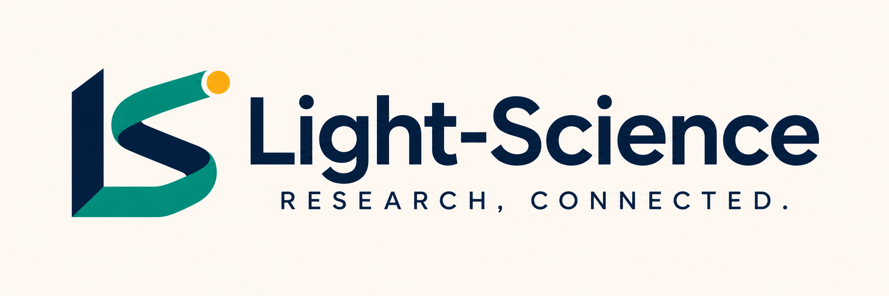
</p>

<p align="center">
  <a href="docs/releases/v2.0.0.md"></a>
  <a href="#skills"></a>
  <a href="LICENSE"></a>
  <a href="https://lightchuan.xyz/"></a>
  <a href="https://github.com/Light0305/Light-Science/stargazers"></a>
</p>

<p align="center"><strong>Turn research questions, evidence, experiments and papers into one project you can keep moving forward.</strong></p>

<p align="center"><a href="https://lightchuan.xyz/en/"><b>Website</b></a> · <b>English</b> · <a href="README.zh-CN.md">简体中文</a></p>

<p align="center">
  <a href="#installation">Install</a> · <a href="#skills">Skills</a> · <a href="#how-a-project-moves-forward">Workflow</a> · <a href="#project-layout">Project layout</a> · <a href="#data-figures">Data figures</a> · <a href="#method-and-mechanism-diagrams">Method diagrams</a> · <a href="#feedback-and-support">Feedback</a>
</p>

**Light-Science** (formerly Light-skills) is a research skills pack for AI agents. It connects literature, ideation, design, experiments, analysis, journal selection, writing, figures and review. Project memory keeps the reasons behind research decisions, and a leader skill coordinates the next step, so every revision can be traced back to a concrete source, version and artifact.

Start from scratch, or bring an existing paper, dataset, codebase or set of reviewer comments and go straight to the stage you need.

> The skill instructions are written in Chinese, and several skills reply in Chinese by default. Ask your agent to answer in English if you prefer.

## Installation

### Let your agent install it

Send this to your agent:

```text
Install the research skills from https://github.com/Light0305/Light-Science.
Ask me first whether to install globally or for the current project, then install the skills I need from the skills table in the README.
```

### Use the skills CLI

Windows, in PowerShell:

```powershell
npx.cmd skills@latest add Light0305/Light-Science
npx.cmd skills@latest add https://github.com/Light0305/Light-Science/tree/master/light-chart/skills/light-chart
```

macOS / Linux:

```bash
npx skills@latest add Light0305/Light-Science
npx skills@latest add https://github.com/Light0305/Light-Science/tree/master/light-chart/skills/light-chart
```

The first command lists the top-level skills; the second adds Chart, which lives in a nested folder. **Pick the same agent and install scope both times**, otherwise Chart ends up somewhere else. The Diagram entry keeps its four sub-skill folders, and each sub-skill can also be installed on its own. For a project-level install, change into the target project first. You can also install a single skill:

```bash
npx skills@latest add Light0305/Light-Science --skill light-write
```

More detail on install locations, dependencies and invocation is in the [installation guide](docs/installation.md) (Chinese).

## Start from a real question

```text
Use light-leader to move this project forward: I want to study <specific question>, and I already have <papers/data/code>.
The project lives at <project path>, and the goal is <a paper / a software copyright and related outputs>.
First read the existing project memory and the actual materials, find the most pressing problem, then complete the step that can be done now.
```

To continue an existing project:

```text
Continue <project path>. Read Memory and the latest handoff first, then check the adopted versions of the manuscript, figures and analyses.
This round, handle <research question or reviewer comments>, and write the results, the reasons for each decision and the next step back into the project.
```

Replace everything in angle brackets before sending. For a focused task, just say "use light-chart to plot this data" or "use light-write to revise this section".

## Skills

**15 main skills plus 4 dedicated Diagram entries: 19 in total.**

| Skill | What it does | Main output |
| --- | --- | --- |
| [light-literature / literature-search](light-literature/SKILL.md) | Literature search, screening, full-text retrieval, close reading, translation, citation checking and evidence synthesis | `Literature/` |
| [light-idea](light-idea/SKILL.md) | Proposes research questions from evidence; compares candidate ideas, competing explanations and minimal discriminating experiments | `Idea/` |
| [light-design](light-design/SKILL.md) | Turns an idea into an executable, discriminating plan with controls, metrics, budget and an analysis plan | `Design/` |
| [light-experiment](light-experiment/SKILL.md) | Runs computational experiments, simulations or benchmarks; keeps configs, environments, logs and raw results | `Experiment/` |
| [light-analysis](light-analysis/SKILL.md) | Analyzes results, errors, uncertainty and alternative explanations; decides whether to run more experiments, revise the design or go back to the question | `Analysis/` |
| [light-crawl](light-crawl/SKILL.md) | Collects website or app data on demand, keeping access conditions, failure records and data provenance | `Acquisition/` |
| [light-journal-select](light-journal-select/SKILL.md) | Chooses journals from the actual contribution and evidence, checks official requirements, and writes a recommendation and a writing brief | `Journal/` |
| [light-write](light-write/SKILL.md) | Drafting, restructuring, polishing, translation and consistency checks for papers; delivers LaTeX plus a compile-checked PDF by default | `Write/` |
| [light-diagram](light-diagram/SKILL.md) | Method and mechanism figures: intent, references, prompts, image generation and editable reconstruction | `Figure/Methods/`, `Figure/Mechanisms/` |
| [light-chart](light-chart/skills/light-chart/SKILL.md) | Python / R scientific charts, multi-panel figures and paper tables from real data | `Figure/Data/` |
| [light-review](light-review/SKILL.md) | Internal pre-submission review: checks figures, text and evidence, locates problems and tracks re-checks | `Review/` |
| [light-patent](light-patent/SKILL.md) | Prepares invention disclosures, claims, specifications, abstracts and drawings from real technical material | `Patent/` |
| [light-software-copyright](light-software-copyright/SKILL.md) | Prepares the three DOCX files of a Chinese software copyright filing (feature description, source code, user manual) from real software | `SoftwareCopyright/` |
| [light-memory](light-memory/SKILL.md) | Keeps sourced decisions, failure lessons and constraints; restores context and flags changed or conflicting sources | `Memory/` |
| [light-leader](light-leader/SKILL.md) | Combines memory with the actual materials to coordinate skills, research backtracking, paper revisions and recovery after interruptions | `Workflow/` when needed |

The Diagram entries can be used on their own or called by the main entry as needed:

| Skill | Delivers |
| --- | --- |
| [light-diagram-prompt](light-diagram/light-diagram-prompt/SKILL.md) | Scientific brief, structural blueprint, image-generation prompts and checkpoints |
| [light-illustrator-diagram](light-diagram/light-illustrator-diagram/SKILL.md) | Native Illustrator `.ai` plus real exports |
| [light-powerpoint-diagram](light-diagram/light-powerpoint-diagram/SKILL.md) | Editable `.pptx` plus real exports |
| [light-visio-diagram](light-diagram/light-visio-diagram/SKILL.md) | Native Visio `.vsdx` plus real exports |

> `light-analysis` was named `light-anaysis` in v2.0.0 and earlier. If you installed the old name, reinstall it under the new one; old project records that mention `light-anaysis` refer to the same skill.

## How a project moves forward

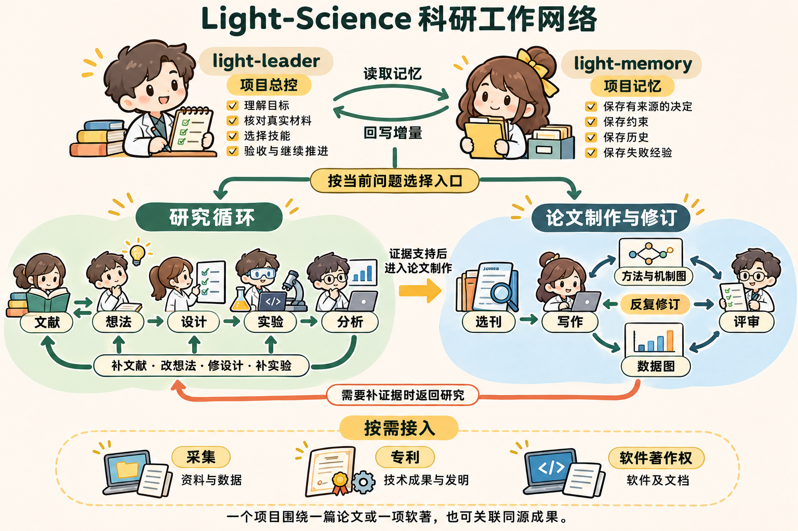

Research is allowed to go backwards: analysis may expose problems in execution, a weak design or a gap in the research question itself, and review may call for more analysis, more experiments or a different target journal. Data acquisition, patents and software copyrights join when the project needs them, and can be prepared early when publication timing matters.

**The leader restores, then verifies, then acts.** It reads the relevant project memory and handoffs, goes back to the papers, code, run results and adopted figures to check the actual state, and decides which skill takes the next step. Only when several steps need coordinating does it keep goals, dependencies, progress, acceptance criteria and a recovery entry in `Workflow/`.

**Memory lets research pick up where it left off.** Why the direction changed, which plan failed and which constraints still hold are all recorded with their sources. When a source changes or sources conflict, it reminds you to re-verify; the scientific facts themselves stay in each stage's original files. Real progress from research or revisions is written back to memory, and the next round starts from there.

<details>
<summary>Show the editable Mermaid workflow</summary>

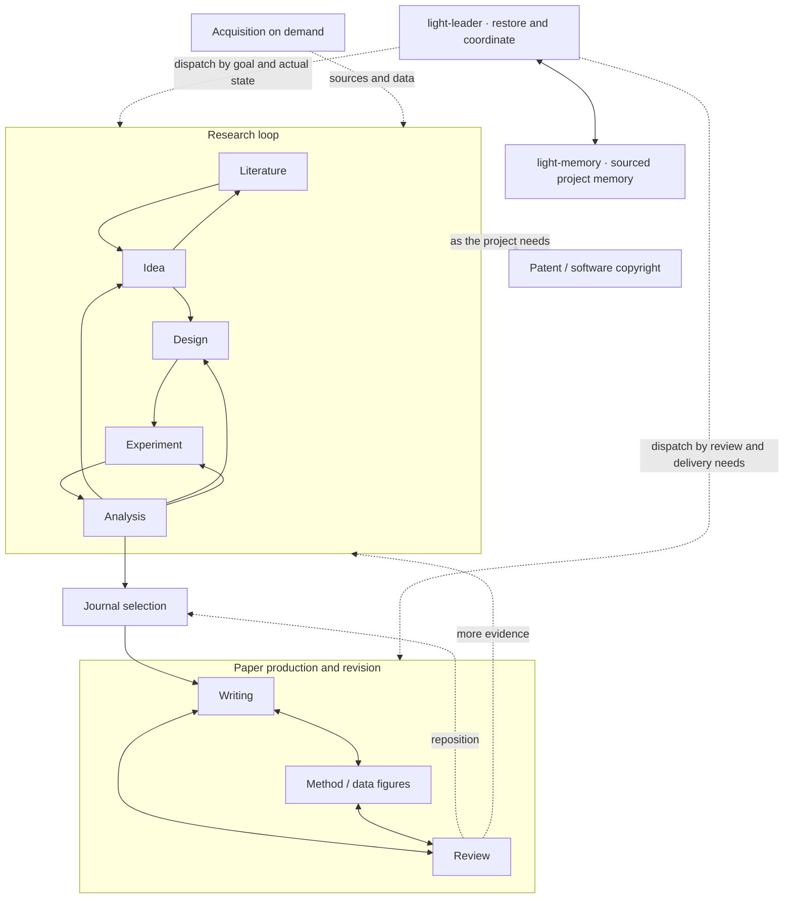

</details>

## Project layout

**The skill install directory holds capabilities; the research project directory holds results.** Below are the main parts a project may use. Start from the actual task: files and folders appear only when there is content for them. An existing project structure takes priority. The full rules are in the [research project layout spec](project-layout/references/project-layout.md) (Chinese).

```text
ProjectName/
├── README.md                          # Research question, stage, conclusions and next step
├── project.json                       # Optional cross-stage index
├── Memory/
│   └── memory.json / events/ / current.md
├── Workflow/
│   └── workflow.json                  # Goals, tasks and recovery entry, when needed
├── Literature/
│   ├── manifest.json / Searches/
│   └── Year_Author_ShortTitle/
│       └── meta.json / paper.pdf / paper.md / paper.zh.md / note.md / images/
├── Idea/IDEA-0001_Topic/
│   └── context.json / ideas.json / decision.md / cards/
├── Design/PROT-0001_Plan/v01/
│   └── design.json / plan.md / protocols/
├── Experiment/
│   ├── Code/ / Environment/ / Data/    # Code, environment or controlled references
│   └── EXP-0001_Batch/
│       └── campaign.json / execution-report.md / runs/R001/
├── Analysis/AN-0001_Question/
│   └── analysis-plan.json / analysis-report.md / code/ / derived/
├── Journal/JRN-0001_Round/
│   └── selection-report.md / light-write-brief.md
├── Write/PAPER-0001_WorkingTitle/
│   └── outline.md / claim-evidence.md / sections/ / drafts/ / build/
├── Figure/
│   ├── Methods/FIG-0001_MethodFigure/  # Intent, prompts, references, native files and exports
│   ├── Mechanisms/FIG-0002_Mechanism/
│   └── Data/FIG-0003_DataFigure/       # Data mapping, code, caption and exports
├── Review/REV-0001_ManuscriptVersionRound/
│   └── review.md / packet/
├── Acquisition/ACQ-0001_Target/case/
├── Patent/PAT-0001_Invention/
│   └── case.json / work/ / drafts/ / figures/
└── SoftwareCopyright/SWC-0001_SoftwareVersion/
    └── 正式资料/<version>/              # Final filing materials (Chinese file names required by the filing)
        ├── <software>_功能说明.docx     # Feature description
        ├── <software>_软件代码.docx     # Source code
        └── <software>_软件说明书.docx   # User manual
```

Ideas, designs, runs, analyses and figures can all keep several rounds of versions, all serving the same core output.

## Data figures

Choose the chart from the scientific question and the data structure; keep experimental units, repeated measurements, missing values and uncertainty; then handle layout, color, annotation and export. Python and R are both supported, including multi-panel figures, omics, follow-up, signals, ecology, spatial fields and image panels.

<!-- chart-showcase:start -->
<table>
  <tr>
    <td width="33%"><a href="docs/assets/charts/03.png">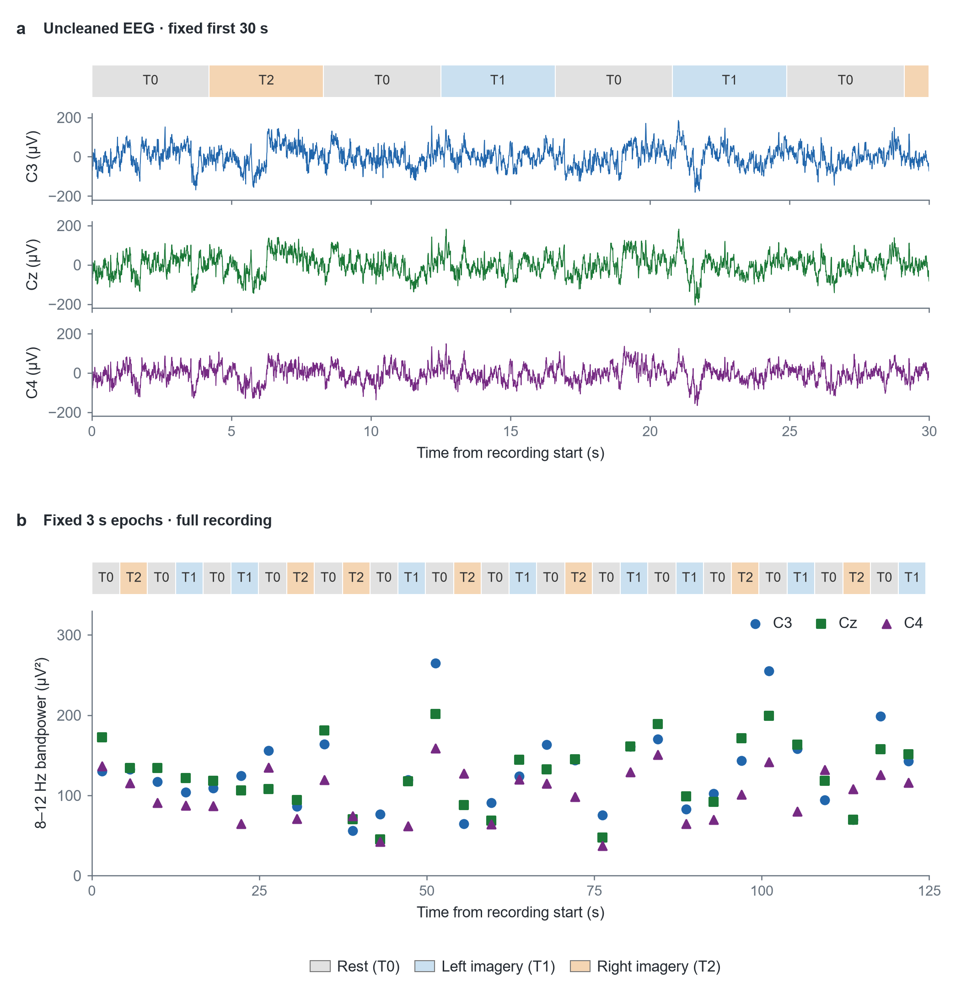</a><br><strong>01 · Measured EEG</strong><br>Raw time series and band power</td>
    <td width="33%"><a href="docs/assets/charts/04.png">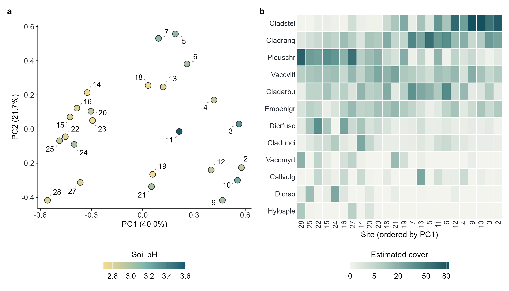</a><br><strong>02 · Ordination and heatmap</strong><br>Community composition along an environmental gradient</td>
    <td width="33%"><a href="docs/assets/charts/05.png">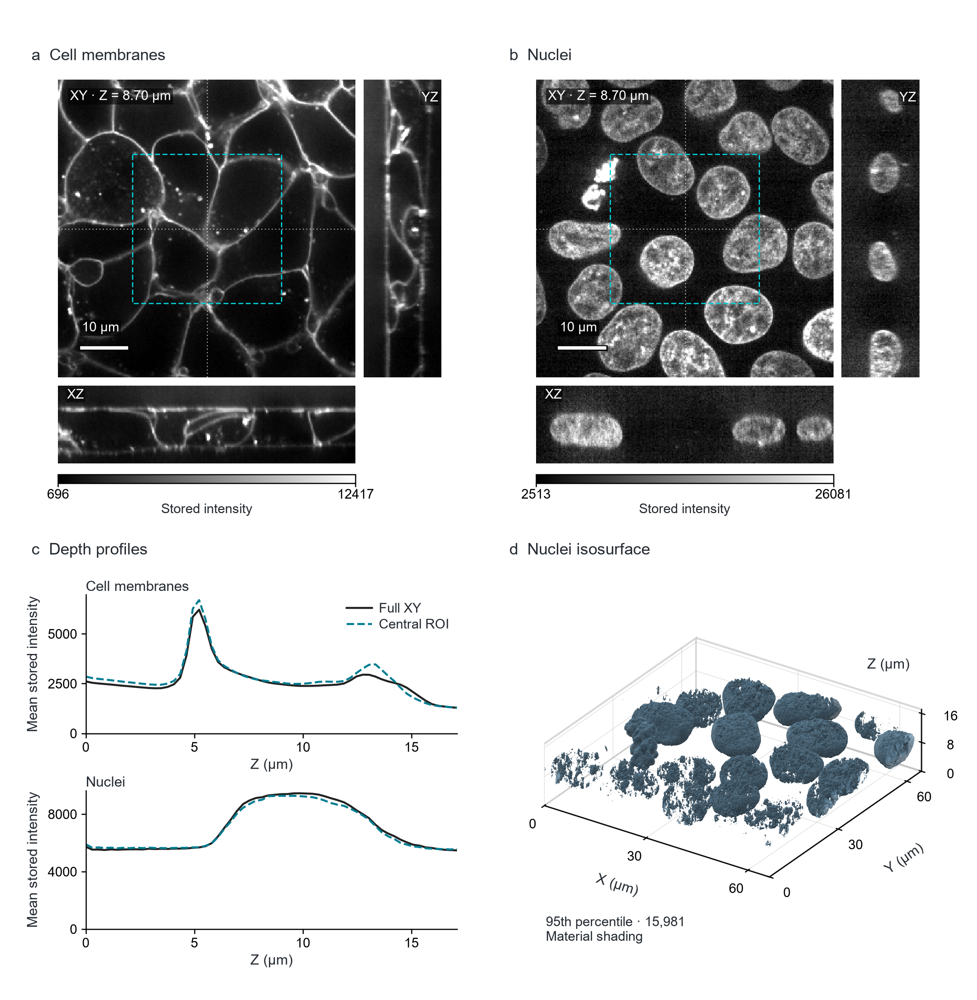</a><br><strong>03 · 3D field and slices</strong><br>Volume data, spatial calibration and matching views</td>
  </tr>
  <tr>
    <td width="33%"><a href="docs/assets/charts/06.png">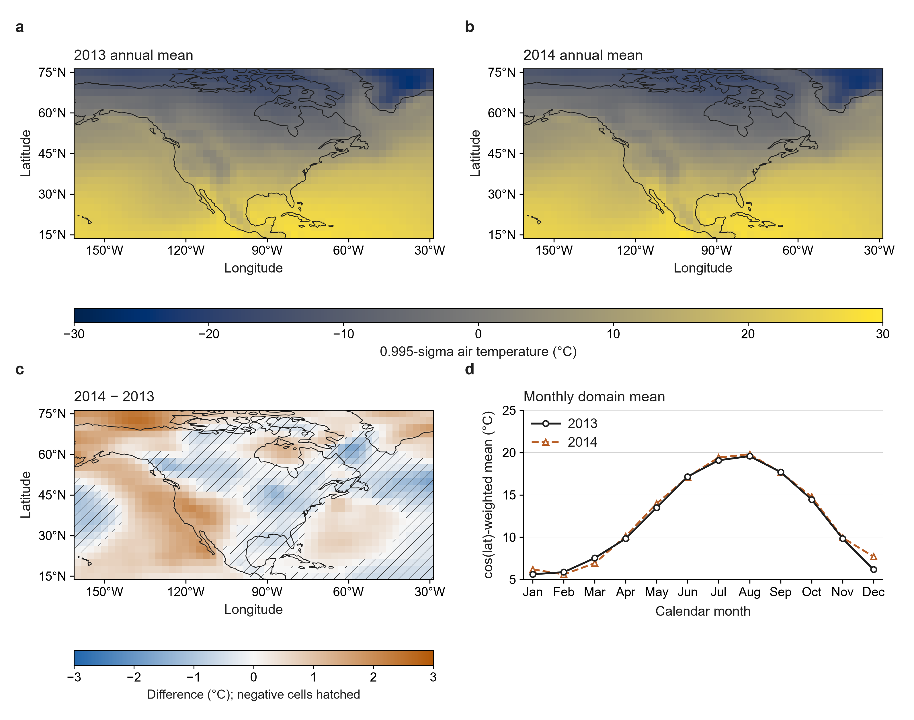</a><br><strong>04 · Temperature field and time series</strong><br>Real coordinates, year-over-year comparison and data support</td>
    <td width="33%"><a href="docs/assets/charts/08.png">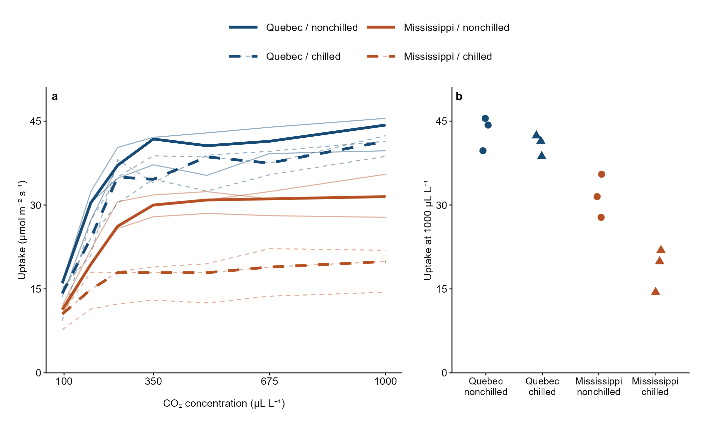</a><br><strong>05 · Plant response, repeated measures</strong><br>Individual trajectories and pairing kept</td>
    <td width="33%"><a href="docs/assets/charts/09.png">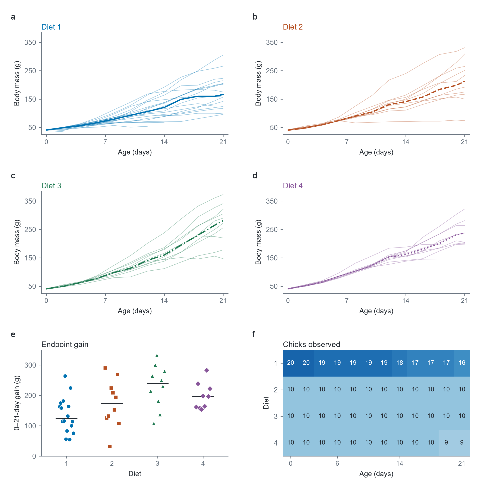</a><br><strong>06 · Growth and follow-up</strong><br>Longitudinal change and the actual number of observations</td>
  </tr>
  <tr>
    <td width="33%"><a href="docs/assets/charts/10.png">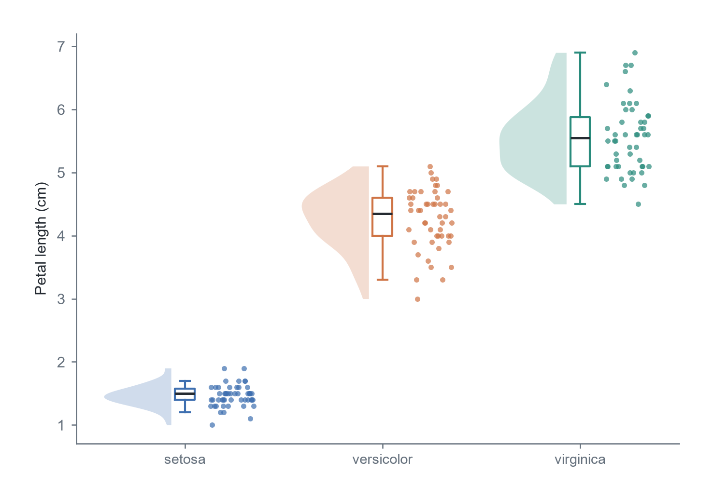</a><br><strong>07 · Raincloud with raw points</strong><br>Distribution shape, quartiles and individual observations</td>
    <td width="33%"><a href="docs/assets/charts/11.png">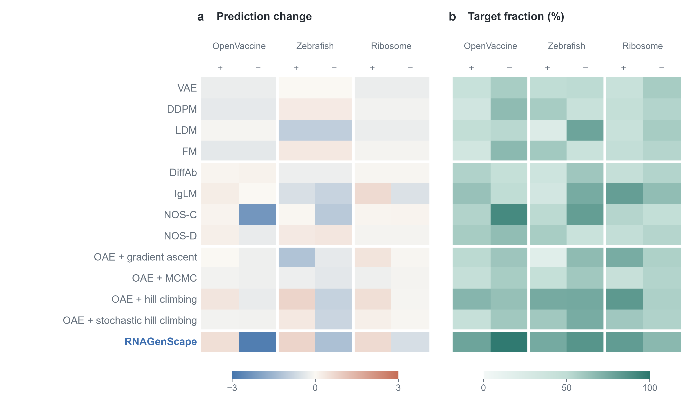</a><br><strong>08 · Method comparison and heatmap</strong><br>Organizing reported values, hierarchy and annotation</td>
    <td width="33%"><a href="docs/assets/charts/12.png">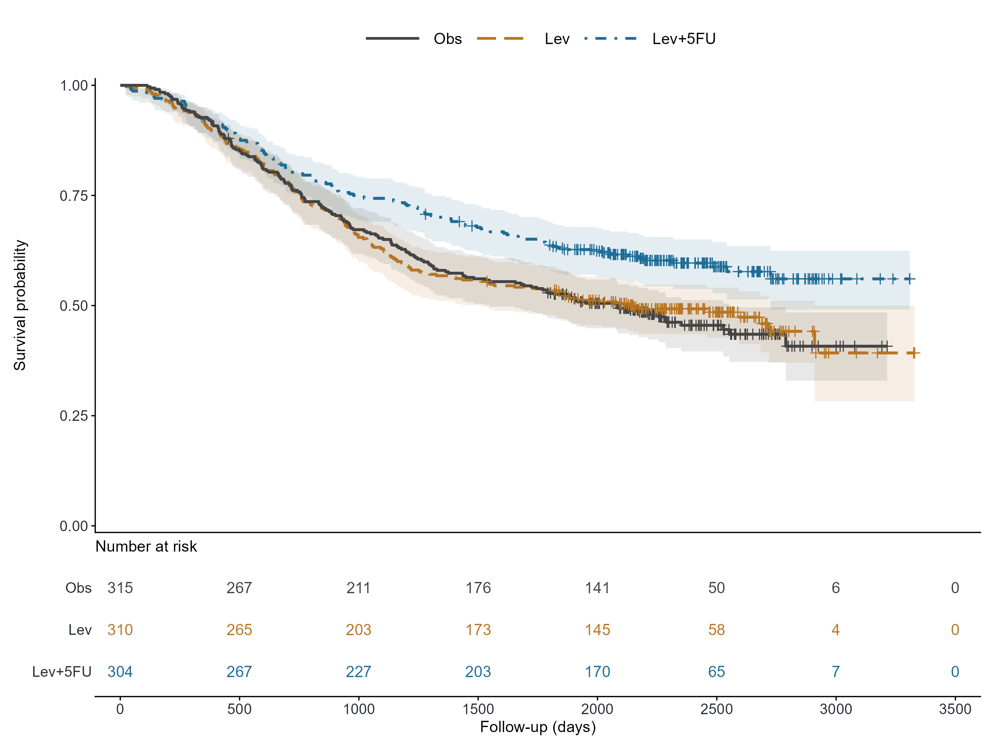</a><br><strong>09 · Survival and number at risk</strong><br>Follow-up support and uncertainty</td>
  </tr>
</table>

<!-- chart-showcase:end -->

Data sources and terms for each figure are in the [showcase notes](docs/showcase/README.md) and [manifest](docs/showcase/manifest.json).

## Method and mechanism diagrams

Read the project materials first to pin down the scientific question, objects and relationships the figure must explain. Then, **figure type and reading path first, domain second**, pick visual references from the library, from the user or from related papers. Extract layout, hierarchy, color and arrow language into a structural blueprint and a high-quality prompt, generate the image for real, and check labels, relationships and evidence boundaries.

When the figure needs further editing, break the chosen reference into objects, text, layers and relationships, and rebuild it along one of three routes: **Illustrator, PowerPoint or Visio**, aiming to match the reference's composition and scientific relationships. The native file is saved, reopened and checked with the matching editing behaviour before previews are exported.

| Tool | Best for | Delivers |
| --- | --- | --- |
| Illustrator | Free-form outlines, fine vectors, complex grouping and visual detail | `.ai`, plus SVG / PDF / PNG as needed |
| PowerPoint | Group meetings and co-authoring, modular layouts, easy for authors to keep editing | `.pptx`, plus PDF / PNG as needed |
| Visio | System frameworks, flows, connections and node adjustments | `.vsdx`, plus SVG / PDF / PNG as needed |

### Generated reference vs. native reconstruction

These are **real cases**. The left column is the generated reference; the right column is the actual export from the matching tool. Click an image to view it at full size; the native files can be downloaded and inspected.

<table>
  <tr><th>Tool and case</th><th width="42%">Generated reference</th><th width="42%">Native reconstruction export</th></tr>
  <tr>
    <td><strong>Illustrator</strong><br>Lithium–sulfur battery mechanism<br><a href="docs/showcase/native/illustrator.ai">AI file</a></td>
    <td><a href="docs/assets/methods/illustrator-reference.png">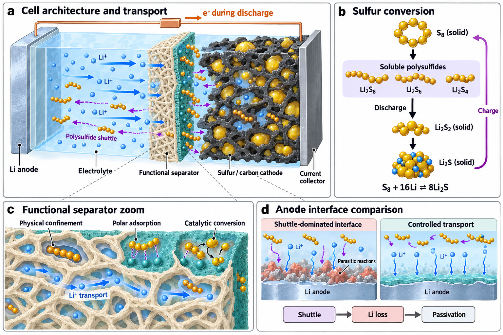</a></td>
    <td><a href="docs/assets/methods/illustrator-reconstruction.png">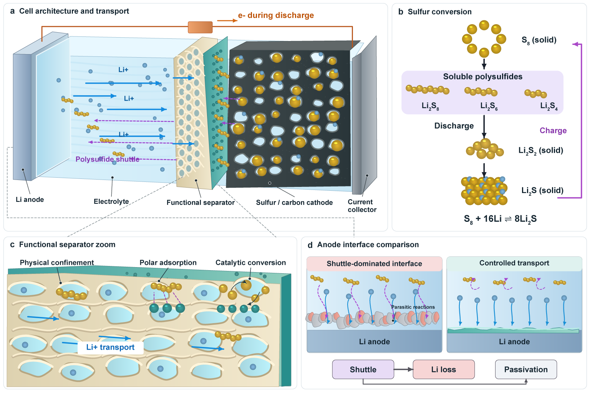</a></td>
  </tr>
  <tr>
    <td><strong>PowerPoint</strong><br>CRISPR–Cas9<br><a href="docs/showcase/native/powerpoint-crispr.pptx">PPTX file</a></td>
    <td><a href="docs/assets/methods/powerpoint-crispr-reference.png">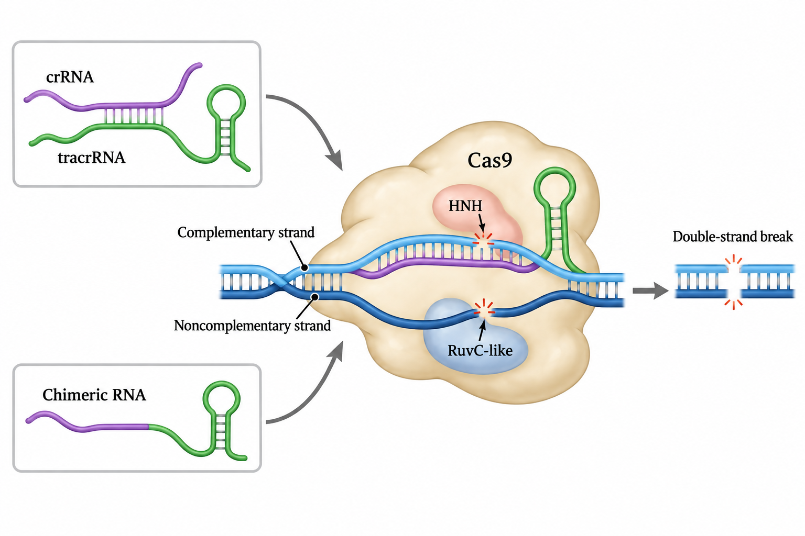</a></td>
    <td><a href="docs/assets/methods/powerpoint-crispr-reconstruction.png">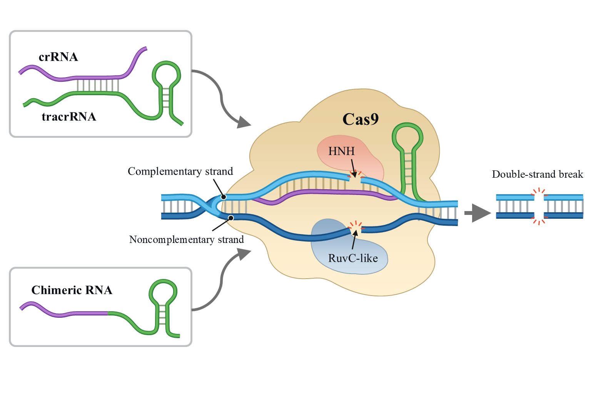</a></td>
  </tr>
  <tr>
    <td><strong>Visio</strong><br>MonoFormer architecture<br><a href="docs/showcase/native/visio-monoformer.vsdx">VSDX file</a></td>
    <td><a href="docs/assets/methods/visio-monoformer-reference.png">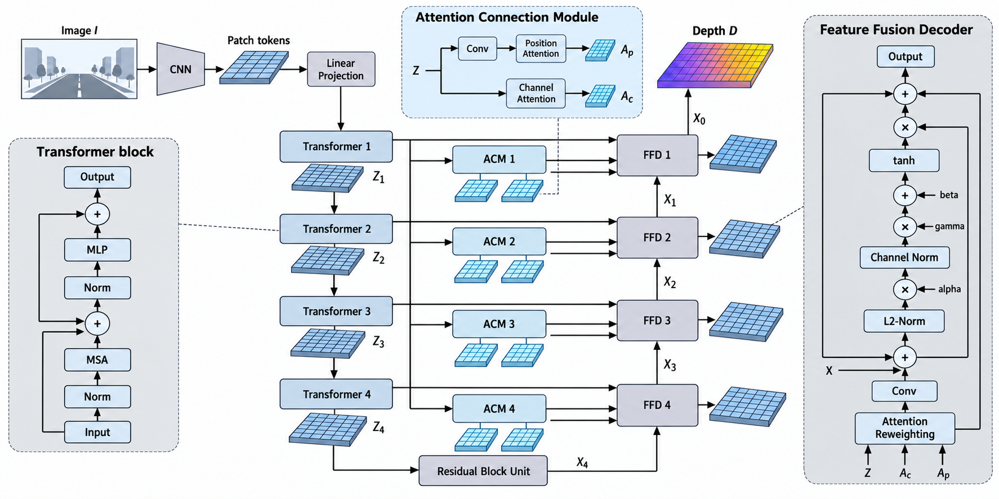</a></td>
    <td><a href="docs/assets/methods/visio-monoformer-reconstruction.png">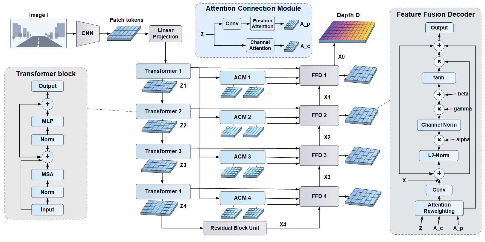</a></td>
  </tr>
</table>

## Feedback and support

Use cases, problems, missing domain support and reproducible suggestions are all welcome.

- [Open an issue](https://github.com/Light0305/Light-Science/issues): describe the skill you used, what you expected and what happened, and attach minimal reproducible material.
- Email: [1833058953@qq.com](mailto:1833058953@qq.com)
- GitHub: [@Light0305](https://github.com/Light0305)
- Related projects: [Light-UI-UX](https://github.com/Light0305/Light-UI-UX) · [Light-WeChat](https://github.com/Light0305/Light-WeChat)

<table align="center">
  <tr><th align="center">Support the author</th><th align="center">WeChat</th><th align="center">Official account</th></tr>
  <tr>
    <td align="center" width="33%"></td>
    <td align="center" width="33%"></td>
    <td align="center" width="33%"></td>
  </tr>
</table>

## License

Original code and documentation are under the [MIT License](LICENSE). Third-party code, adapted resources, paper figures, example data and galleries keep their own licenses, so **the pack as a whole is not uniformly MIT**. See [third-party notices](THIRD_PARTY_NOTICES.md) (Chinese).
