<p align="center">
  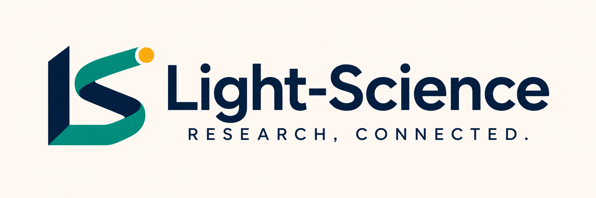
</p>

<p align="center">
  <a href="docs/releases/v2.0.0.md"></a>
  <a href="#skills-一览"></a>
  <a href="LICENSE"></a>
  <a href="https://lightchuan.xyz/"></a>
  <a href="https://github.com/Light0305/Light-Science/stargazers"></a>
</p>

<p align="center"><strong>把研究问题、证据、实验和论文，连成一个可以持续推进的项目。</strong></p>

<p align="center"><a href="https://lightchuan.xyz/"><b>官网</b></a> · <a href="README.md">English</a> · <b>简体中文</b></p>

<p align="center">
  <a href="#安装">安装</a> · <a href="#skills-一览">Skills</a> · <a href="#如何推进一个项目">工作流</a> · <a href="#项目产出结构">产出目录</a> · <a href="#数据图展示">数据图</a> · <a href="#方法图与机制图">方法图</a> · <a href="#反馈与支持">反馈与支持</a>
</p>

**Light-Science**（原 Light-skills）是面向 AI Agent 的科研 skills 包。它把文献、选题、设计、实验、分析、选刊、写作、绘图和评审接在一起，用项目记忆保留研究决定，用总控协调下一步，让每轮修改都能回到具体的来源、版本和产物。

你可以从头推进，也可以带着已有论文、数据、代码或审稿问题直接进入需要的阶段。

## 安装

### 让 Agent 安装

把这段话发给你的 Agent：

```text
从 https://github.com/Light0305/Light-Science 安装科研 skills。
先让我选择全局安装或当前项目安装，再按 README 的技能表安装所需技能。
```

### 使用 skills CLI

Windows，在 PowerShell 中运行：

```powershell
npx.cmd skills@latest add Light0305/Light-Science
npx.cmd skills@latest add https://github.com/Light0305/Light-Science/tree/master/light-chart/skills/light-chart
```

macOS / Linux：

```bash
npx skills@latest add Light0305/Light-Science
npx skills@latest add https://github.com/Light0305/Light-Science/tree/master/light-chart/skills/light-chart
```

第一条选择顶层技能，第二条补充嵌套目录中的 Chart；两次选择同一 Agent 和安装范围即可。Diagram 总入口保留所用的四个子目录，子入口也可以独立安装。项目级安装应先进入目标项目目录。也可以指定单项：

```bash
npx skills@latest add Light0305/Light-Science --skill light-write
```

## 从一个真实问题开始

```text
用 light-leader 推进这个项目：我想研究 <具体问题>，已有 <论文/数据/代码>。
项目放在 <项目路径>，目标是 <一篇论文/软著及同源成果>。
先查看已有项目记忆和实际材料，找出最需要解决的问题，再推进当前能完成的一步。
```

已有项目也可以直接续作：

```text
继续 <项目路径>。先读 Memory 和现有交接，再核对采用的稿件、图与分析版本。
本轮处理 <研究问题或评审意见>，把结果、决定依据和下一步写回项目。
```

只需要局部工作时，直接说“用 light-chart 根据这份数据画图”或“用 light-write 修改这一节”即可。

## Skills 一览

**15 个主要技能，加上 Diagram 的 4 个专门入口，共 19 个。**

| 技能 | 负责什么 | 主要产出位置 |
| --- | --- | --- |
| [light-literature / literature-search](light-literature/SKILL.md) | 文献检索、筛选、原文获取、精读、翻译、引用核对与证据综合 | `Literature/` |
| [light-idea](light-idea/SKILL.md) | 从证据提出研究问题，比较候选想法、竞争解释与最小判别实验 | `Idea/` |
| [light-design](light-design/SKILL.md) | 形成可执行、可判别的方案，明确对照、指标、预算与分析计划 | `Design/` |
| [light-experiment](light-experiment/SKILL.md) | 执行计算实验、仿真或基准测试，保存配置、环境、日志与原始结果 | `Experiment/` |
| [light-analysis](light-analysis/SKILL.md) | 分析结果、误差、不确定性与替代解释，决定补实验、改设计或回到选题 | `Analysis/` |
| [light-crawl](light-crawl/SKILL.md) | 按需采集网站或应用数据，保留获取条件、失败记录和数据来源 | `Acquisition/` |
| [light-journal-select](light-journal-select/SKILL.md) | 根据实际贡献与证据选刊，核对官方要求，形成建议和写作 brief | `Journal/` |
| [light-write](light-write/SKILL.md) | 论文起草、重构、润色、翻译与一致性检查；默认 LaTeX＋编译检查后的 PDF | `Write/` |
| [light-diagram](light-diagram/SKILL.md) | 方法图、机制图的图意、参考、提示词、生图和可编辑重建 | `Figure/Methods/`、`Figure/Mechanisms/` |
| [light-chart](light-chart/skills/light-chart/SKILL.md) | 实际数据的 Python / R 科研图、多面板图和论文表格 | `Figure/Data/` |
| [light-review](light-review/SKILL.md) | 投稿前内部评审、图文与证据检查，定位问题并追踪复核 | `Review/` |
| [light-patent](light-patent/SKILL.md) | 从真实技术材料准备技术交底、权利要求、说明书、摘要与附图 | `Patent/` |
| [light-software-copyright](light-software-copyright/SKILL.md) | 根据真实软件准备功能说明、软件代码、软件说明书三份 DOCX | `SoftwareCopyright/` |
| [light-memory](light-memory/SKILL.md) | 保存有来源的决定、失败教训与约束，恢复上下文，提示来源变化和冲突 | `Memory/` |
| [light-leader](light-leader/SKILL.md) | 联合记忆与实际材料，协调技能、研究回退、论文修订和中断恢复 | 按需使用 `Workflow/` |

Diagram 的专门入口可独立使用，也可由总入口按需要调用：

| 技能 | 交付 |
| --- | --- |
| [light-diagram-prompt](light-diagram/light-diagram-prompt/SKILL.md) | 科学 brief、结构蓝图、生图提示词与检查点 |
| [light-illustrator-diagram](light-diagram/light-illustrator-diagram/SKILL.md) | Illustrator 原生 `.ai` 与实际导出 |
| [light-powerpoint-diagram](light-diagram/light-powerpoint-diagram/SKILL.md) | 可编辑 `.pptx` 与实际导出 |
| [light-visio-diagram](light-diagram/light-visio-diagram/SKILL.md) | Visio 原生 `.vsdx` 与实际导出 |

## 如何推进一个项目

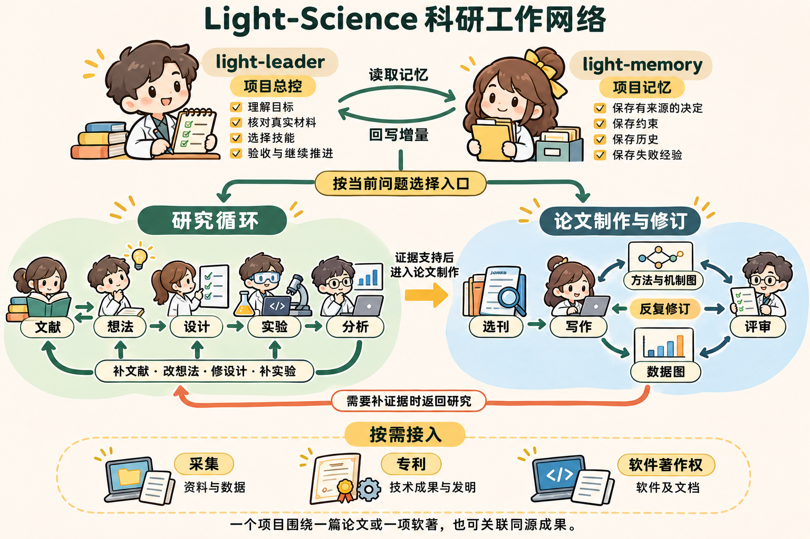

研究允许回退：分析可能暴露执行问题、设计不足或选题本身的缺口；评审也可能触发补分析、补实验和重新定位期刊。采集、专利与软著根据当前需要接入，涉及公开时间安排时可以提前准备。

**Leader 先恢复，再核对，再行动。** 它读取有关项目记忆与交接，返回论文、代码、运行结果和采用稿图检查实际状态，决定下一步交给哪个技能。需要多步协调时，才在 `Workflow/` 保留目标、依赖、进度、验收依据和恢复入口。

**Memory 让研究能够接着做。** 为什么改方向、哪个方案失败过、哪些限制仍有效，都记录来源。来源变化或相互冲突时，提醒重新核实；具体科学事实仍以各阶段原件为准。研究或修稿产生的实际增量再回写记忆，下一轮从这里接上。

<details>
<summary>展开可编辑的 Mermaid 工作流</summary>

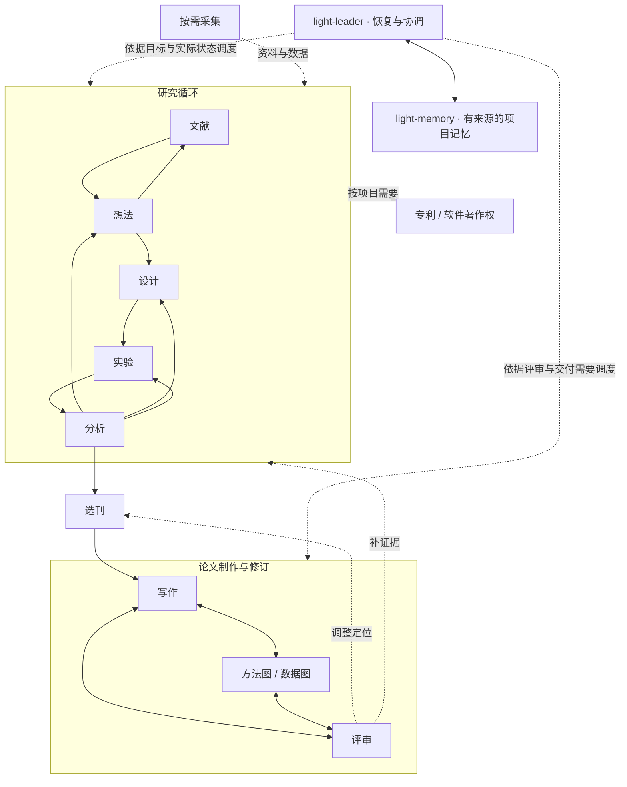

</details>

## 项目产出结构

**技能安装目录保存能力，研究项目目录保存成果。** 以下是一个项目可能用到的主要内容；从实际任务开始建立，有内容才产生对应文件和目录。已有项目结构优先，完整规则见 [科研项目目录规范](project-layout/references/project-layout.md)。

```text
项目名称/
├── README.md                          # 研究问题、阶段、结论与下一步
├── project.json                       # 可选的跨阶段索引
├── Memory/
│   └── memory.json / events/ / current.md
├── Workflow/
│   └── workflow.json                  # 按需保存目标、任务与恢复入口
├── Literature/
│   ├── manifest.json / Searches/
│   └── 年份_作者_原题短名/
│       └── meta.json / paper.pdf / paper.md / paper.zh.md / note.md / images/
├── Idea/IDEA-0001_选题主题/
│   └── context.json / ideas.json / decision.md / cards/
├── Design/PROT-0001_方案/v01/
│   └── design.json / plan.md / protocols/
├── Experiment/
│   ├── Code/ / Environment/ / Data/    # 代码、环境或受控引用
│   └── EXP-0001_执行批次/
│       └── campaign.json / execution-report.md / runs/R001/
├── Analysis/AN-0001_分析问题/
│   └── analysis-plan.json / analysis-report.md / code/ / derived/
├── Journal/JRN-0001_选刊轮次/
│   └── selection-report.md / light-write-brief.md
├── Write/PAPER-0001_工作标题/
│   └── outline.md / claim-evidence.md / sections/ / drafts/ / build/
├── Figure/
│   ├── Methods/FIG-0001_方法图/        # 图意、提示词、参考、原生文件与导出
│   ├── Mechanisms/FIG-0002_机制图/
│   └── Data/FIG-0003_数据图/           # 数据映射、代码、图注与导出
├── Review/REV-0001_稿件版本与轮次/
│   └── review.md / packet/
├── Acquisition/ACQ-0001_采集目标/case/
├── Patent/PAT-0001_技术方案/
│   └── case.json / work/ / drafts/ / figures/
└── SoftwareCopyright/SWC-0001_软件版本/
    └── 正式资料/<版本>/
        ├── <软件名>_功能说明.docx
        ├── <软件名>_软件代码.docx
        └── <软件名>_软件说明书.docx
```

想法、设计、运行、分析和稿图都可以保留多轮版本，共同服务于这一核心成果。

## 数据图展示

从科学问题和数据结构选图，保留实验单位、重复测量、缺失值和不确定性，再处理布局、颜色、注释与导出。支持 Python / R，以及多面板、组学、随访、信号、生态、空间场和图像板等任务。

<!-- chart-showcase:start -->
<table>
  <tr>
    <td width="33%"><a href="docs/assets/charts/03.png">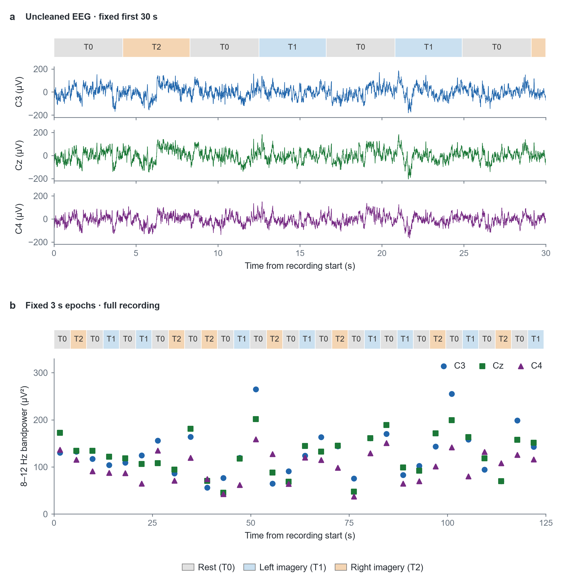</a><br><strong>01 · 实测脑电信号</strong><br>原始时序与频段功率</td>
    <td width="33%"><a href="docs/assets/charts/04.png">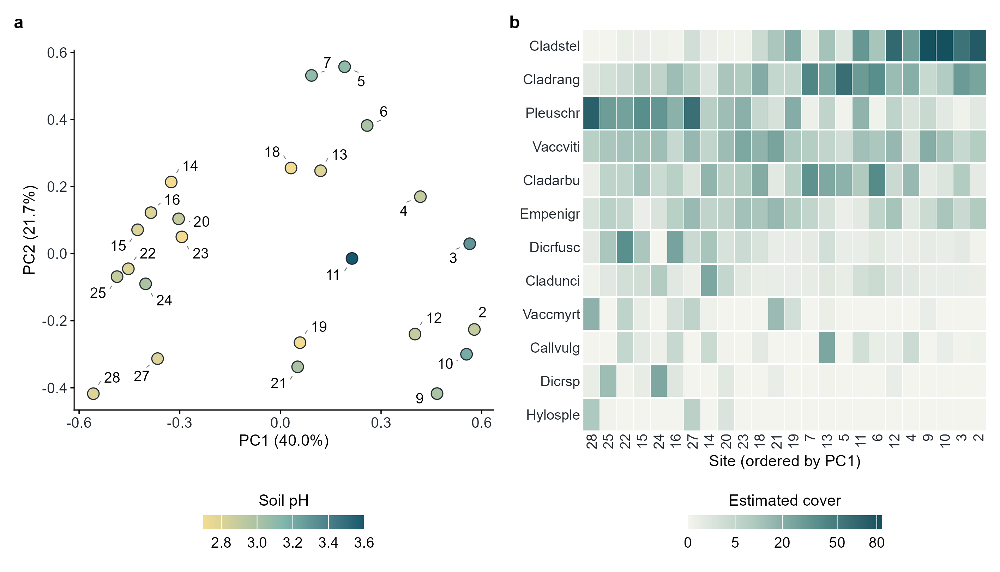</a><br><strong>02 · 生态排序与热图</strong><br>群落组成与环境梯度</td>
    <td width="33%"><a href="docs/assets/charts/05.png">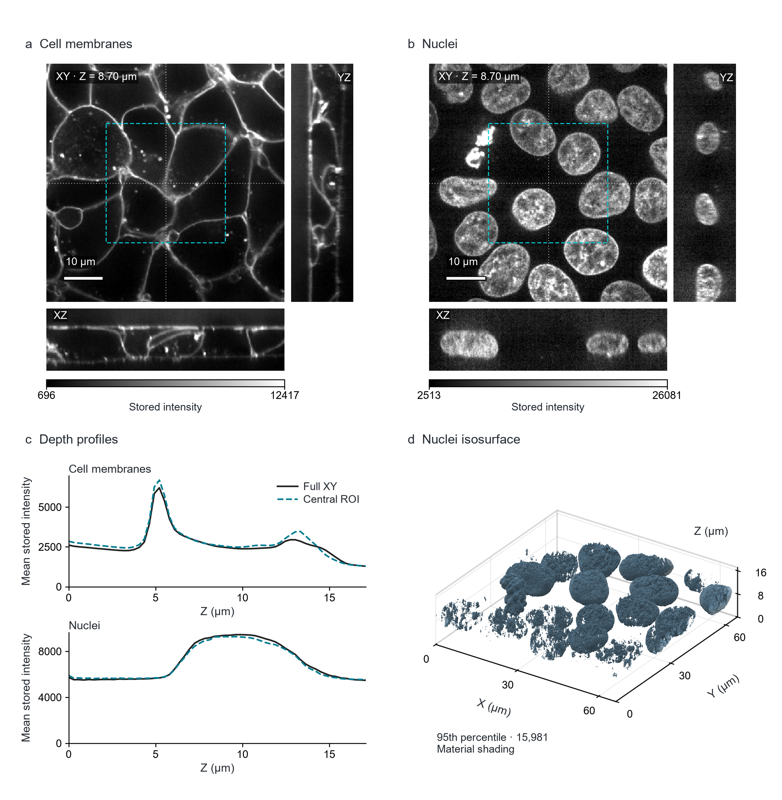</a><br><strong>03 · 三维场与切片</strong><br>体数据、空间标定与对应视图</td>
  </tr>
  <tr>
    <td width="33%"><a href="docs/assets/charts/06.png">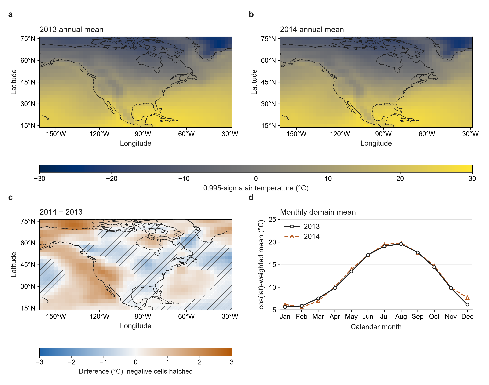</a><br><strong>04 · 温度场与时间序列</strong><br>真实坐标、年度对比与数据支持</td>
    <td width="33%"><a href="docs/assets/charts/08.png">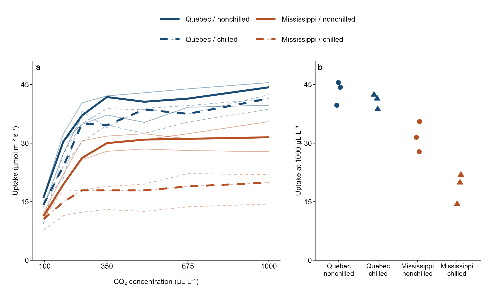</a><br><strong>05 · 植物响应与重复测量</strong><br>保留个体轨迹与配对关系</td>
    <td width="33%"><a href="docs/assets/charts/09.png">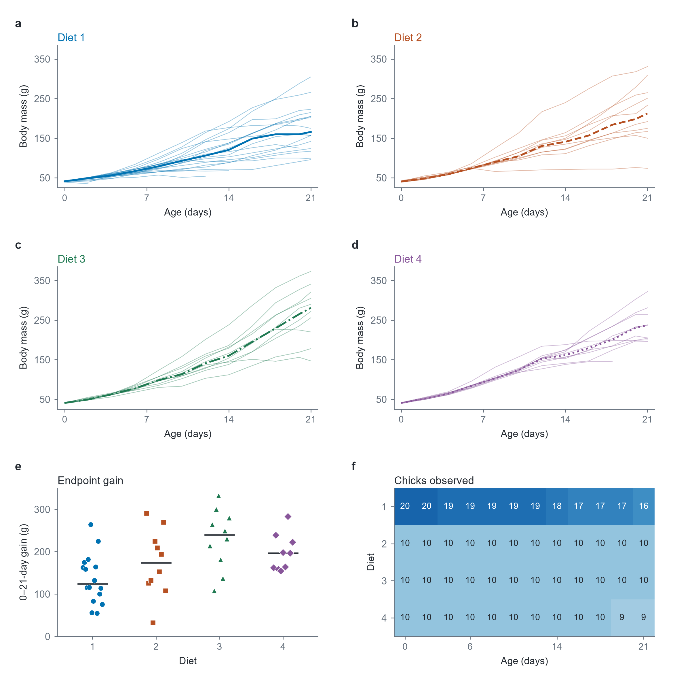</a><br><strong>06 · 生长轨迹与随访</strong><br>纵向变化与实际观测数量</td>
  </tr>
  <tr>
    <td width="33%"><a href="docs/assets/charts/10.png">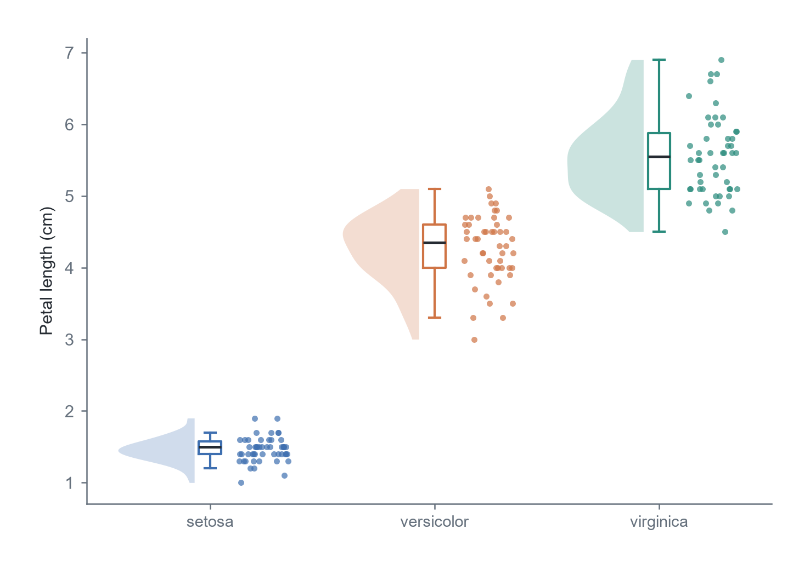</a><br><strong>07 · 雨云图与原始点</strong><br>分布形态、四分位与个体观测</td>
    <td width="33%"><a href="docs/assets/charts/11.png">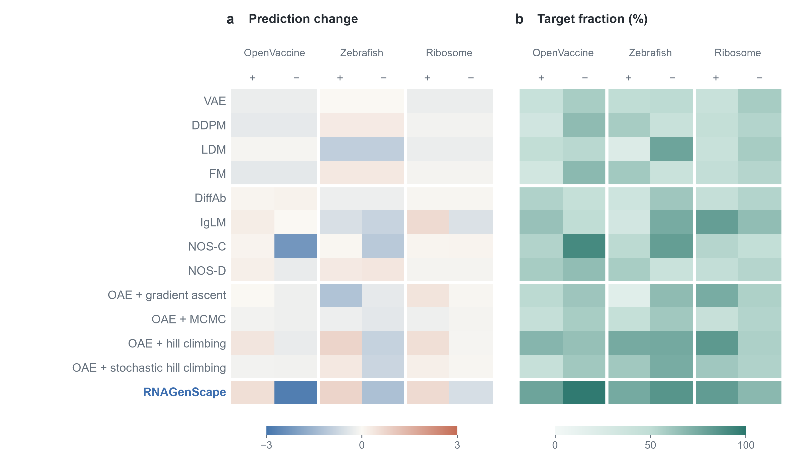</a><br><strong>08 · 方法对比与热图</strong><br>报告值、层级与注释的组织</td>
    <td width="33%"><a href="docs/assets/charts/12.png">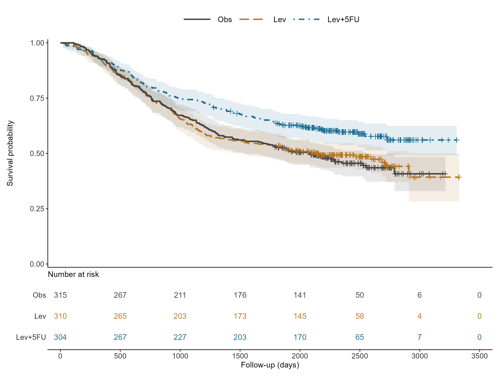</a><br><strong>09 · 生存曲线与风险人数</strong><br>随访支持与不确定性</td>
  </tr>
</table>

<!-- chart-showcase:end -->

## 方法图与机制图

先读项目材料，确定图要解释的科学问题、对象和关系；再按**图型与阅读路径优先、领域其次**，从图库、用户参考或相关论文中选择视觉参考。提炼布局、层级、配色和箭头语言，形成结构蓝图和高质量提示词，再实际生图并核对标签、关系与证据边界。

需要继续编辑时，将选定参考拆成对象、文字、层级和关系，选择 **Illustrator、PowerPoint、Visio** 中的一条路线重建，目标是贴近参考的构图与科学关系。原生文件经过保存、重开和相应编辑行为检查，再导出预览。

| 工具 | 更适合的编辑需求 | 交付 |
| --- | --- | --- |
| Illustrator | 自由轮廓、精细矢量、复杂分组与视觉细节 | `.ai`，按需 SVG / PDF / PNG |
| PowerPoint | 组会与论文协作、模块布局、方便作者继续改图 | `.pptx`，按需 PDF / PNG |
| Visio | 系统框架、流程、连接关系及节点调整 | `.vsdx`，按需 SVG / PDF / PNG |

### 生成参考与实际重建对照

以下是 **一些真实案例**。左侧是实际生成参考，右侧是对应工具的实际导出；点击图片查看原尺寸，原生文件可直接下载检查。

<table>
  <tr><th>工具与案例</th><th width="42%">生成参考</th><th width="42%">原生重建导出</th></tr>
  <tr>
    <td><strong>Illustrator</strong><br>锂硫电池机制<br><a href="docs/showcase/native/illustrator.ai">AI 文件</a></td>
    <td><a href="docs/assets/methods/illustrator-reference.png">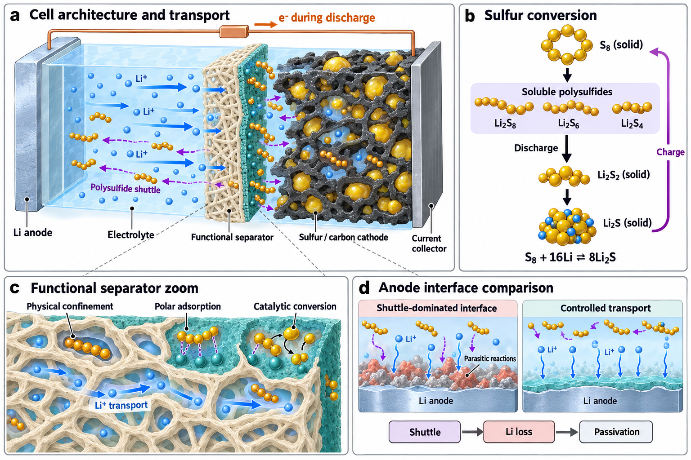</a></td>
    <td><a href="docs/assets/methods/illustrator-reconstruction.png">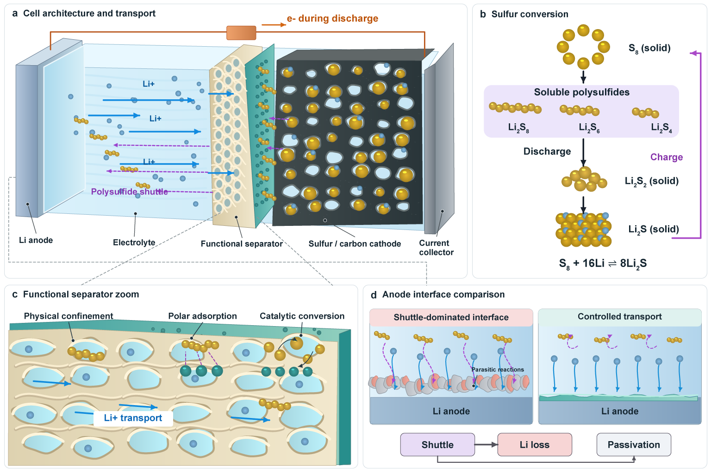</a></td>
  </tr>
  <tr>
    <td><strong>PowerPoint</strong><br>CRISPR–Cas9<br><a href="docs/showcase/native/powerpoint-crispr.pptx">PPTX 文件</a></td>
    <td><a href="docs/assets/methods/powerpoint-crispr-reference.png">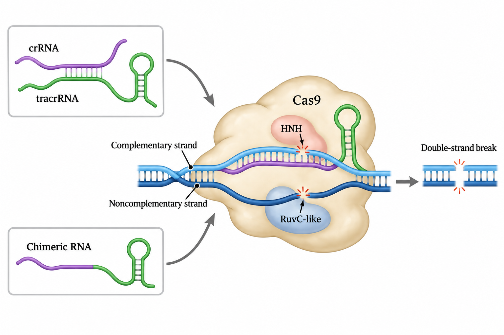</a></td>
    <td><a href="docs/assets/methods/powerpoint-crispr-reconstruction.png">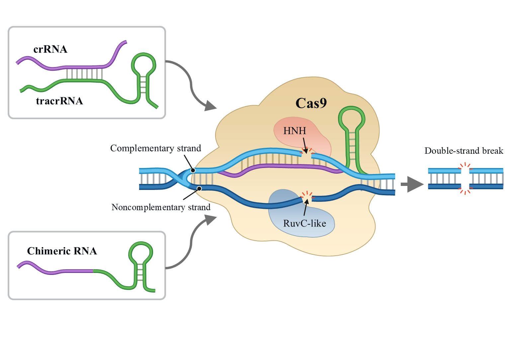</a></td>
  </tr>
  <tr>
    <td><strong>Visio</strong><br>MonoFormer 架构<br><a href="docs/showcase/native/visio-monoformer.vsdx">VSDX 文件</a></td>
    <td><a href="docs/assets/methods/visio-monoformer-reference.png">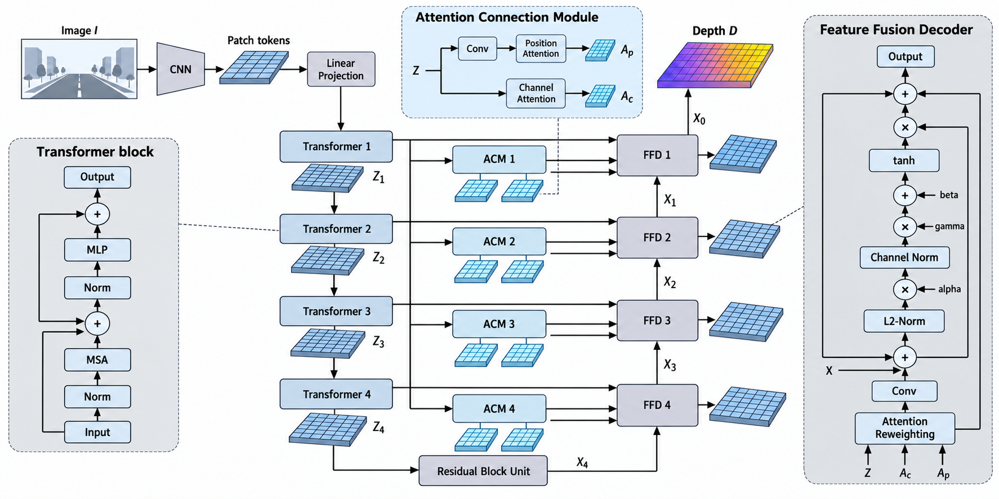</a></td>
    <td><a href="docs/assets/methods/visio-monoformer-reconstruction.png">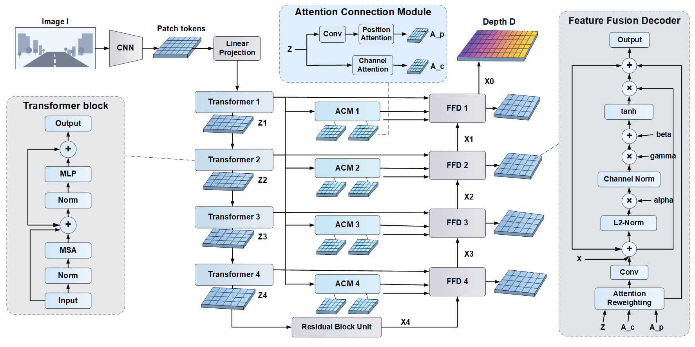</a></td>
  </tr>
</table>

## 反馈与支持

欢迎反馈使用案例、问题、缺失的领域支持，以及可复现的改进建议。

- [提交 Issue](https://github.com/Light0305/Light-Science/issues)：描述使用的技能、预期与实际结果，附最小可复现材料。
- 邮箱：[1833058953@qq.com](mailto:1833058953@qq.com)
- GitHub：[@Light0305](https://github.com/Light0305)
- 相关项目：[Light-UI-UX](https://github.com/Light0305/Light-UI-UX) · [Light-WeChat](https://github.com/Light0305/Light-WeChat)

<table align="center">
  <tr><th align="center">支持作者</th><th align="center">微信交流</th><th align="center">公众号</th></tr>
  <tr>
    <td align="center" width="33%"></td>
    <td align="center" width="33%"></td>
    <td align="center" width="33%"></td>
  </tr>
</table>

## 许可证

原创代码与文档沿用 [MIT License](LICENSE)。第三方代码、适配资源、论文图、示例数据和图库分别保留原许可，**整包资源不统一视为 MIT**。
