# 展示案例与来源

本页配套 README 与 [选片页](index.html)。图片、原生文件均从既有实际产物按原字节复制；来源路径、SHA-256 和大小见 [manifest.json](manifest.json)。作者已确认 README 采用 03、04、05、06、08、09、10、11、12，共 9 张；选择保存在 [selection.json](selection.json)。

## 数据图

这些案例来自不同数据集和任务，不构成同一研究，也不表示本项目重新完成了原始研究。每例的描述范围、实验单位、缺失值、分析方法和局限以图注为准。来源链接供核对；具体文件的许可不由根目录 MIT 取代。

### 01 · 多中心临床证据面板

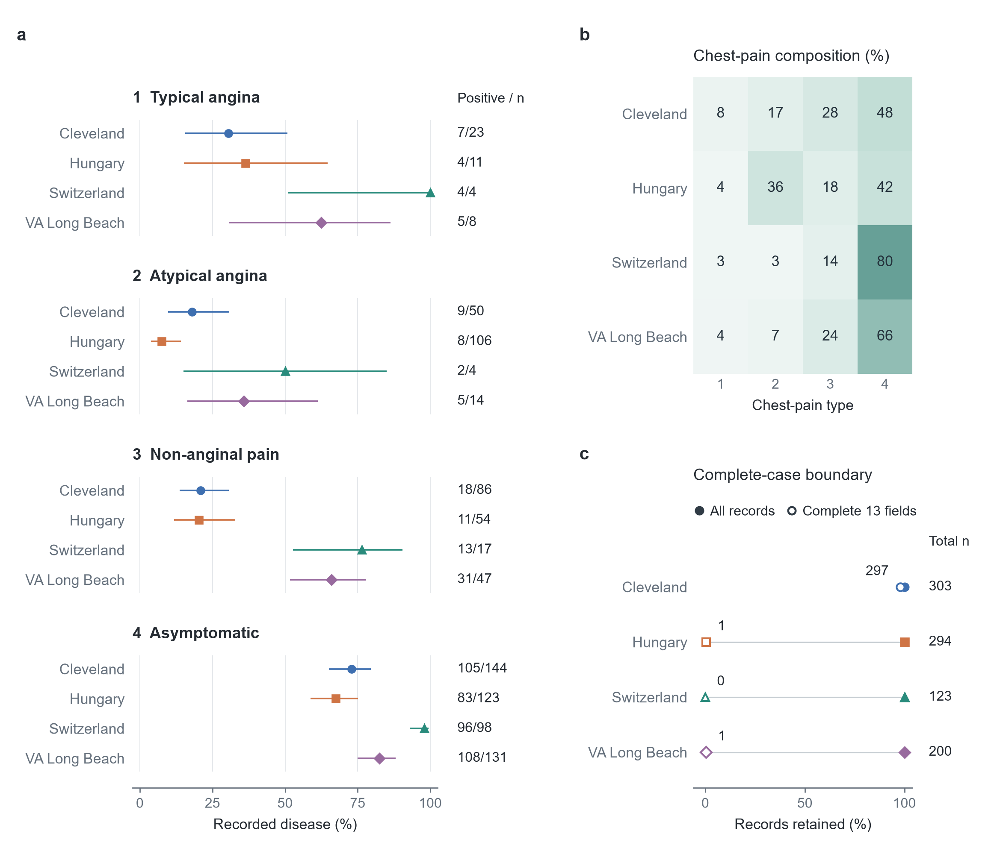

UCI Heart Disease，四中心历史样本的描述性再分析；不作因果推断。

数据来源：[https://doi.org/10.24432/C52P4X](https://doi.org/10.24432/C52P4X)。

来源条件：Dataset: CC BY 4.0; credit Janosi, Steinbrunn, Pfisterer & Detrano.

原始产物位置：`light-chart/artifacts/v0.8-multicentre/B_evidence_final.png`。

[完整图注](captions/01.md)。

### 02 · 组学 PCA 与配对变化

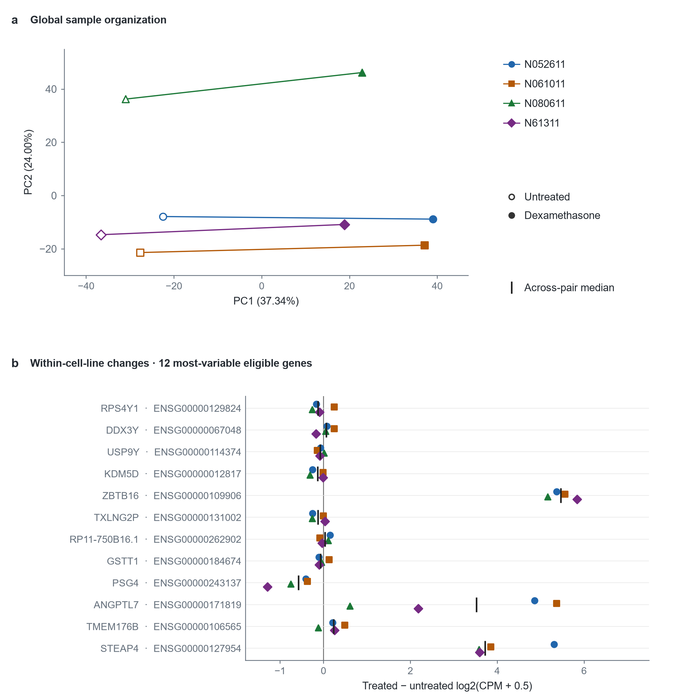

airway：8 个样本、4 个细胞系的配对描述；不冒充显著性结果。

数据来源：[https://bioconductor.org/packages/airway/](https://bioconductor.org/packages/airway/)。

来源条件：Retain airway/Bioconductor package and study source attribution; see task provenance.

原始产物位置：`light-chart/artifacts/nature-backbone-rebuild/heldout/runs/light-chart/omics-airway/figure-v1.png`。

[完整图注](captions/02.md)。

### 03 · 脑电时序与频段功率

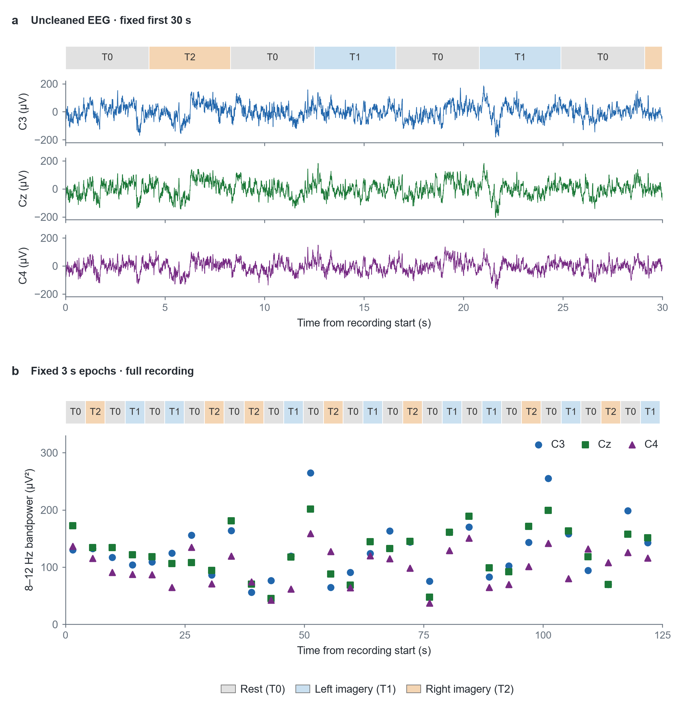

PhysioNet EEG S001/R04：真实采样与固定时窗；时窗不是独立受试者。

数据来源：[https://physionet.org/content/eegmmidb/1.0.0/](https://physionet.org/content/eegmmidb/1.0.0/)。

来源条件：Retain PhysioNet EEGMMIDB attribution and Open Data Commons Attribution License v1.0.

原始产物位置：`light-chart/artifacts/nature-backbone-rebuild/heldout/runs/light-chart/signals-eeg/figure-v1.png`。

[完整图注](captions/03.md)。

### 04 · 生态排序与群落热图

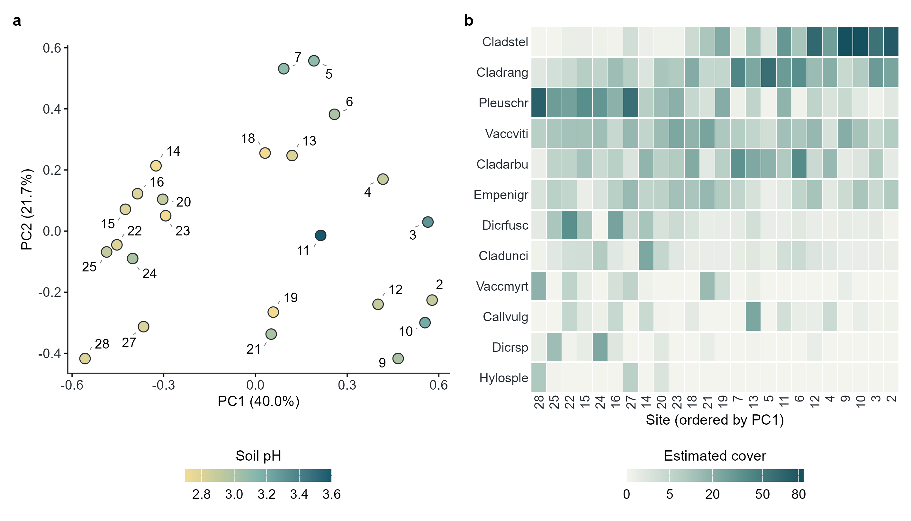

vegan varespec/varechem：24 个样地、44 个物种；描述群落结构。

数据来源：[https://cran.r-project.org/package=vegan](https://cran.r-project.org/package=vegan)。

来源条件：Retain vegan dataset attribution: Väre, Ohtonen & Oksanen (1995); see task provenance.

原始产物位置：`light-chart/artifacts/nature-backbone-rebuild/heldout/runs/light-chart/ecology-vare/v7/figure.png`。

[完整图注](captions/04.md)。

### 05 · 真实三维场与正交切片

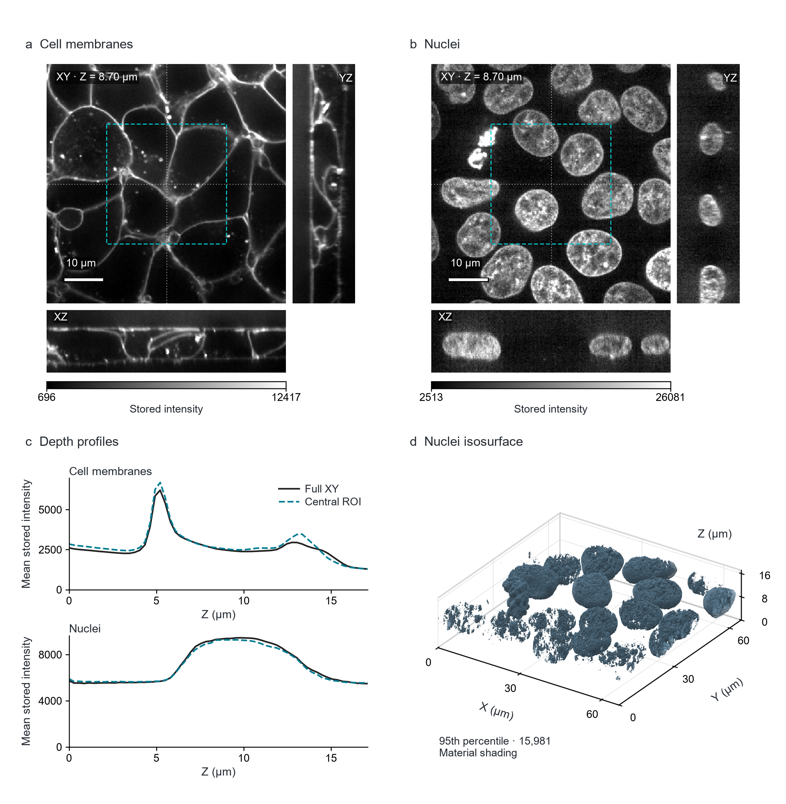

Allen Institute/scikit-image cells3d 实测体数据；等值面不是已验证的细胞分割。

数据来源：[https://scikit-image.org/docs/stable/api/skimage.data.html#skimage.data.cells3d](https://scikit-image.org/docs/stable/api/skimage.data.html#skimage.data.cells3d)。

来源条件：Retain Allen Institute for Cell Science/scikit-image data attribution and source-specific terms.

原始产物位置：`light-chart/artifacts/nature-backbone-rebuild/phase6/imaging/tasks/cells3d/outputs/cells3d-v6.png`。

[完整图注](captions/05.md)。

### 06 · 温度场与年度差异

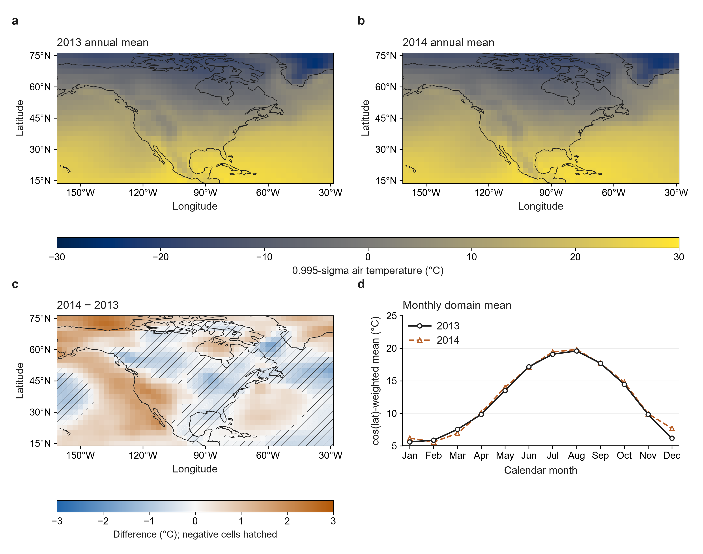

2013/2014 温度场的描述性对比；年度差异不是长期气候趋势。

数据来源：[https://docs.xarray.dev/en/stable/examples/area_weighted_temperature.html](https://docs.xarray.dev/en/stable/examples/area_weighted_temperature.html)。

来源条件：Retain original air_temperature NetCDF source records and Natural Earth public-domain coastline attribution.

原始产物位置：`light-chart/artifacts/nature-backbone-rebuild/phase6/climate/tasks/air_temperature/figures/v2/air-temperature.png`。

[完整图注](captions/06.md)。

### 07 · 大气 CO₂ 季节变化

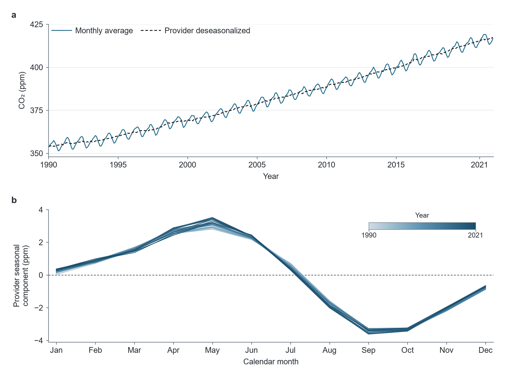

Mauna Loa 观测序列；展示趋势、季节性与数据支持范围。

数据来源：[https://gml.noaa.gov/ccgg/trends/](https://gml.noaa.gov/ccgg/trends/)。

来源条件：Retain actual NOAA/source records in the figure task; see caption for series provenance.

原始产物位置：`light-chart/artifacts/nature-backbone-rebuild/phase6/climate/tasks/mauna_loa_co2/figures/v3/mauna-loa-co2.png`。

[完整图注](captions/07.md)。

### 08 · 植物响应与重复测量

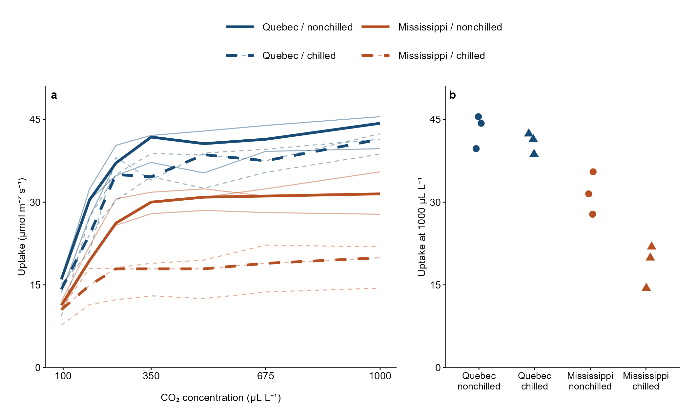

R datasets::CO2：12 株植物、84 次观测；保留每株轨迹。

数据来源：[https://stat.ethz.ch/R-manual/R-devel/library/datasets/html/zCO2.html](https://stat.ethz.ch/R-manual/R-devel/library/datasets/html/zCO2.html)。

来源条件：Retain R datasets::CO2 attribution: Potvin, Lechowicz & Tardif (1990).

原始产物位置：`light-chart/artifacts/v0.8-gallery/figures/38_T02_R_final.png`。

[完整图注](captions/08.md)。

### 09 · 生长轨迹与随访支持

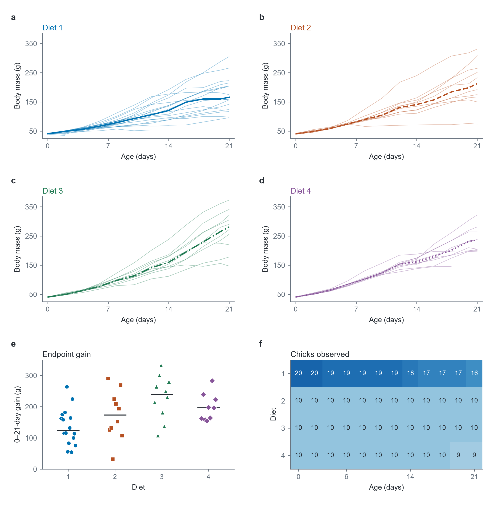

R datasets::ChickWeight：真实观测轨迹，明确缺失随访。

数据来源：[https://stat.ethz.ch/R-manual/R-devel/library/datasets/html/ChickWeight.html](https://stat.ethz.ch/R-manual/R-devel/library/datasets/html/ChickWeight.html)。

来源条件：Retain R datasets::ChickWeight attribution and dataset documentation.

原始产物位置：`light-chart/artifacts/v0.8-gallery/figures/37_T01_evidence.png`。

[完整图注](captions/09.md)。

### 10 · 雨云图与完整原始点

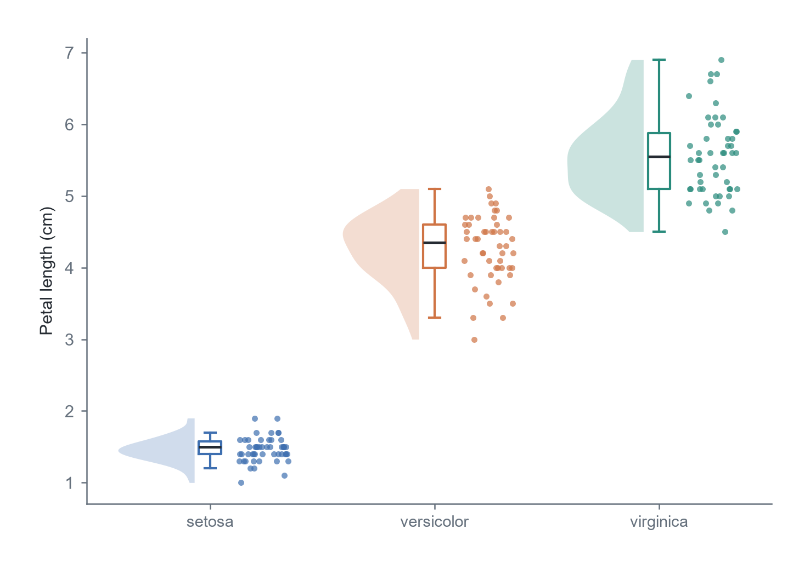

Iris 实测数据；密度、四分位与所有原始点。

数据来源：[https://archive.ics.uci.edu/dataset/53/iris](https://archive.ics.uci.edu/dataset/53/iris)。

来源条件：Retain Iris dataset attribution and source terms.

原始产物位置：`light-chart/artifacts/v0.8-gallery/figures/07_raincloud.png`。

[完整图注](captions/10.md)。

### 11 · 方法对比与结构化热图

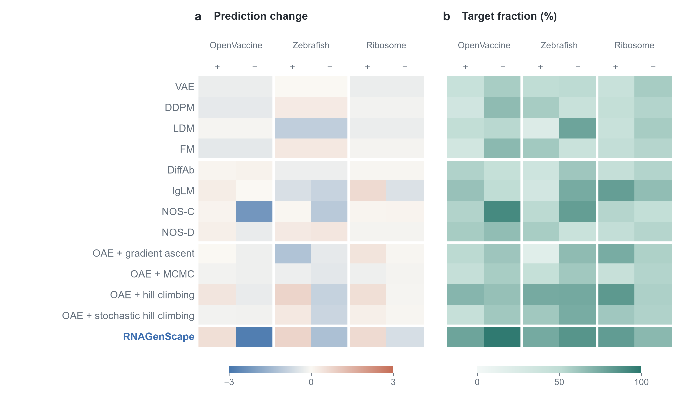

figures4papers 提供的 RNAGenScape 汇总值；不是本项目独立实验。

数据来源：[https://github.com/ChenLiu-1996/figures4papers](https://github.com/ChenLiu-1996/figures4papers)。

来源条件：CC BY-NC 4.0, Chen Liu and contributors; original data and adapted example retain these terms.

原始产物位置：`light-chart/artifacts/v0.8-gallery/figures/41_03_structured_heatmap.png`。

[完整图注](captions/11.md)。

### 12 · 生存曲线与风险人数

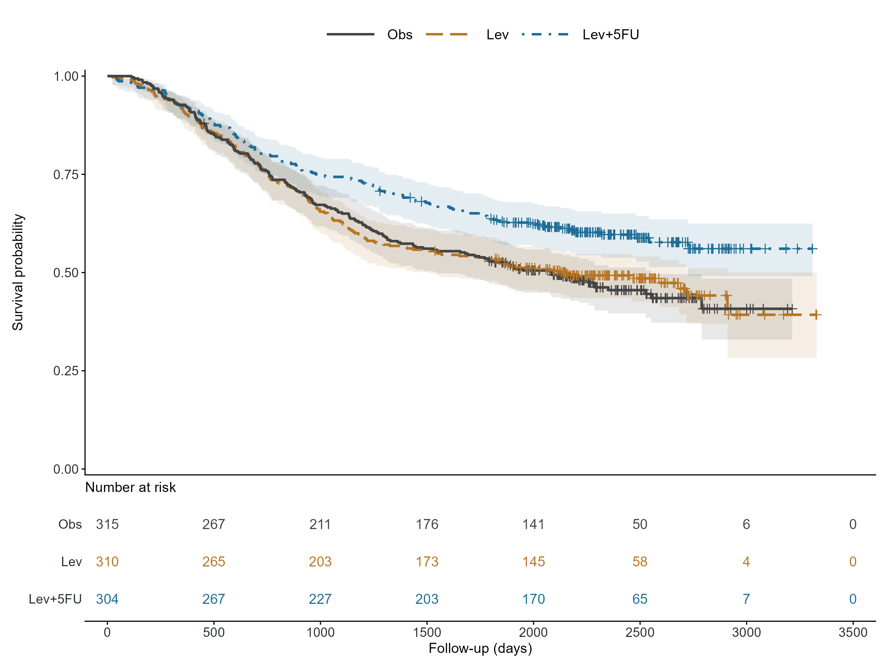

R survival::colon：未调整生存曲线、置信带与随访支持。

数据来源：[https://stat.ethz.ch/R-manual/R-devel/library/survival/html/colon.html](https://stat.ethz.ch/R-manual/R-devel/library/survival/html/colon.html)。

来源条件：Retain survival::colon dataset/trial attribution and original source documentation.

原始产物位置：`light-chart/artifacts/nature-backbone-rebuild/heldout/runs/light-chart/clinical-colon/v3/figure.png`。

[完整图注](captions/12.md)。

## 方法图案例

三种工具各展示一张不同的图：Illustrator 锂硫电池机制、PowerPoint CRISPR–Cas9 切割机制、Visio MonoFormer 深度估计架构。均在 2026-10-30 实际运行并保存过原生文件，由人工拆解参考建立结构场景。生成参考不是论文原图或实验事实。

锂硫电池参考中的两处科学关系已在 Illustrator 中修正：将 Shuttle 对 Li loss / Passivation 的作用改为分别分支，并将锂负极放大引线接回实际对象。

CRISPR–Cas9 为历史可见绘制案例，保留 136 个原生对象、9 个文字对象与 7 条连接符；展示 PNG 来自真实 PowerPoint 导出，导出源文件与此处提供的最终 PPTX 字节一致。该案例验证可见插入与原生编辑，不属于后续新复杂案例的验收；仍保留曲线、表面纹理近似及历史相交诊断。

Visio 的 MonoFormer 原生文件保留两页：第 1 页按生成参考复现，第 2 页修正旁路、残差源箭头与同级跳连。下方对照使用第 1 页，并另附修正版预览。参考图含已识别的关系错误；用于科研表达应核对修正版。核对范围是已声明的架构关系，不证明完整实现等价或模型性能。

“1∶1”是参照重建目标，三例仍有细节、字体、纹理或几何近似，未通过逐像素完全一致验收。

### Illustrator · 锂硫电池机制

| 生成参考 | 原生导出 |
| --- | --- |
| 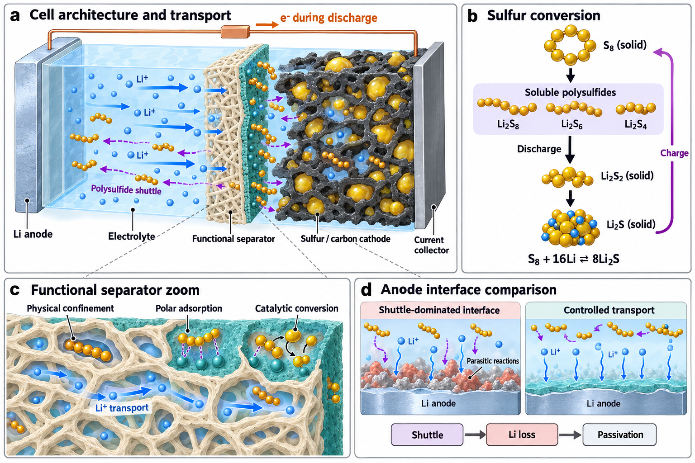 | 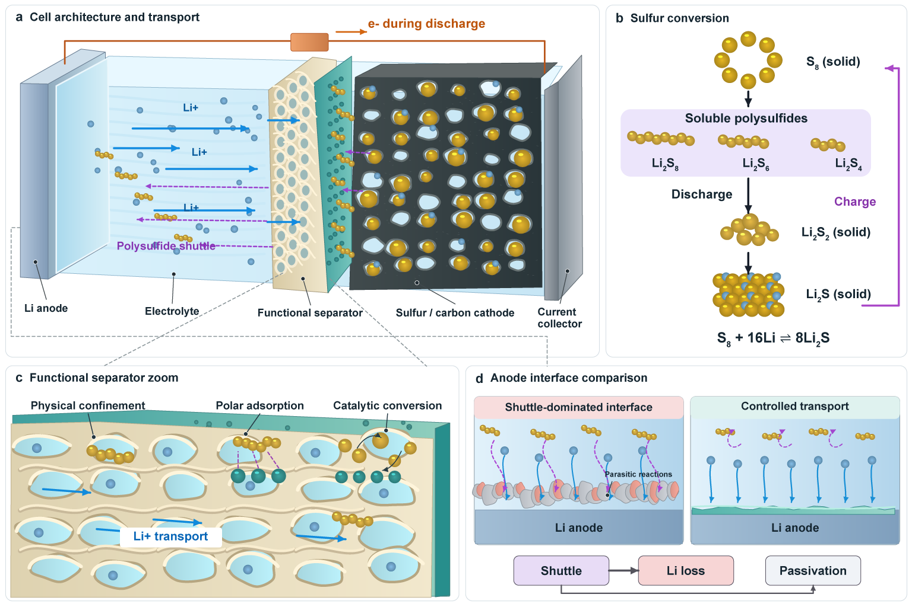 |

锂硫电池机制概念图；原生路径、文字和分组，已修正生成参考中的因果分支与放大来源。

[原生文件](native/illustrator.ai) · [来源记录](evidence/illustrator/source-manifest.json) · [历史核验](evidence/illustrator/verification.json)。

完整历史报告在源码内 `light-diagram/light-illustrator-diagram/evaluations/2026-10-30-lis-comparison/REPORT.md`；[原始报告文本副本](evidence/illustrator/original-report.txt) 保留原文字节，其中原相对路径仍以源码内案例目录为基准。

[实际使用的提示词](prompts/illustrator.txt)。

### PowerPoint · CRISPR–Cas9 切割机制

| 生成参考 | 原生导出 |
| --- | --- |
| 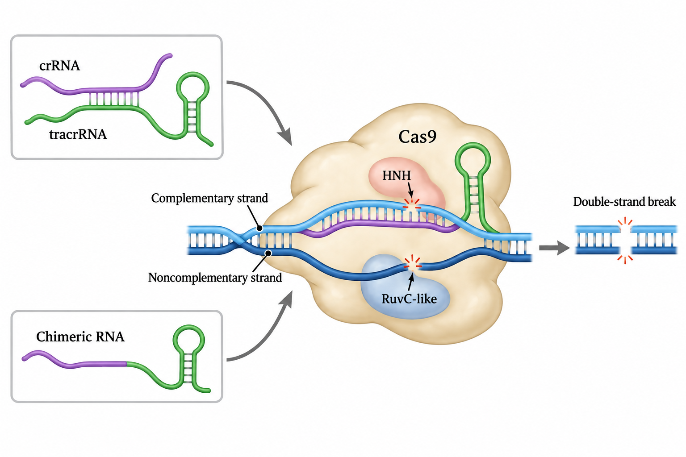 | 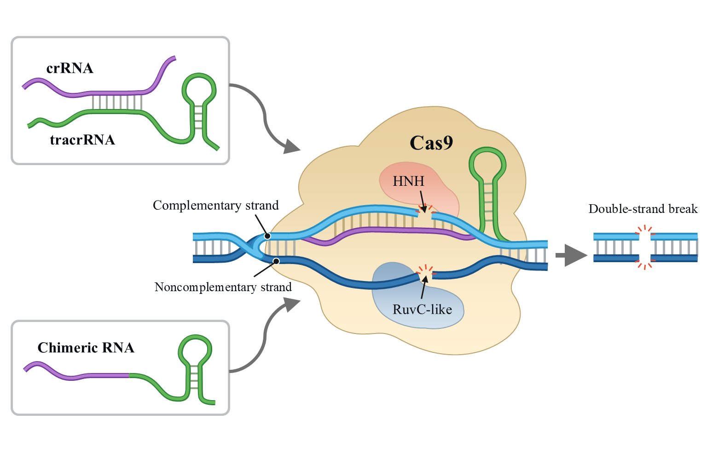 |

CRISPR–Cas9 概念图；136 个原生对象，保留可编辑轮廓、文字与连接。历史案例验证可见绘制和原生编辑，纹理与曲线细节存在近似。

[原生文件](native/powerpoint-crispr.pptx) · [来源记录](evidence/powerpoint-crispr/source-manifest.json) · [历史核验](evidence/powerpoint-crispr/native-r1.audit.json)。

完整历史报告在源码内 `light-diagram/light-powerpoint-diagram/evaluations/2026-10-30-crispr-live/REPORT.md`；[原始报告文本副本](evidence/powerpoint-crispr/original-report.txt) 保留原文字节，其中原相对路径仍以源码内案例目录为基准。

本例沿用早期 Visio 案例的同一张生成参考；来源记录只用于说明参考图出处，PowerPoint 原生编辑检查以单独的历史核验文件为准。

[实际使用的提示词](prompts/powerpoint-crispr.txt)。

### Visio · MonoFormer 深度估计架构

| 生成参考 | 原生导出 |
| --- | --- |
| 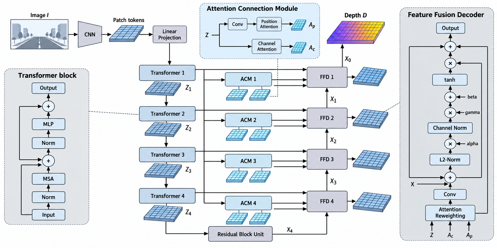 | 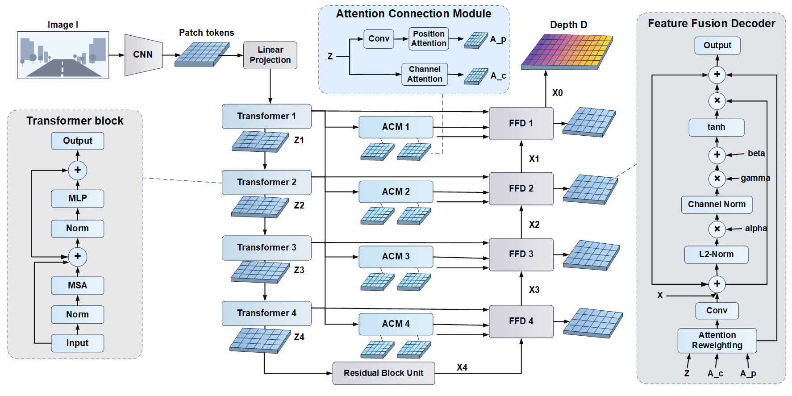 |

MonoFormer 四级网络架构；表中展示按图复现页，原生文件第 2 页保留科学关系修正版。

[原生文件](native/visio-monoformer.vsdx) · [来源记录](evidence/visio-monoformer/source-manifest.json) · [历史核验](evidence/visio-monoformer/verification.json)。

完整历史报告在源码内 `light-diagram/light-visio-diagram/evaluations/2026-10-30-monoformer/REPORT.md`；[原始报告文本副本](evidence/visio-monoformer/original-report.txt) 保留原文字节，其中原相对路径仍以源码内案例目录为基准。

[科学关系修正版预览](../assets/methods/visio-monoformer-corrected.png)。

[实际使用的提示词](prompts/visio-monoformer.txt)。

Illustrator 在 2026-11-06 的新 PDF 导出分支因桌面桥接失败尚待复验。此处展示的是较早的成功原生 AI 与实际 PNG，不将历史成功记录用于认证后续分支。

## 科学依据与引用范围

- 锂硫电池概念参考使用 [10.1039/D4TA03930K](https://doi.org/10.1039/D4TA03930K) 与 [10.1038/s41467-024-52550-9](https://doi.org/10.1038/s41467-024-52550-9) 的可访问摘要/引言信息，未声称读取不可访问全文。
- CRISPR–Cas9 沿用 [Jinek 等（2012）](https://doi.org/10.1126/science.1225829) 的体外切割概念范围，省略 PAM 和核苷酸方向，不表示原子精度；图片为实际生成参考，不是论文原图。
- MonoFormer 的历史核对范围为 [Bae、Moon、Im 的论文](https://arxiv.org/html/2205.11083v3) 第 3.1–3.3 节和 Figure 1，及 [作者 GCT 实现](https://github.com/sjg02122/MonoFormer/blob/main/monoformer/networks/depth/blocks.py)。街景和深度块是几何示意，不是真实预测结果。
- 图内细节与科学关系的核对范围以各例历史报告为准，本轮只调整文档展示，没有重跑桌面应用或新增专家复核。
