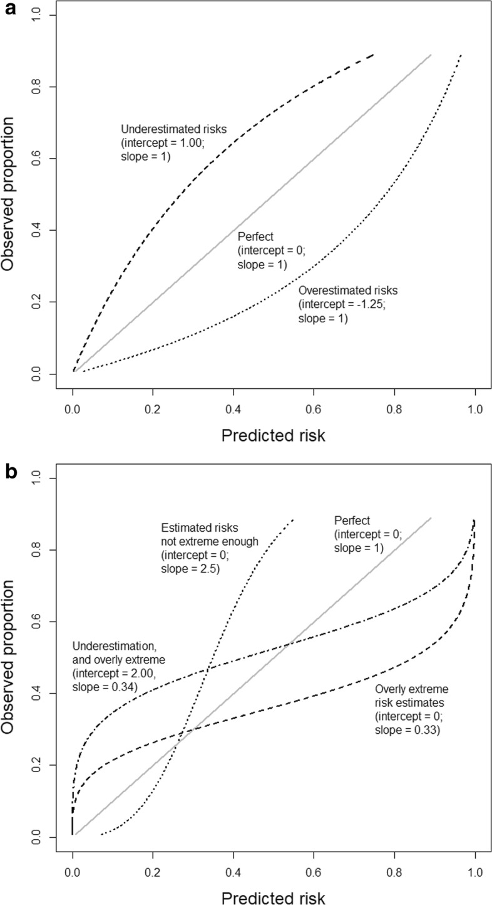

# Calibration: the Achilles heel of predictive analytics. — Figure 1

Domain: clinical; role: positive. Structural reference only.

Question: Are predicted risks shifted overall or too extreme?

Evidence/read path: Intercept-error examples above → slope-error examples below.

Layout: Two vertically stacked square comparison spaces on 0–1 probability axes; directly named trajectories.

Encoding: Monochrome with solid/dashed/dotted identities and a light identity line.

Transfer: Use a real identity reference and direct labels when a few curves stay separated; two error mechanisms deserve separate panels.

Limits: Illustrative curves are conceptual, not new patient results. Keep curve labels outside crossing regions and do not substitute discrimination AUC for calibration.

[Original complete figure](https://pmc.ncbi.nlm.nih.gov/articles/PMC6912996/#Fig1) · [Primary paper](https://pmc.ncbi.nlm.nih.gov/articles/PMC6912996/)

License: CC BY. Whole unmodified source image where bundled.
Attribution: Van Calster B, McLernon DJ, van Smeden M, Wynants L, Steyerberg EW, Topic Group ‘Evaluating diagnostic tests and prediction models’ of the STRATOS initiative.; DOI: 10.1186/s12916-019-1466-7.
License source: © The Author(s). 2019Open AccessThis article is distributed under the terms of the Creative Commons Attribution 4.0 International License (http://creativecommons.org/licenses/by/4.0/), which permits unrestricted use, distribution, and reproduction in any medium, provided you give appropriate credit to the original author(s) and the source, provide a link to the Creative Commons license, and indicate if changes were made. The Creative Commons Public Domain Dedication waiver (http://creativecommons.org/publicdomain/zero/1.0/) applies to the data made available in this article, unless otherwise stated.

Inspected: 2026-10-28, whole figure by /root/phase3_reference_finish with view_image. Source hash: `ecef95d8558f58d5f1d89ef0a41832c178b1d5cdd5e296b602b6d3442fd4ac89`.
