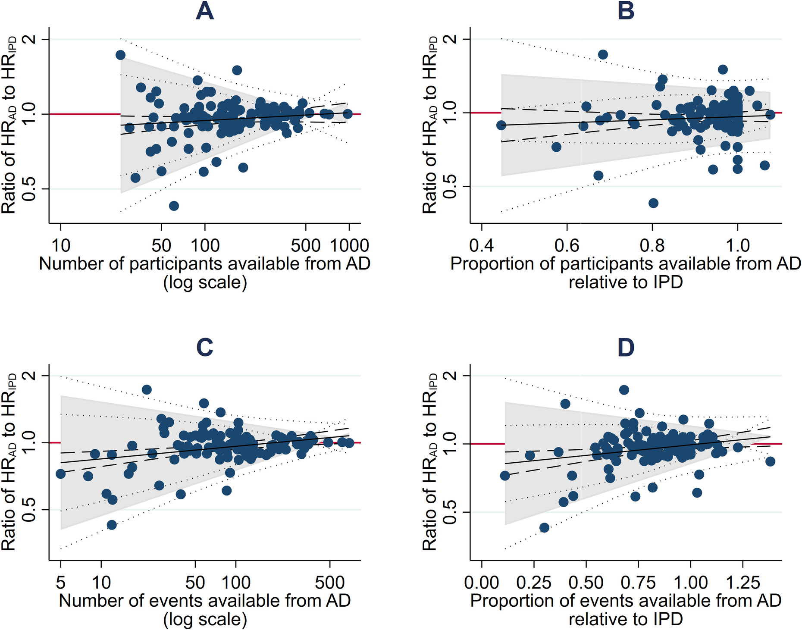

# Comparison of aggregate and individual participant data approaches to meta-analysis of randomised trials: An observational study. — Figure 2

Domain: clinical; role: positive. Structural reference only.

Question: Does aggregate-versus-individual-data agreement depend on participant or event support?

Evidence/read path: Participant count/proportion in top row, event count/proportion in bottom row; common agreement-ratio outcome.

Layout: 2×2 matched rectangular panels; left support counts use log x, right proportions use their own x domains.

Encoding: Dark blue observations, red no-difference reference, grey agreement area and distinct precision lines.

Transfer: Keep the same y reference across distinct support diagnostics; use color sparingly for the scientific anchor.

Limits: Agreement limits and their precision are distinct from an effect CI. BCG contains no paired IPD/AD estimates, so these analyses cannot be imported.

[Original complete figure](https://journals.plos.org/plosmedicine/article?id=10.1371/journal.pmed.1003019#pmed.1003019.g002) · [Primary paper](https://journals.plos.org/plosmedicine/article?id=10.1371/journal.pmed.1003019)

License: CC BY. Whole unmodified source image where bundled.
Attribution: Tierney JF, Fisher DJ, Burdett S, Stewart LA, Parmar MKB.; DOI: 10.1371/journal.pmed.1003019.
License source: © 2020 Tierney et alThis is an open access article distributed under the terms of the Creative Commons Attribution License, which permits unrestricted use, distribution, and reproduction in any medium, provided the original author and source are credited.

Inspected: 2026-10-28, whole figure by /root/phase3_reference_finish with view_image. Source hash: `6beb78c54abb8bd8dc78373b11e46d338460fb775cda525b4e1e409214ac24ba`.
