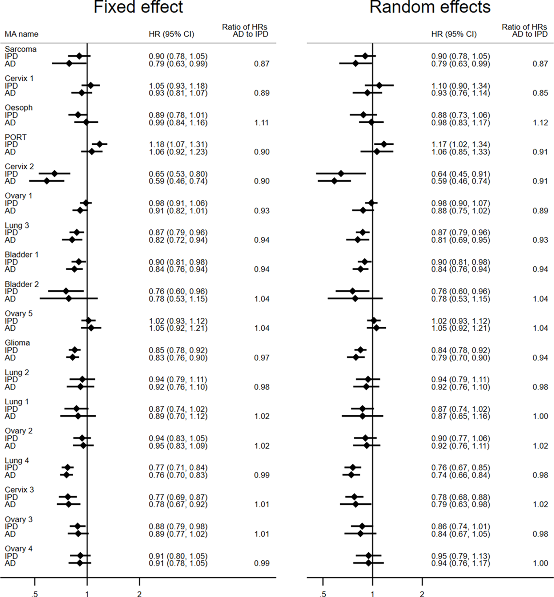

# Comparison of aggregate and individual participant data approaches to meta-analysis of randomised trials: An observational study. — Figure 3

Domain: clinical; role: positive. Structural reference only.

Question: Do aggregate- and individual-data effect estimates agree under two synthesis models?

Evidence/read path: Fixed-effect column versus random-effects column, with the same named comparison rows.

Layout: Two tall parallel forest blocks; shared row register; numeric estimates occupy dedicated text columns.

Encoding: Black point/interval marks and a no-effect vertical reference; numerical ratio column adds an explicit comparison.

Transfer: Align paired estimates by study identity and reserve text columns before drawing. Monochrome can carry a complete evidence comparison.

Limits: Source estimates are pooled under declared models. Our BCG study RRs remain unpooled; never add pooled diamonds merely to resemble this figure.

[Original complete figure](https://journals.plos.org/plosmedicine/article?id=10.1371/journal.pmed.1003019#pmed.1003019.g003) · [Primary paper](https://journals.plos.org/plosmedicine/article?id=10.1371/journal.pmed.1003019)

License: CC BY. Whole unmodified source image where bundled.
Attribution: Tierney JF, Fisher DJ, Burdett S, Stewart LA, Parmar MKB.; DOI: 10.1371/journal.pmed.1003019.
License source: © 2020 Tierney et alThis is an open access article distributed under the terms of the Creative Commons Attribution License, which permits unrestricted use, distribution, and reproduction in any medium, provided the original author and source are credited.

Inspected: 2026-10-28, whole figure by /root/phase3_reference_finish with view_image. Source hash: `7c9f81a88617adfd7d6853996b672970edc87c915ebec55c03e35f9a8d05d4b4`.
