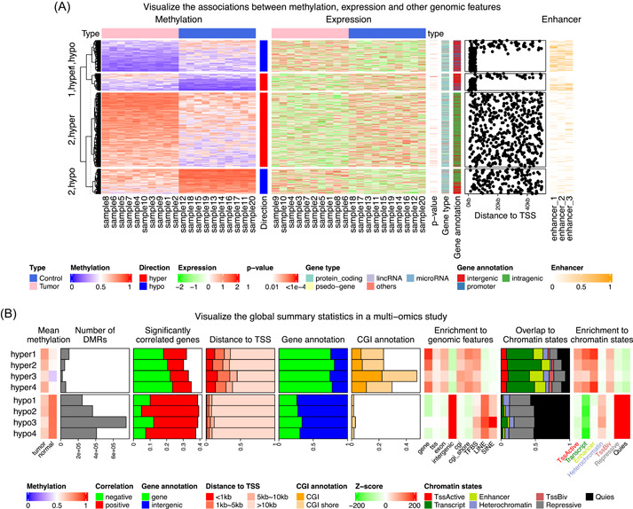

# Complex heatmap visualization — Figure 4

Domain: omics; role: positive. Structural reference only.

Question: How do aligned methylation, expression and genomic annotations relate to study-level summaries?

Evidence/read path: Row-aligned measurements and annotations above → grouped summary statistics below.

Layout: Wide upper matrix block with narrow side annotations and shared identity; shorter lower summary block. Legends are grouped by variable.

Encoding: Separate scales for methylation, expression, categories and enrichment; palettes are variable-specific.

Transfer: Reserve annotation and legend space by meaning. Keep the shared row identity exact and use external summaries only when they add evidence.

Limits: Dense labels and red/green categories are not a recommended universal style. Pasilla lacks methylation/enhancer data; those tracks cannot be invented.

[Original complete figure](https://pmc.ncbi.nlm.nih.gov/articles/PMC10989952/?pdf=render#imt243-fig-0004) · [Primary paper](https://pmc.ncbi.nlm.nih.gov/articles/PMC10989952/?pdf=render)

License: CC BY. Whole unmodified source image where bundled.
Attribution: Gu Z.; DOI: 10.1002/imt2.43.
License source: © 2022 The Authors. iMeta published by John Wiley & Sons Australia, Ltd on behalf of iMeta Science.https://creativecommons.org/licenses/by/4.0/This is an open access article under the terms of the http://creativecommons.org/licenses/by/4.0/ License, which permits use, distribution and reproduction in any medium, provided the original work is properly cited.

Inspected: 2026-10-28, whole figure by /root/phase3_reference_finish with view_image. Source hash: `8d130362484678bd9d80fcd5bf61795a6519b4cb5cfac97a347fdc01c3faf8a4`.
