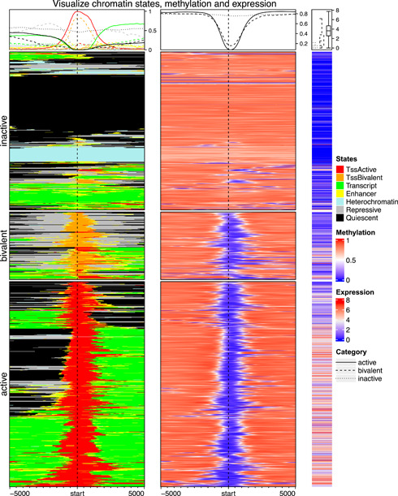

# Complex heatmap visualization — Figure 6 (counterexample)

Domain: omics; role: counterexample. Structural reference only.

Question: A dense aligned matrix needs readable categorical scales.

Evidence/read path: Profiles above aligned chromatin/methylation/expression blocks.

Layout: Tall shared row order with narrow side annotation and compact legends.

Encoding: Highly saturated state colors and dense text; structural alignment is useful, palette is not a default.

Transfer: Retain aligned identity and profile registration; test every categorical legend at final size.

Limits: Separate counterexample for color/legend crowding, excluded from six positive references.

[Original complete figure](https://pmc.ncbi.nlm.nih.gov/articles/PMC10989952/?pdf=render#imt243-fig-0006) · [Primary paper](https://pmc.ncbi.nlm.nih.gov/articles/PMC10989952/?pdf=render)

License: CC BY. Whole unmodified source image where bundled.
Attribution: Gu Z.; DOI: 10.1002/imt2.43.
License source: © 2022 The Authors. iMeta published by John Wiley & Sons Australia, Ltd on behalf of iMeta Science.https://creativecommons.org/licenses/by/4.0/This is an open access article under the terms of the http://creativecommons.org/licenses/by/4.0/ License, which permits use, distribution and reproduction in any medium, provided the original work is properly cited.

Inspected: 2026-10-28, whole figure by /root/phase3_reference_finish with view_image. Source hash: `869a2164e2884ceb9e5122a9acf81bae45e9940ac90106f4d523ca22dd940244`.
