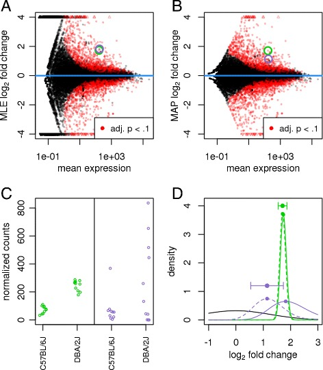

# Moderated estimation of fold change and  dispersion for RNA-seq data with DESeq2. — Figure 2

Domain: omics; role: positive. Structural reference only.

Question: How does shrinkage change estimates, and why do particular genes respond differently?

Evidence/read path: Matched global MA views → two traceable genes → their likelihood/posterior shapes.

Layout: 2×2 near-square panels; the first two share domains and gene identities; lower panels explain the same selected examples.

Encoding: Black background observations, red adjusted-P highlights, two persistent gene colors; boundary triangles disclose clipped points.

Transfer: Pair an overview with mechanistic explanation only when the example IDs can be traced through both.

Limits: Pasilla has no supplied differential results or posterior model. Do not manufacture significance, shrinkage or likelihoods; the dense red highlights and bright pair are not a universal palette.

[Original complete figure](https://pmc.ncbi.nlm.nih.gov/articles/PMC4302049/#Fig2) · [Primary paper](https://pmc.ncbi.nlm.nih.gov/articles/PMC4302049/)

License: CC BY. Whole unmodified source image where bundled.
Attribution: Love MI, Huber W, Anders S.; DOI: 10.1186/s13059-014-0550-8.
License source: © Love et al.; licensee BioMed Central. 2014This is an Open Access article distributed under the terms of the Creative Commons Attribution License (http://creativecommons.org/licenses/by/4.0), which permits unrestricted use, distribution, and reproduction in any medium, provided the original work is properly credited. The Creative Commons Public Domain Dedication waiver (http://creativecommons.org/publicdomain/zero/1.0/) applies to the data made available in this article, unless otherwise stated.

Inspected: 2026-10-28, whole figure by /root/phase3_reference_finish with view_image. Source hash: `5e98df53cfe4d5c8d9c46b9d6f0be0cd3012aa133beae73bf0153e6b4908c2a4`.
