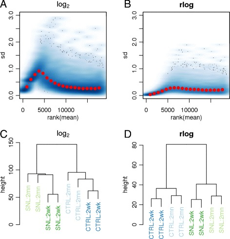

# Moderated estimation of fold change and  dispersion for RNA-seq data with DESeq2. — Figure 5

Domain: omics; role: positive. Structural reference only.

Question: Does a transformation stabilize variance and change sample structure?

Evidence/read path: Two matched mean–SD diagnostics above, corresponding sample dendrograms below.

Layout: 2×2 grid; method is the column identity; compare A/B before C/D. Dendrogram heights have separate actual ranges.

Encoding: Blue density field with red summary points; sample identity in colored labels.

Transfer: Show a transformation diagnostic separately from sample organization. Keep sample labels traceable instead of repeating the count matrix.

Limits: Do not claim our CPM/log transform is rlog. Pale dendrogram labels need darker text or an annotation strip at print size.

[Original complete figure](https://pmc.ncbi.nlm.nih.gov/articles/PMC4302049/#Fig5) · [Primary paper](https://pmc.ncbi.nlm.nih.gov/articles/PMC4302049/)

License: CC BY. Whole unmodified source image where bundled.
Attribution: Love MI, Huber W, Anders S.; DOI: 10.1186/s13059-014-0550-8.
License source: © Love et al.; licensee BioMed Central. 2014This is an Open Access article distributed under the terms of the Creative Commons Attribution License (http://creativecommons.org/licenses/by/4.0), which permits unrestricted use, distribution, and reproduction in any medium, provided the original work is properly credited. The Creative Commons Public Domain Dedication waiver (http://creativecommons.org/publicdomain/zero/1.0/) applies to the data made available in this article, unless otherwise stated.

Inspected: 2026-10-28, whole figure by /root/phase3_reference_finish with view_image. Source hash: `3dd44a7bbbaa34da24e62ad870db96abbe7fbd33eef01b3772348d2f7adfd456`.
