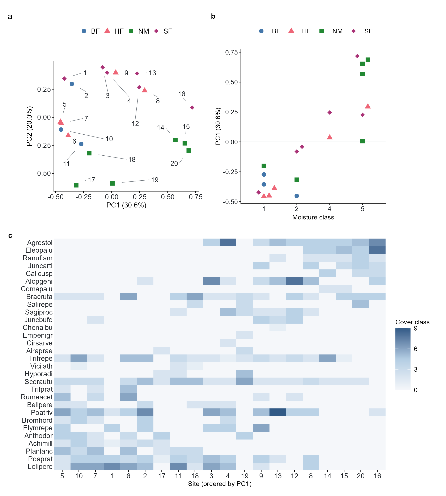

# Light-chart historical dune iteration 2 — label-leader counterexample

Domain: ecology; role: counterexample. Structural reference only.

Question: Can every site label be traced to its true point?

Evidence/read path: Equal-unit ordination → moisture association → complete community matrix.

Layout: Two upper panels and wide matrix; duplicated management keys; detached label leaders.

Encoding: Categorical shape/color and sequential cover-class field.

Transfer: Keep exact coordinates but fix label attachment and tightly overlapping points before claiming ship.

Limits: Historical capped development draft selected with unresolved visual issues; explicitly not a publication reference and excluded from six-paper-figure quota.

License: Project-generated inspection example. Whole unmodified source image where bundled.
Attribution: Light-chart development task; DOI: not a paper reference.
License source: This project’s historical generated figure; original task/review files remain unchanged.

Inspected: 2026-10-28, whole figure by /root/phase3_reference_finish with view_image. Source hash: `2e91306d4b0438617799be995ce3866e5cb3ed59a9ecdd570b115110436bf858`.
