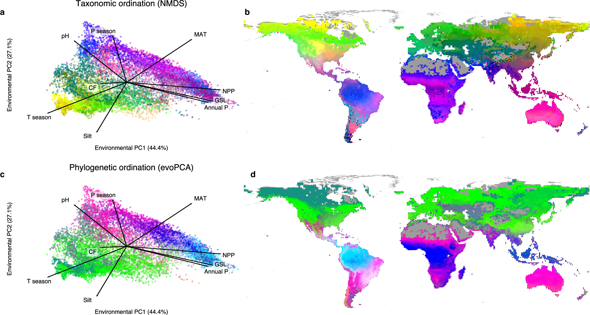

# Regional uniqueness of tree species composition and response to forest loss and climate change — Figure 1

Domain: ecology; role: positive. Structural reference only.

Question: How do global taxonomic and phylogenetic community composition relate to environmental and geographic space?

Evidence/read path: ordination/environment association → geographic localization → phylogenetic counterpart; top ordination -> matching top map; lower ordination -> matching lower map

Layout: two rows; roughly 40% ordination and 60% map per row Environmental PC axes are explicitly labelled; biplot arrows reach named environmental variables.

Encoding: Multivariate color manifold across ordination and map. Color is a multivariate spatial signature, not categorical treatment membership.

Transfer: Preserve a shared identity mapping across distinct evidence views; connect annotations to their actual scientific anchor.

Limits: COUNTEREXAMPLE for palette transfer: these continuous multivariate rainbow colors do not distinguish our four nominal management groups. Copying them would destroy categorical semantics.

[Original complete figure](https://www.nature.com/articles/s41467-024-48276-3/figures/1) · [Primary paper](https://doi.org/10.1038/s41467-024-48276-3)

License: CC BY. Whole unmodified source image where bundled.
Attribution: ['Nina van Tiel', 'Fabian Fopp', 'Philipp Brun', 'Johan van den Hoogen', 'Dirk Nikolaus Karger', 'Cecilia M. Casadei', 'Lisha Lyu', 'Devis Tuia', 'Niklaus E. Zimmermann', 'Thomas W. Crowther', 'Loïc Pellissier']; DOI: 10.1038/s41467-024-48276-3.
License source: https://creativecommons.org/licenses/by/4.0/ Open Access  This article is licensed under a Creative Commons Attribution 4.0 International License, which permits use, sharing, adaptation, distribution and reproduction in any medium or format, as long as you give appropriate credit to the original author(s) and the source, provide a link to the Creative Commons licence, and indicate if changes were made. The images or other third party material in this article are included in the article’s Creative Commons licence, unless indicated otherwise in a credit line to the material. If material is not included in the article’s Creative Commons licence and your intended use is not permitted by statutory regulation or exceeds the permitted use, you will need to obtain permission directly from the copyright holder. To view a copy of this licence, visit  http://creativecommons.org/licenses/by/4.0/ .

Inspected: 2026-10-28, whole figure by /root/phase3_reference_finish with view_image. Source hash: `ad2e54900de8ac415bb398ca54739da0cd3ca7475806815d6f5aa6fd25c09bda`.
