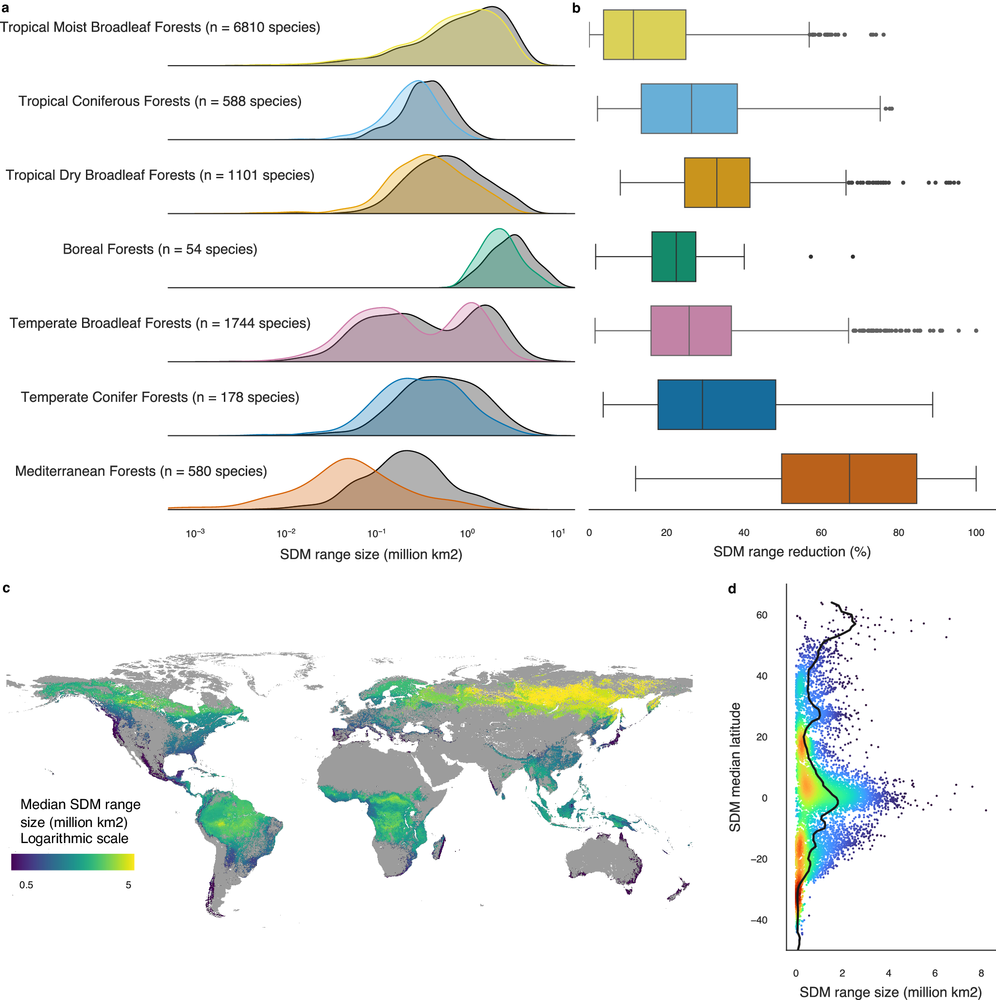

# Regional uniqueness of tree species composition and response to forest loss and climate change — Figure 2

Domain: ecology; role: positive. Structural reference only.

Question: How do suitable ranges and forest loss vary by biome and location?

Evidence/read path: paired distributions → range-reduction comparison → spatial localization → latitudinal boundary; aligned biome rows in top pair -> lower map -> lower latitude distribution

Layout: top two equal columns; lower map about three quarters width and narrow vertical companion One log range axis for all ridges, one percent scale for all boxes; lower orientation follows latitude.

Encoding: Biome categories and scalar map gradient have different semantic jobs. Same biome rows and hues across top panels; map has its own scalar key.

Transfer: Align complementary panels without insisting on equal size. Heatmap row labels need physical space; modest PCA emphasis is justified.

Limits: Do not force the moisture association to use equal x/y units: its x is ordered class, unlike PCA coordinate distance.

[Original complete figure](https://www.nature.com/articles/s41467-024-48276-3/figures/2) · [Primary paper](https://doi.org/10.1038/s41467-024-48276-3)

License: CC BY. Whole unmodified source image where bundled.
Attribution: ['Nina van Tiel', 'Fabian Fopp', 'Philipp Brun', 'Johan van den Hoogen', 'Dirk Nikolaus Karger', 'Cecilia M. Casadei', 'Lisha Lyu', 'Devis Tuia', 'Niklaus E. Zimmermann', 'Thomas W. Crowther', 'Loïc Pellissier']; DOI: 10.1038/s41467-024-48276-3.
License source: https://creativecommons.org/licenses/by/4.0/ Open Access  This article is licensed under a Creative Commons Attribution 4.0 International License, which permits use, sharing, adaptation, distribution and reproduction in any medium or format, as long as you give appropriate credit to the original author(s) and the source, provide a link to the Creative Commons licence, and indicate if changes were made. The images or other third party material in this article are included in the article’s Creative Commons licence, unless indicated otherwise in a credit line to the material. If material is not included in the article’s Creative Commons licence and your intended use is not permitted by statutory regulation or exceeds the permitted use, you will need to obtain permission directly from the copyright holder. To view a copy of this licence, visit  http://creativecommons.org/licenses/by/4.0/ .

Inspected: 2026-10-28, whole figure by /root/phase3_reference_finish with view_image. Source hash: `d670909003d0b5eb7ce847099e30dfa5257897e8cc7f14ff678c668e69fa32b7`.
