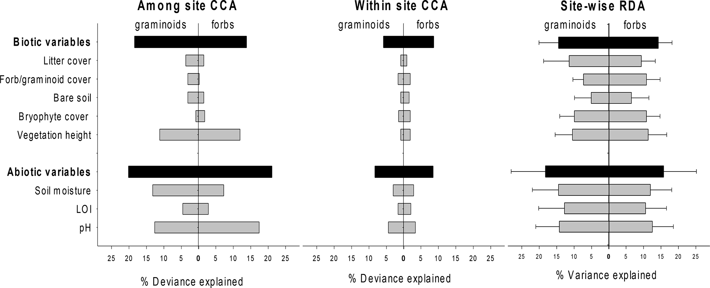

# The Importance of Biotic vs. Abiotic Drivers of Local Plant Community Composition Along Regional Bioclimatic Gradients — Figure 3

Domain: ecology; role: positive. Structural reference only.

Question: Does explanatory power of biotic and abiotic variables depend on analysis scale?

Evidence/read path: regional evidence → pooled local evidence → separate-site evidence; three aligned columns with common variable rows

Layout: three comparable columns and a shared left label band Mirror bars distinguish two functional groups; deviance and variance units are disclosed separately.

Encoding: Two neutral tones carry a simple semantic distinction. Black grouped effects, grey component effects, direct group labels.

Transfer: Share repeated labels and keys where semantics are identical; reserve clean peripheral space for scientific names.

Limits: COUNTEREXAMPLE for our layout: mirroring signs for two groups is not a true negative value. Do not mirror or transform our positive cover classes.

[Original complete figure](https://doi.org/10.1371/journal.pone.0130205.g003) · [Primary paper](https://doi.org/10.1371/journal.pone.0130205)

License: CC BY. Whole unmodified source image where bundled.
Attribution: ['Kari Klanderud', 'Vigdis Vandvik', 'Deborah Goldberg']; DOI: 10.1371/journal.pone.0130205.
License source: CC BY 4.0; publisher states unrestricted use, distribution and reproduction with attribution.

Inspected: 2026-10-28, whole figure by /root/phase3_reference_finish with view_image. Source hash: `44781b650217690989954bbb1cbf8fdfbbfa9ff4bc4a403705527e53c93ec3da`.
