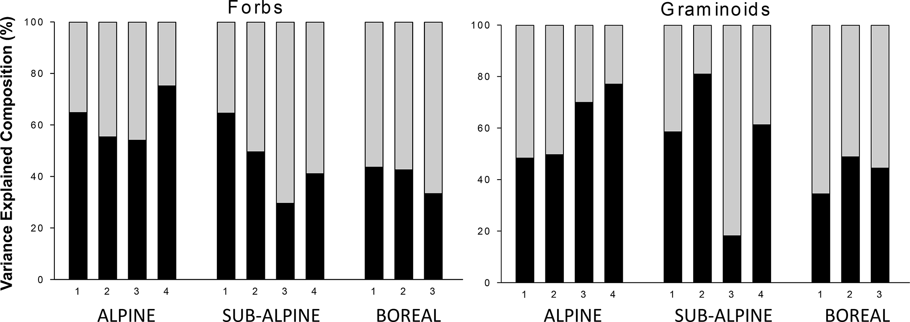

# The Importance of Biotic vs. Abiotic Drivers of Local Plant Community Composition Along Regional Bioclimatic Gradients — Figure 4

Domain: ecology; role: positive. Structural reference only.

Question: How does relative biotic versus abiotic explanatory share vary along climatic classes?

Evidence/read path: forb association → graminoid counterpart; two equal companion panels; climate classes grouped within each

Layout: two wide equal panels Common 0-100 percent scale; precipitation ordinal labels nested inside climate groups.

Encoding: Neutral stacking for complementary shares. Grey/black components described in caption rather than another bulky legend.

Transfer: Let caption carry methodological explanation; keep the final figure to axes, identities and necessary keys.

Limits: COUNTEREXAMPLE for chart selection: a 100% stack would conceal absolute vegetation cover. Our matrix remains all 600 original cover-class values.

[Original complete figure](https://doi.org/10.1371/journal.pone.0130205.g004) · [Primary paper](https://doi.org/10.1371/journal.pone.0130205)

License: CC BY. Whole unmodified source image where bundled.
Attribution: ['Kari Klanderud', 'Vigdis Vandvik', 'Deborah Goldberg']; DOI: 10.1371/journal.pone.0130205.
License source: CC BY 4.0; publisher states unrestricted use, distribution and reproduction with attribution.

Inspected: 2026-10-28, whole figure by /root/phase3_reference_finish with view_image. Source hash: `a92677c64011fb28b1361ddb121335e6418b2296f0ab2c12fc69c414901dce6f`.
