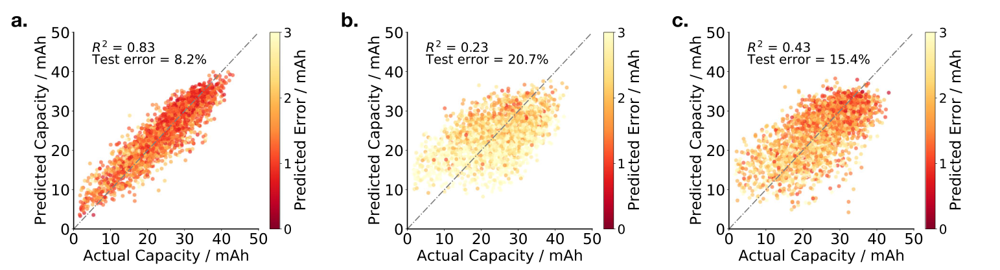

# Impedance-based forecasting of lithium-ion battery performance amid uneven usage — Figure 3

Domain: materials; role: positive. Structural reference only.

Question: Full state/action predictions are challenged by withholding either component.

Evidence/read path: Complete predictor → state-only control → action-only control.

Layout: Three same-size, same-extent square prediction panels; shared continuous uncertainty semantics.

Encoding: Stable categorical identities; no source RGB copied. Material scalar uncertainty stays continuous.

Transfer: Make the complete Nyquist overview precede the origin detail, and magnitude precede phase. Keep coordinate comparisons honest without an unmotivated difference panel.

Limits: Structural visual reference only; source data, estimates, uncertainty, mechanism and panel count are not transferred. Cropped article prose/caption outside the complete figure; no panel or key edited.

[Original complete figure](https://www.nature.com/articles/s41467-022-32422-w/figures/3) · [Primary paper](https://www.nature.com/articles/s41467-022-32422-w)

License: CC BY 4.0. Whole figure extracted from original PDF page; all panels/keys retained, no recoloring. Surrounding article prose/caption excluded.
Attribution: Penelope K. Jones, Ulrich Stimming and Alpha A. Lee; DOI: 10.1038/s41467-022-32422-w.
License source: Primary PDF last page Open Access clause

Inspected: 2026-10-28, whole figure by /root/phase3_reference_finish with view_image. Source hash: `3034033cfd7c853fc9e2624fc153ca839e7d6b04733bd6d6a0e7d0dd707056fb`.
