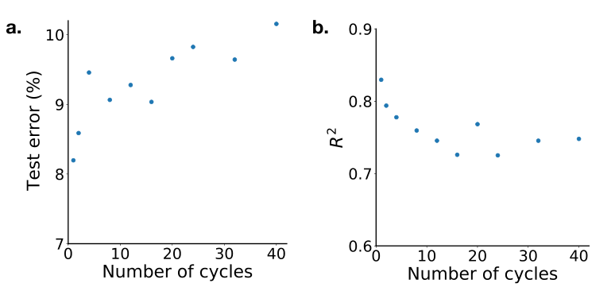

# Impedance-based forecasting of lithium-ion battery performance amid uneven usage — Figure 4

Domain: materials; role: positive. Structural reference only.

Question: Forecast error and explained variation degrade with forecast horizon.

Evidence/read path: Paired complementary outcomes share the identical physical horizon axis.

Layout: Two plain scatter panels without connecting fit or decorative legends.

Encoding: Stable categorical identities; no source RGB copied. Material scalar uncertainty stays continuous.

Transfer: Magnitude and phase get equal wider frequency axes at the same final page size. Connecting lines remain only guides between measurements, never model fits.

Limits: Structural visual reference only; source data, estimates, uncertainty, mechanism and panel count are not transferred. Cropped article prose/caption outside the complete figure; no panel or key edited.

[Original complete figure](https://www.nature.com/articles/s41467-022-32422-w/figures/4) · [Primary paper](https://www.nature.com/articles/s41467-022-32422-w)

License: CC BY 4.0. Whole figure extracted from original PDF page; all panels/keys retained, no recoloring. Surrounding article prose/caption excluded.
Attribution: Penelope K. Jones, Ulrich Stimming and Alpha A. Lee; DOI: 10.1038/s41467-022-32422-w.
License source: Primary PDF last page Open Access clause

Inspected: 2026-10-28, whole figure by /root/phase3_reference_finish with view_image. Source hash: `5e1f125b457c7fcb3c77be4ef2967a7ae820c355d0cbc0a76d25006b14dff7ba`.
