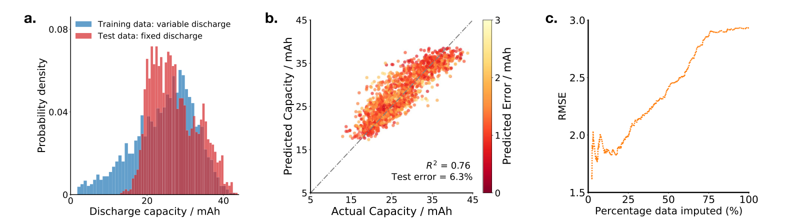

# Impedance-based forecasting of lithium-ion battery performance amid uneven usage — Figure 6

Domain: materials; role: positive. Structural reference only.

Question: Does uncertainty identify failures after a shift in discharge conditions?

Evidence/read path: Training/test support overlap → actual versus predicted capacity → retained-fraction error.

Layout: Three equal panels with distinct axes; shared scalar uncertainty relates point color to the final selective-prediction curve.

Encoding: Stable categorical identities; no source RGB copied. Material scalar uncertainty stays continuous.

Transfer: Separate observed support and predictive errors from raw impedance geometry; no fitted predictor or uncertainty is added to the measured-only EIS task.

Limits: Structural visual reference only; source data, estimates, uncertainty, mechanism and panel count are not transferred. Cropped article prose/caption outside the complete figure; no panel or key edited.

[Original complete figure](https://www.nature.com/articles/s41467-022-32422-w/figures/6) · [Primary paper](https://www.nature.com/articles/s41467-022-32422-w)

License: CC BY 4.0. Whole figure extracted from original PDF page; all panels/keys retained, no recoloring. Surrounding article prose/caption excluded.
Attribution: Penelope K. Jones, Ulrich Stimming and Alpha A. Lee; DOI: 10.1038/s41467-022-32422-w.
License source: Primary PDF last page Open Access clause

Inspected: 2026-10-28, whole figure by /root/phase3_reference_finish with view_image. Source hash: `cfd5811b5614f876a0f69b246d0d5a8bd61757086fb9fb0dfabdfd3b8be82051`.
