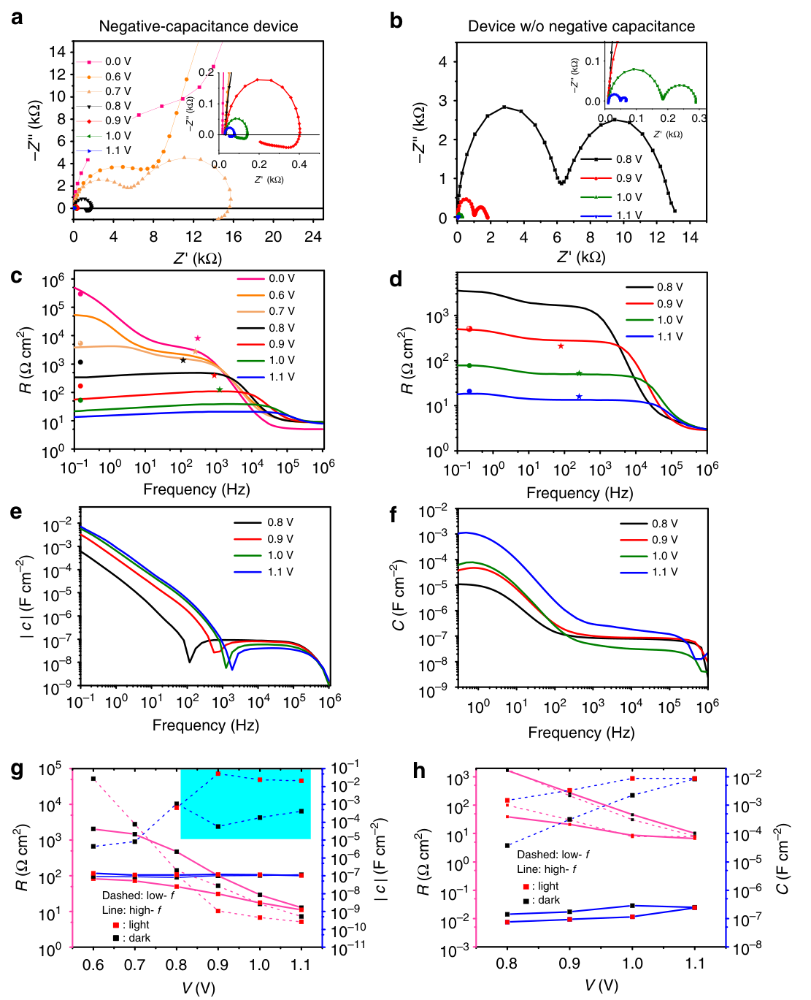

# Origin of apparent light-enhanced and negative capacitance in perovskite solar cells — Figure 2 (counterexample)

Domain: materials; role: counterexample. Structural reference only.

Question: Two device conditions show distinct voltage-dependent signed impedance and capacitance.

Evidence/read path: Condition columns; Nyquist → real component → capacitance → fitted summary rows.

Layout: 4×2 grid with Nyquist origin insets; rainbow voltage keys and dual-axis summaries.

Encoding: Categorical condition identity; existing two project palette families preserved.

Transfer: Partial counterexample: rainbow keys and dual-axis final row would complicate this two-spectrum comparison. Use two stable colors, independent signed phase/magnitude panels and explicit zero lines.

Limits: Structural visual reference only; source data, estimates, uncertainty, mechanism and panel count are not transferred. Cropped article prose/caption outside the complete figure; no panel or key edited.

[Original complete figure](https://www.nature.com/articles/s41467-019-09079-z/figures/2) · [Primary paper](https://www.nature.com/articles/s41467-019-09079-z)

License: CC BY 4.0. Whole figure extracted from original PDF page; all panels/keys retained, no recoloring. Surrounding article prose/caption excluded.
Attribution: Firouzeh Ebadi, Nima Taghavinia, Raheleh Mohammadpour, Anders Hagfeldt and Wolfgang Tress; DOI: 10.1038/s41467-019-09079-z.
License source: Primary PDF last page Open Access clause

Inspected: 2026-10-28, whole figure by /root/phase3_reference_finish with view_image. Source hash: `2084c7521b18b045881de2092768ad172ed0f872ed604a3b2684ba2aaf4b6804`.
