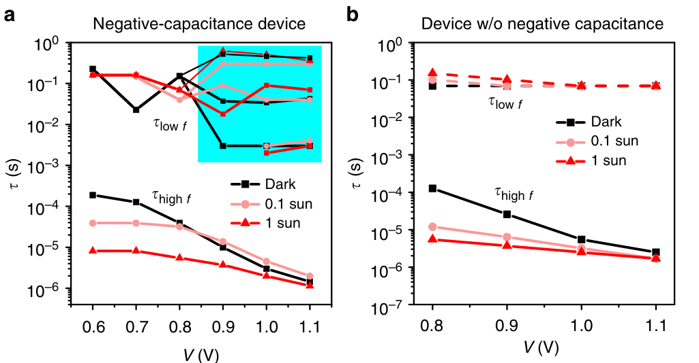

# Origin of apparent light-enhanced and negative capacitance in perovskite solar cells — Figure 3

Domain: materials; role: positive. Structural reference only.

Question: Light intensity and bias dependence are compared across device conditions.

Evidence/read path: Two matched condition panels with explicit high/low-frequency branches.

Layout: Equal-height pair, marker/line redundancy, explicitly shaded signed domain.

Encoding: Categorical condition identity; existing two project palette families preserved.

Transfer: Preserve positive physical imaginary observations as negative Nyquist values, and keep signed phase across zero; no log transform or sign removal for appearance.

Limits: Structural visual reference only; source data, estimates, uncertainty, mechanism and panel count are not transferred. Cropped article prose/caption outside the complete figure; no panel or key edited.

[Original complete figure](https://www.nature.com/articles/s41467-019-09079-z/figures/3) · [Primary paper](https://www.nature.com/articles/s41467-019-09079-z)

License: CC BY 4.0. Whole figure extracted from original PDF page; all panels/keys retained, no recoloring. Surrounding article prose/caption excluded.
Attribution: Firouzeh Ebadi, Nima Taghavinia, Raheleh Mohammadpour, Anders Hagfeldt and Wolfgang Tress; DOI: 10.1038/s41467-019-09079-z.
License source: Primary PDF last page Open Access clause

Inspected: 2026-10-28, whole figure by /root/phase3_reference_finish with view_image. Source hash: `b7186c8f490bcfa7332ed5b2b106fff0493f8ae4b34a0b450d887a8a2f82ef63`.
