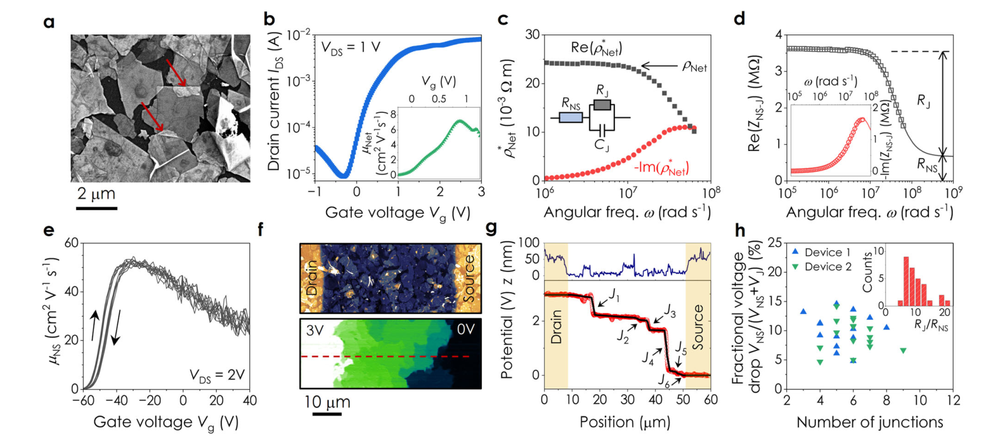

# Understanding how junction resistances impact the conduction mechanism in nano-networks — Figure 4

Domain: materials; role: positive. Structural reference only.

Question: Electrical resistance estimates are checked against microscopic and spatial junction evidence.

Evidence/read path: Morphology → field response → frequency decomposition → local verification.

Layout: 2×4 grid, morphology scale bars, paired real/imaginary frequency components and local insets.

Encoding: Categorical condition identity; existing two project palette families preserved.

Transfer: Separate overview, origin and frequency components into explicitly labelled roles; no equivalent-circuit fit is imported into our measured-only task.

Limits: Structural visual reference only; source data, estimates, uncertainty, mechanism and panel count are not transferred. Cropped article prose/caption outside the complete figure; no panel or key edited.

[Original complete figure](https://www.nature.com/articles/s41467-024-48614-5/figures/4) · [Primary paper](https://www.nature.com/articles/s41467-024-48614-5)

License: CC BY 4.0. Whole figure extracted from original PDF page; all panels/keys retained, no recoloring. Surrounding article prose/caption excluded.
Attribution: Cian Gabbett et al.; DOI: 10.1038/s41467-024-48614-5.
License source: Primary PDF last page Open Access clause

Inspected: 2026-10-28, whole figure by /root/phase3_reference_finish with view_image. Source hash: `1622b5808188ae0a368aa5529c574675e33252e2d2559270ad5c958001d3cd66`.
