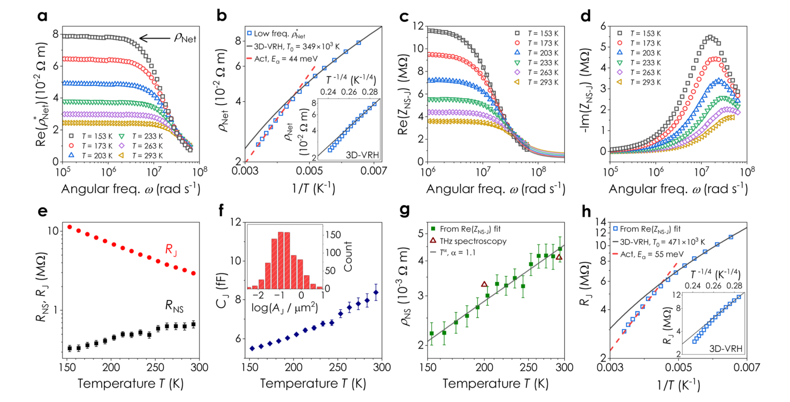

# Understanding how junction resistances impact the conduction mechanism in nano-networks — Figure 5

Domain: materials; role: positive. Structural reference only.

Question: Temperature-dependent frequency responses are compared with extracted transport parameters.

Evidence/read path: Raw frequency families → derived parameters → orthogonal transport comparisons.

Layout: 2×4 grid; repeated temperature hue/marker identities; full spectra first.

Encoding: Categorical condition identity; existing two project palette families preserved.

Transfer: Retain all 39 observed frequencies in every relevant view, maintain spectrum identity and equal Nyquist physical units; smaller nested marks expose coincidence without offsets.

Limits: Structural visual reference only; source data, estimates, uncertainty, mechanism and panel count are not transferred. Cropped article prose/caption outside the complete figure; no panel or key edited.

[Original complete figure](https://www.nature.com/articles/s41467-024-48614-5/figures/5) · [Primary paper](https://www.nature.com/articles/s41467-024-48614-5)

License: CC BY 4.0. Whole figure extracted from original PDF page; all panels/keys retained, no recoloring. Surrounding article prose/caption excluded.
Attribution: Cian Gabbett et al.; DOI: 10.1038/s41467-024-48614-5.
License source: Primary PDF last page Open Access clause

Inspected: 2026-10-28, whole figure by /root/phase3_reference_finish with view_image. Source hash: `db65141ff9a71674c0992dffa83192cb9358e8f2c06e145f4f3575e534c94aa0`.
