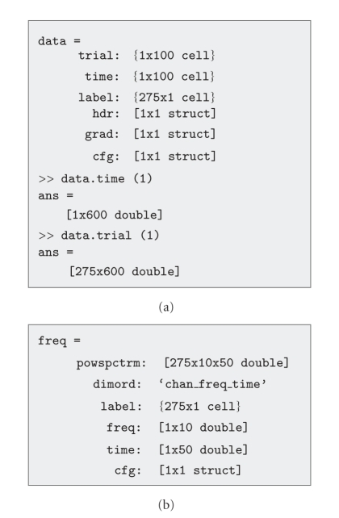

# FieldTrip: Open source software for advanced analysis of MEG, EEG, and invasive electrophysiological data. — Figure 2 (counterexample)

Domain: signals; role: counterexample. Structural reference only.

Question: A software structure screenshot is not a scientific data chart.

Evidence/read path: Two textual software data structures.

Layout: Two stacked grey code boxes.

Encoding: No measured marks or scientific axes.

Transfer: Reject from positive scientific chart references, even though it appears in a useful methods paper.

Limits: Counterexample for superficial figure counting; no color, layout or domain coverage is inferred.

[Original complete figure](https://pmc.ncbi.nlm.nih.gov/articles/PMC3021840/#fig2) · [Primary paper](https://pmc.ncbi.nlm.nih.gov/articles/PMC3021840/)

License: CC BY (version not stated in archived primary license clause). Whole unmodified source image where bundled.
Attribution: Oostenveld R, Fries P, Maris E, Schoffelen JM.; DOI: 10.1155/2011/156869.
License source: Copyright © 2011 Robert Oostenveld et al.This is an open access article distributed under the Creative Commons Attribution License, which permits unrestricted use, distribution, and reproduction in any medium, provided the original work is properly cited.

Inspected: 2026-10-28, whole figure by /root/phase3_reference_finish with view_image. Source hash: `9e2990968569cb71a4b3f81c3c05a60d279929eeac3cbdea5aaa60c6bd18f5e0`.
