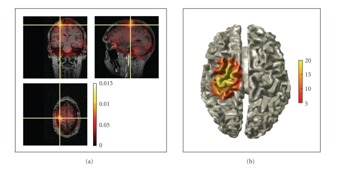

# FieldTrip: Open source software for advanced analysis of MEG, EEG, and invasive electrophysiological data. — Figure 6

Domain: signals; role: positive. Structural reference only.

Question: Where is reconstructed coherence located in orthogonal volume slices and on a surface?

Evidence/read path: Orthogonal registered slices → alternative surface representation.

Layout: Two balanced wide blocks; the left block contains three physically registered slices with crosshairs, right is one surface view.

Encoding: Shared spatial anatomy with separate displayed scalar ranges and colorbars.

Transfer: Use orthogonal slices to expose what a surface can hide; preserve physical crosshair coordinates and state distinct scalar transforms.

Limits: Requires source reconstruction and anatomy, absent from our ECG input. A surface is not proof of a valid 3D field; opacity and warm scales can hide weak regions.

[Original complete figure](https://pmc.ncbi.nlm.nih.gov/articles/PMC3021840/#fig6) · [Primary paper](https://pmc.ncbi.nlm.nih.gov/articles/PMC3021840/)

License: CC BY (version not stated in archived primary license clause). Whole unmodified source image where bundled.
Attribution: Oostenveld R, Fries P, Maris E, Schoffelen JM.; DOI: 10.1155/2011/156869.
License source: Copyright © 2011 Robert Oostenveld et al.This is an open access article distributed under the Creative Commons Attribution License, which permits unrestricted use, distribution, and reproduction in any medium, provided the original work is properly cited.

Inspected: 2026-10-28, whole figure by /root/phase3_reference_finish with view_image. Source hash: `835312411c854cd40f9dc0064db0057de3a9cef9c9bfca91514fd0ebb80506e8`.
