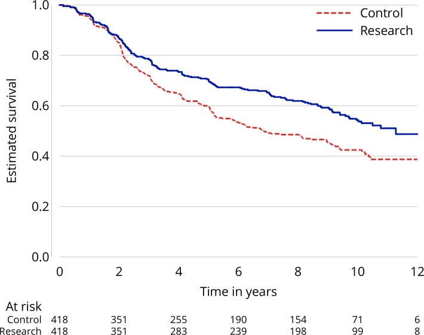

# Proposals on Kaplan-Meier plots in medical research and a survey of stakeholder views: KMunicate. — Figure 1 (counterexample)

Domain: clinical; role: counterexample. Structural reference only.

Question: A survival tail becomes harder to judge without uncertainty and fuller support.

Evidence/read path: Survival curve and basic two-row risk set.

Layout: Wide curve with a minimal support row.

Encoding: Red dashed versus blue solid; no interval band in this baseline.

Transfer: Compare with the same paper Figure5 rather than adding a disconnected generic table.

Limits: Counterexample is the limited baseline relative to the paper’s uncertainty/support improvement, not an assertion that every simple KM is invalid.

[Original complete figure](https://pmc.ncbi.nlm.nih.gov/articles/PMC6773317/#F1) · [Primary paper](https://pmc.ncbi.nlm.nih.gov/articles/PMC6773317/)

License: CC BY. Whole unmodified source image where bundled.
Attribution: Morris TP, Jarvis CI, Cragg W, Phillips PPJ, Choodari-Oskooei B, Sydes MR.; DOI: 10.1136/bmjopen-2019-030215.
License source: © Author(s) (or their employer(s)) 2019. Re-use permitted under CC BY. Published by BMJ.This is an open access article distributed in accordance with the Creative Commons Attribution 4.0 Unported (CC BY 4.0) license, which permits others to copy, redistribute, remix, transform and build upon this work for any purpose, provided the original work is properly cited, a link to the licence is given, and indication of whether changes were made. See: https://creativecommons.org/licenses/by/4.0/.

Inspected: 2026-10-28, whole figure by /root/phase3_reference_finish with view_image. Source hash: `c4f10bb9b470ac28f1511b4f307fbe459a90bf8439ea979ed9a82312fcb13091`.
