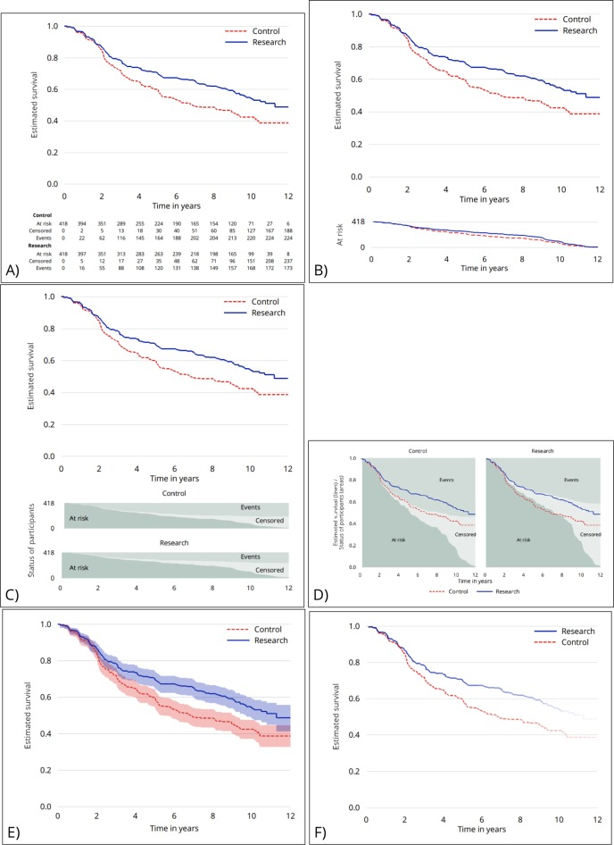

# Proposals on Kaplan-Meier plots in medical research and a survey of stakeholder views: KMunicate. — Figure 2

Domain: clinical; role: positive. Structural reference only.

Question: How do different displays explain uncertainty and the changing risk set?

Evidence/read path: Six candidate constructions for the same survival data: support, status composition, intervals and fading.

Layout: 2-column comparison sheet with six distinct constructions. It is an alternatives study, not a recommendation to publish all six versions together.

Encoding: Same red dashed and blue solid treatment identities; intervals share each trajectory color.

Transfer: Compare alternative layouts at equal size when support competes with curves; select one complementary support display.

Limits: The six alternatives repeat evidence deliberately for design comparison. Do not mechanically append every alternative to a manuscript figure or treat status rows as a stand-alone table image.

[Original complete figure](https://pmc.ncbi.nlm.nih.gov/articles/PMC6773317/#F2) · [Primary paper](https://pmc.ncbi.nlm.nih.gov/articles/PMC6773317/)

License: CC BY. Whole unmodified source image where bundled.
Attribution: Morris TP, Jarvis CI, Cragg W, Phillips PPJ, Choodari-Oskooei B, Sydes MR.; DOI: 10.1136/bmjopen-2019-030215.
License source: © Author(s) (or their employer(s)) 2019. Re-use permitted under CC BY. Published by BMJ.This is an open access article distributed in accordance with the Creative Commons Attribution 4.0 Unported (CC BY 4.0) license, which permits others to copy, redistribute, remix, transform and build upon this work for any purpose, provided the original work is properly cited, a link to the licence is given, and indication of whether changes were made. See: https://creativecommons.org/licenses/by/4.0/.

Inspected: 2026-10-28, whole figure by /root/phase3_reference_finish with view_image. Source hash: `00e7cb5cfd184e8f20365601b3fc538ba6ab577e305c9f1b3d2e6c0ac5e7b8ea`.
