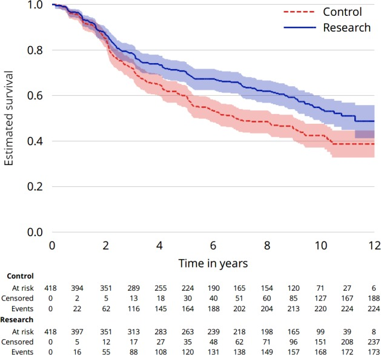

# Proposals on Kaplan-Meier plots in medical research and a survey of stakeholder views: KMunicate. — Figure 5

Domain: clinical; role: positive. Structural reference only.

Question: How much survival evidence remains at each time point?

Evidence/read path: Survival and CI above → at-risk/censored/event support below.

Layout: One dominant wide curve area plus a compact, exactly time-aligned extended risk table; a coupled figure, not two unrelated plots.

Encoding: Solid blue versus dashed red, matching translucent intervals; dark text for numerical support.

Transfer: Use the support block as part of the survival construction. Align every time column with its curve axis.

Limits: Requires event/censoring and risk-set calculations. General manuscript tables still default to LaTeX; a risk table is a semantic component of this curve.

[Original complete figure](https://pmc.ncbi.nlm.nih.gov/articles/PMC6773317/#F5) · [Primary paper](https://pmc.ncbi.nlm.nih.gov/articles/PMC6773317/)

License: CC BY. Whole unmodified source image where bundled.
Attribution: Morris TP, Jarvis CI, Cragg W, Phillips PPJ, Choodari-Oskooei B, Sydes MR.; DOI: 10.1136/bmjopen-2019-030215.
License source: © Author(s) (or their employer(s)) 2019. Re-use permitted under CC BY. Published by BMJ.This is an open access article distributed in accordance with the Creative Commons Attribution 4.0 Unported (CC BY 4.0) license, which permits others to copy, redistribute, remix, transform and build upon this work for any purpose, provided the original work is properly cited, a link to the licence is given, and indication of whether changes were made. See: https://creativecommons.org/licenses/by/4.0/.

Inspected: 2026-10-28, whole figure by /root/phase3_reference_finish with view_image. Source hash: `6892ae338a89b006911b4e95b9125315ff68388d695aba09a15edf80fca35046`.
