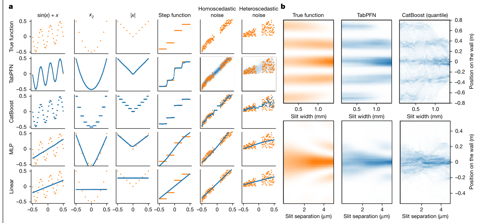

# Accurate predictions on small data with a tabular foundation model — Figure 3

Domain: ml; role: positive. Structural reference only.

Question: Model behavior across function and noise types is checked against ground truth.

Evidence/read path: Function/noise columns cross model rows, followed by a separate physical-distribution challenge.

Layout: Small-multiple matrix shares examples and row identities; the second block shows two spatial scales.

Encoding: Categorical condition identity; existing two project palette families preserved.

Transfer: Use consistent panel roles and preserve full per-class counts; an overall accuracy score cannot stand in for all failure modes.

Limits: Structural visual reference only; source data, estimates, uncertainty, mechanism and panel count are not transferred. Cropped article prose/caption outside the complete figure; no panel or key edited.

[Original complete figure](https://www.nature.com/articles/s41586-024-08328-6/figures/3) · [Primary paper](https://www.nature.com/articles/s41586-024-08328-6)

License: CC BY 4.0. Whole figure extracted from original PDF page; all panels/keys retained, no recoloring. Surrounding article prose/caption excluded.
Attribution: Noah Hollmann, Samuel Müller, Lennart Purucker, Arjun Krishnakumar, Max Körfer, Shi Bin Hoo, Robin Tibor Schirrmeister and Frank Hutter; DOI: 10.1038/s41586-024-08328-6.
License source: Primary PDF page 8 Open Access clause

Inspected: 2026-10-28, whole figure by /root/phase3_reference_finish with view_image. Source hash: `2f9a1b9b9ec47d3627c440778c3dfadb57a131c47177d4e93c7ae81230553560`.
