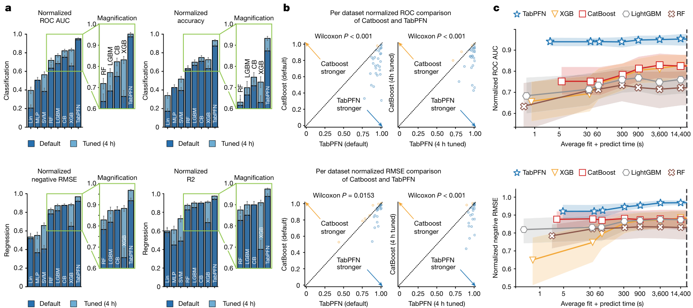

# Accurate predictions on small data with a tabular foundation model — Figure 4

Domain: ml; role: positive. Structural reference only.

Question: Benchmark performance, paired dataset comparison and time cost form a capability argument.

Evidence/read path: Aggregate ranking → per-dataset boundary → budget tradeoff; classification/regression aligned in rows.

Layout: Three evidence columns with one stable method key, task rows, compact insets.

Encoding: Categorical condition identity; existing two project palette families preserved.

Transfer: Keep selection/fit-time and held-out errors as distinct evidence roles; do not turn validation runs into new test evaluations.

Limits: Structural visual reference only; source data, estimates, uncertainty, mechanism and panel count are not transferred. Cropped article prose/caption outside the complete figure; no panel or key edited.

[Original complete figure](https://www.nature.com/articles/s41586-024-08328-6/figures/4) · [Primary paper](https://www.nature.com/articles/s41586-024-08328-6)

License: CC BY 4.0. Whole figure extracted from original PDF page; all panels/keys retained, no recoloring. Surrounding article prose/caption excluded.
Attribution: Noah Hollmann, Samuel Müller, Lennart Purucker, Arjun Krishnakumar, Max Körfer, Shi Bin Hoo, Robin Tibor Schirrmeister and Frank Hutter; DOI: 10.1038/s41586-024-08328-6.
License source: Primary PDF page 8 Open Access clause

Inspected: 2026-10-28, whole figure by /root/phase3_reference_finish with view_image. Source hash: `cd43ac81528334815f3937f6a565817c4c33b34876fc30f1bf40b791a2033e31`.
