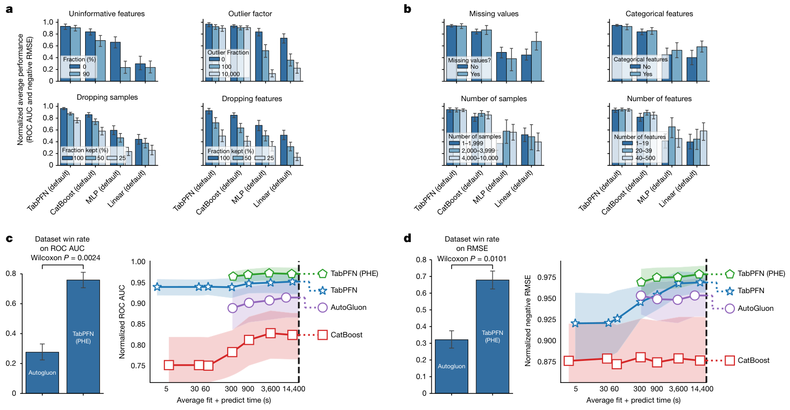

# Accurate predictions on small data with a tabular foundation model — Figure 5

Domain: ml; role: positive. Structural reference only.

Question: Modified datasets and tuned-ensemble comparisons bound generality.

Evidence/read path: Top condition strata; lower win rates and actual budget tradeoffs.

Layout: Nested small multiples, direct line-end identities, blue aggregate bars.

Encoding: Categorical condition identity; existing two project palette families preserved.

Transfer: Use exactly two stable hue/shape/line identities and a separate full count scale; do not pack every possible diagnostic into this small task.

Limits: Structural visual reference only; source data, estimates, uncertainty, mechanism and panel count are not transferred. Cropped article prose/caption outside the complete figure; no panel or key edited.

[Original complete figure](https://www.nature.com/articles/s41586-024-08328-6/figures/5) · [Primary paper](https://www.nature.com/articles/s41586-024-08328-6)

License: CC BY 4.0. Whole figure extracted from original PDF page; all panels/keys retained, no recoloring. Surrounding article prose/caption excluded.
Attribution: Noah Hollmann, Samuel Müller, Lennart Purucker, Arjun Krishnakumar, Max Körfer, Shi Bin Hoo, Robin Tibor Schirrmeister and Frank Hutter; DOI: 10.1038/s41586-024-08328-6.
License source: Primary PDF page 8 Open Access clause

Inspected: 2026-10-28, whole figure by /root/phase3_reference_finish with view_image. Source hash: `117200ab1bc378fd4a3135940bb162eb91f2f4fea4aff3f95d3370e7e1dad92e`.
