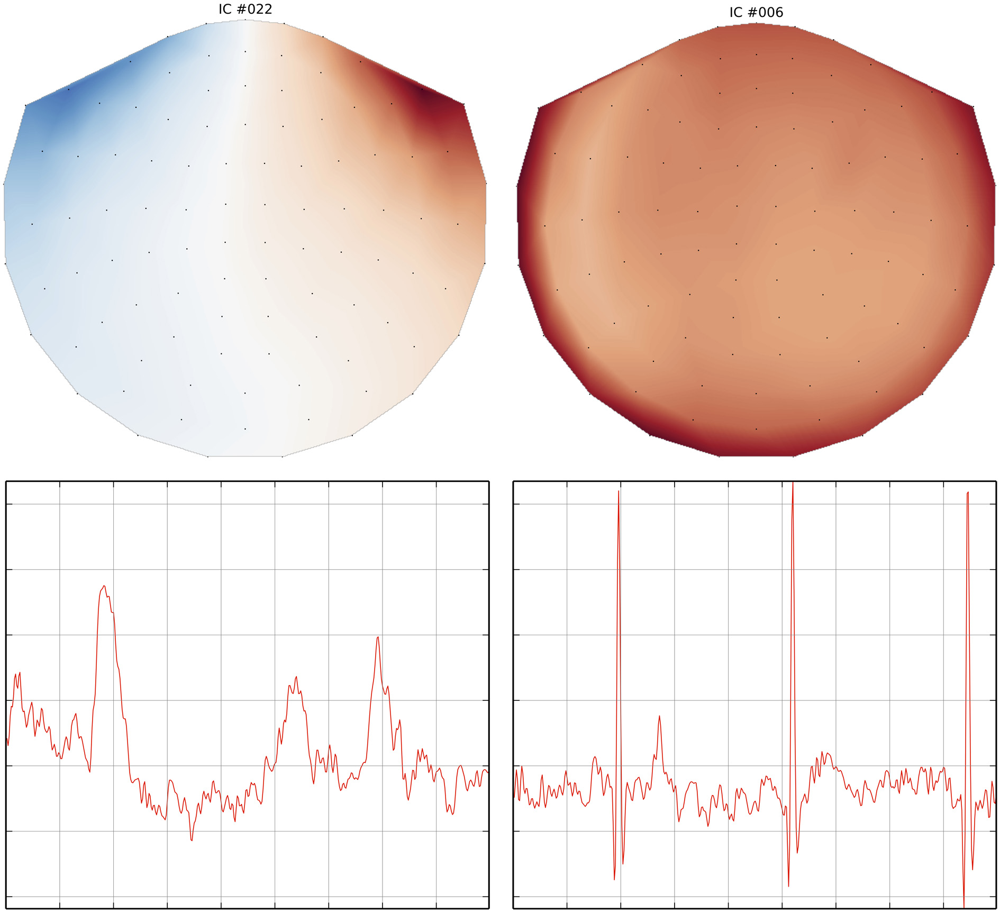

# MEG and EEG data analysis with MNE-Python. — Figure 6

Domain: signals; role: positive. Structural reference only.

Question: Does each component have a spatial pattern and waveform consistent with its artifact identity?

Evidence/read path: Two components in columns, spatial topology above and corresponding waveform below.

Layout: 2×2 matched blocks; equal topographic circles and equal waveform boxes.

Encoding: Diverging maps and simple red traces; component ID links both roles.

Transfer: Pair spatial and temporal evidence by exact component ID. Repeated layout makes two candidates easy to compare.

Limits: Source waveform panels omit detailed axes, and no shared map colorbar is shown: do not copy these omissions into quantitative ECG work. No ICA output is inferred from a raw waveform.

[Original complete figure](https://www.frontiersin.org/journals/neuroscience/articles/10.3389/fnins.2013.00267/full#F6) · [Primary paper](https://www.frontiersin.org/journals/neuroscience/articles/10.3389/fnins.2013.00267/full)

License: CC BY (version not stated in archived primary license clause). Whole unmodified source image where bundled.
Attribution: Gramfort A, Luessi M, Larson E, Engemann DA, Strohmeier D, Brodbeck C, Goj R, Jas M, Brooks T, Parkkonen L, Hämäläinen M.; DOI: 10.3389/fnins.2013.00267.
License source: Copyright © 2013 Gramfort, Luessi, Larson, Engemann, Strohmeier, Brodbeck, Goj, Jas, Brooks, Parkkonen and Hämäläinen.This is an open-access article distributed under the terms of the Creative Commons Attribution License (CC BY). The use, distribution or reproduction in other forums is permitted, provided the original author(s) or licensor are credited and that the original publication in this journal is cited, in accordance with accepted academic practice. No use, distribution or reproduction is permitted which does not comply with these terms.

Inspected: 2026-10-28, whole figure by /root/phase3_reference_finish with view_image. Source hash: `ab79dff1769fcdf73030d90bf81be590967765486f4db145e2a943a2e353aa1c`.
