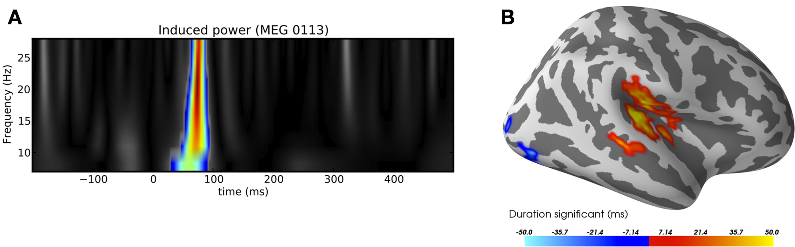

# MEG and EEG data analysis with MNE-Python. — Figure 7 (counterexample)

Domain: signals; role: counterexample. Structural reference only.

Question: A spatial contrast and a temporal region need distinct, readable scalar semantics.

Evidence/read path: Time-frequency activation on left, spatial contrast on right.

Layout: Two wide complementary panels.

Encoding: Rainbow/jet appearance, dark field, mismatched visual scalar roles.

Transfer: Keep complementary roles but use declared sequential/diverging scales appropriate to each quantity.

Limits: Separate palette counterexample; activation inference cannot be transferred from the image.

[Original complete figure](https://www.frontiersin.org/journals/neuroscience/articles/10.3389/fnins.2013.00267/full#F7) · [Primary paper](https://www.frontiersin.org/journals/neuroscience/articles/10.3389/fnins.2013.00267/full)

License: CC BY (version not stated in archived primary license clause). Whole unmodified source image where bundled.
Attribution: Gramfort A, Luessi M, Larson E, Engemann DA, Strohmeier D, Brodbeck C, Goj R, Jas M, Brooks T, Parkkonen L, Hämäläinen M.; DOI: 10.3389/fnins.2013.00267.
License source: Copyright © 2013 Gramfort, Luessi, Larson, Engemann, Strohmeier, Brodbeck, Goj, Jas, Brooks, Parkkonen and Hämäläinen.This is an open-access article distributed under the terms of the Creative Commons Attribution License (CC BY). The use, distribution or reproduction in other forums is permitted, provided the original author(s) or licensor are credited and that the original publication in this journal is cited, in accordance with accepted academic practice. No use, distribution or reproduction is permitted which does not comply with these terms.

Inspected: 2026-10-28, whole figure by /root/phase3_reference_finish with view_image. Source hash: `e9b7500d90582d22ca4c85a2a34facf50c153d99aa9b4fbb5a4a3ae22715b78f`.
