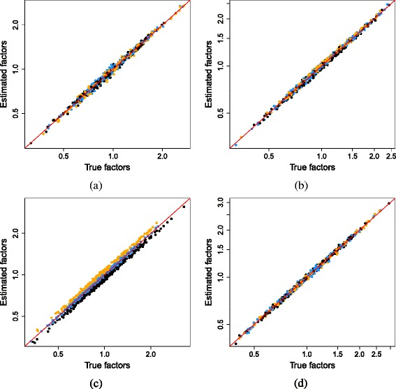

# Pooling across cells to normalize single-cell RNA sequencing data with many zero counts. — Figure 4

Domain: omics; role: positive. Structural reference only.

Question: Do estimated normalization factors agree with simulated truth under different scenarios?

Evidence/read path: Four conditions, each comparing estimated with true factor.

Layout: 2×2 equal plot boxes with a common diagonal; no decorative companion panel.

Encoding: Black and two group colors, red identity line; axes retain the actual domains.

Transfer: Use small multiples when a genuine scenario changes the relationship, and keep a quantitative reference line.

Limits: These are simulation-specific factors, not new measurements for our count data. Match limits when comparing conditions; the source has condition-specific ranges.

[Original complete figure](https://pmc.ncbi.nlm.nih.gov/articles/PMC4848819/#Fig4) · [Primary paper](https://pmc.ncbi.nlm.nih.gov/articles/PMC4848819/)

License: CC BY. Whole unmodified source image where bundled.
Attribution: Lun AT, Bach K, Marioni JC.; DOI: 10.1186/s13059-016-0947-7.
License source: © Lun et al. 2016 Open Access This article is distributed under the terms of the Creative Commons Attribution 4.0 International License (http://creativecommons.org/licenses/by/4.0/), which permits unrestricted use, distribution, and reproduction in any medium, provided you give appropriate credit to the original author(s) and the source, provide a link to the Creative Commons license, and indicate if changes were made. The Creative Commons Public Domain Dedication waiver (http://creativecommons.org/publicdomain/zero/1.0/) applies to the data made available in this article, unless otherwise stated.

Inspected: 2026-10-28, whole figure by /root/phase3_reference_finish with view_image. Source hash: `5fc6b097fb04da6c542f84906f33cb6994079cec9ed7afefd439fe4791bcc2c7`.
