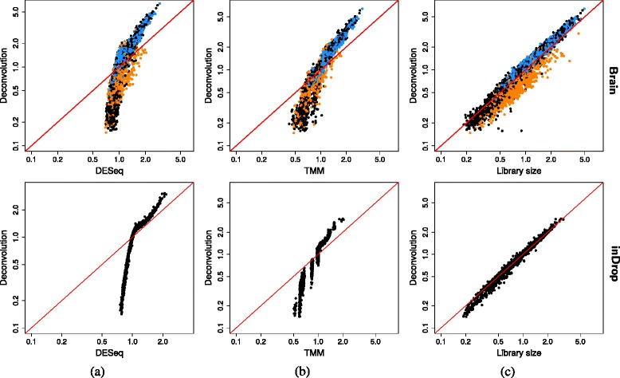

# Pooling across cells to normalize single-cell RNA sequencing data with many zero counts. — Figure 5

Domain: omics; role: positive. Structural reference only.

Question: Which normalization methods disagree across two empirical datasets?

Evidence/read path: Methods in columns and datasets in rows; compare each against a common estimator.

Layout: 2×3 aligned grid, equal square boxes, log axes and one identity diagonal per panel.

Encoding: Group color appears only in the row with supplied group metadata; the other row remains black.

Transfer: Align quantitative method comparisons, use group color only where justified, and retain the diagonal.

Limits: Do not infer biological groups from sample names or depict factor disagreement as a differential-expression result.

[Original complete figure](https://pmc.ncbi.nlm.nih.gov/articles/PMC4848819/#Fig5) · [Primary paper](https://pmc.ncbi.nlm.nih.gov/articles/PMC4848819/)

License: CC BY. Whole unmodified source image where bundled.
Attribution: Lun AT, Bach K, Marioni JC.; DOI: 10.1186/s13059-016-0947-7.
License source: © Lun et al. 2016 Open Access This article is distributed under the terms of the Creative Commons Attribution 4.0 International License (http://creativecommons.org/licenses/by/4.0/), which permits unrestricted use, distribution, and reproduction in any medium, provided you give appropriate credit to the original author(s) and the source, provide a link to the Creative Commons license, and indicate if changes were made. The Creative Commons Public Domain Dedication waiver (http://creativecommons.org/publicdomain/zero/1.0/) applies to the data made available in this article, unless otherwise stated.

Inspected: 2026-10-28, whole figure by /root/phase3_reference_finish with view_image. Source hash: `e86b63e0c7034e3762e42e14e296b54e9057fb39e1e3cc1a475c5c93aef6936d`.
