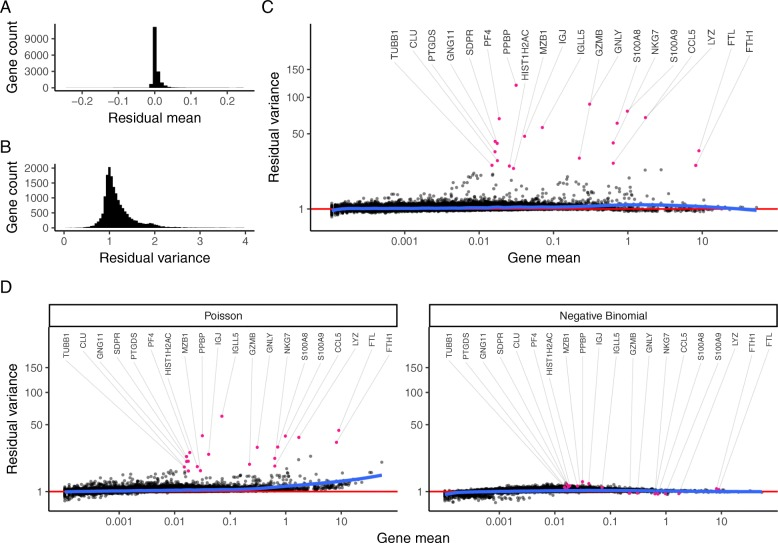

# Normalization and variance stabilization of single-cell RNA-seq data using regularized negative binomial regression. — Figure 4

Domain: omics; role: positive. Structural reference only.

Question: Does normalization remove depth effects while preserving informative genes?

Evidence/read path: Two small marginal checks → dominant mean–variance view → two alternative-model comparisons.

Layout: Small stacked histograms occupy upper left, wide main scatter upper right, two matched rectangular controls below.

Encoding: Grey genes, pink selected markers, blue fitted trend and red reference line; selected identities use long leaders.

Transfer: Allocate more width to the central diagnostic than its marginal summaries; preserve common axes across model comparisons.

Limits: The variance threshold and fitted curves require the actual model. Long fan leaders are a crowding risk; do not use this label style for 20 spatially close site IDs.

[Original complete figure](https://pmc.ncbi.nlm.nih.gov/articles/PMC6927181/#Fig4) · [Primary paper](https://pmc.ncbi.nlm.nih.gov/articles/PMC6927181/)

License: CC BY. Whole unmodified source image where bundled.
Attribution: Hafemeister C, Satija R.; DOI: 10.1186/s13059-019-1874-1.
License source: © The Author(s) 2019Open Access This article is distributed under the terms of the Creative Commons Attribution 4.0 International License (http://creativecommons.org/licenses/by/4.0/), which permits unrestricted use, distribution, and reproduction in any medium, provided you give appropriate credit to the original author(s) and the source, provide a link to the Creative Commons license, and indicate if changes were made. The Creative Commons Public Domain Dedication waiver (http://creativecommons.org/publicdomain/zero/1.0/) applies to the data made available in this article, unless otherwise stated.

Inspected: 2026-10-28, whole figure by /root/phase3_reference_finish with view_image. Source hash: `eda61fd2eaa1f45409dd6b1bee654fc1ae687e3b466bdaa5b1fc89923a385ee1`.
