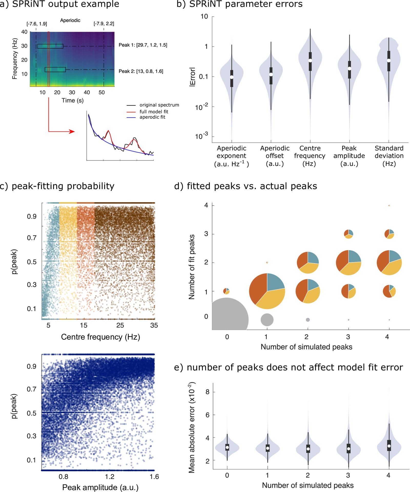

# Time-resolved parameterization of aperiodic and periodic brain activity. — Figure 3

Domain: signals; role: positive. Structural reference only.

Question: Does a time-resolved spectral method recover parameters and peaks reliably?

Evidence/read path: Spectrogram with a declared time cross-section → parameter errors → peak-detection and count controls.

Layout: Asymmetric top example plus wider error distribution; lower diagnostics form complementary blocks rather than repeated heatmaps.

Encoding: Perceptual sequential spectrogram, restrained violins, explicit selected-time arrow; count areas have a different semantic role.

Transfer: Show an actual local slice beside the time-frequency field when it explains interpretation, and keep validation evidence separate from the representative example.

Limits: Errors and detection probabilities use 10,000 simulations, not independent bins from one ECG. Pie-area count glyphs and heterogeneous units should not be copied without a real task need.

[Original complete figure](https://elifesciences.org/articles/77348#fig3) · [Primary paper](https://elifesciences.org/articles/77348)

License: CC BY. Whole unmodified source image where bundled.
Attribution: Wilson LE, da Silva Castanheira J, Baillet S.; DOI: 10.7554/eLife.77348.
License source: © 2022, Wilson et al2022Wilson et alhttps://creativecommons.org/licenses/by/4.0/This article is distributed under the terms of the Creative Commons Attribution License, which permits unrestricted use and redistribution provided that the original author and source are credited.

Inspected: 2026-10-28, whole figure by /root/phase3_reference_finish with view_image. Source hash: `a7d4cd41f5aeca1e3f965e73aa80a1a0a171c6c6c5974bab14340324b978c091`.
