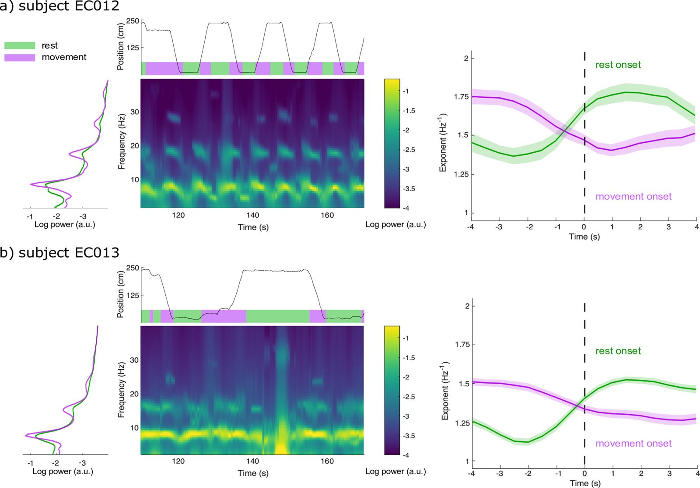

# Time-resolved parameterization of aperiodic and periodic brain activity. — Figure 5

Domain: signals; role: positive. Structural reference only.

Question: How do spectral dynamics align with locomotion and transitions for two subjects?

Evidence/read path: Condition spectrum → time-aligned behavior and spectrogram → transition-aligned parameter trajectories; repeat by subject.

Layout: Two subject rows; a narrow marginal spectrum, dominant time-frequency block and wide trajectory block in each.

Encoding: Green/purple condition identity across all roles; sequential power field; bands belong to declared summary estimates.

Transfer: Reserve temporal width for the field, align behavior to real time, and distinguish overview time from event-relative time.

Limits: Movement states, fitted exponents and uncertainty require their real inputs. ECG cannot acquire locomotion labels or fitted spectral parameters from layout imitation.

[Original complete figure](https://elifesciences.org/articles/77348#fig5) · [Primary paper](https://elifesciences.org/articles/77348)

License: CC BY. Whole unmodified source image where bundled.
Attribution: Wilson LE, da Silva Castanheira J, Baillet S.; DOI: 10.7554/eLife.77348.
License source: © 2022, Wilson et al2022Wilson et alhttps://creativecommons.org/licenses/by/4.0/This article is distributed under the terms of the Creative Commons Attribution License, which permits unrestricted use and redistribution provided that the original author and source are credited.

Inspected: 2026-10-28, whole figure by /root/phase3_reference_finish with view_image. Source hash: `70dc019f65f6c6201b17e3b290239a012e666afe22c896b6f548e875bb311700`.
