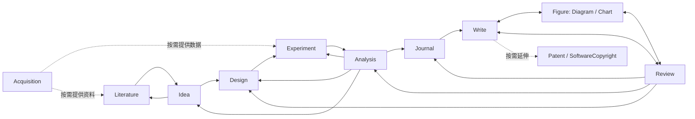

# 科研项目目录规范 1.0

本规范统一 **产物位置、归档身份、版本关系与导航**，专业文件继续遵守各 skill 已实现的契约。目录可以从任何阶段开始；不要求先检索、再选题才能画图或写作。用户已有目录和明确指定的输出位置优先。

## 1. 两种目录不要混用

- **skill 包**：SKILL.md、scripts、references、模板、参考仓库、开发测试。这里维护能力。
- **研究项目**：某个真实问题的输入、过程、证据、正文和交付文件。下面的树属于这里。

`D:/Light-Skills` 是当前的技能源码集合，不是某个研究项目。不能因为当前工作目录在这里，就把下一篇论文或实验默认写到包里。一个项目以一篇论文或一项软著为中心，也可包括同一研究延伸的软著和专利；不以多篇论文组成的大课题作为默认单位。候选 idea、设计、运行和分析可以有多轮，它们共同服务于这一核心成果。另起独立论文通常另建项目，通过来源路径和稳定 ID 引用已有成果，不复制成新的独立证据。

## 实际工作网络

通常从 `Literature → Idea → Design → Experiment → Analysis` 开始。分析可回到 idea、设计、执行，也可触发补查文献；`Acquisition` 按当前需要供给数据或公共资料，交给相应阶段使用。研究结果形成后，通常经 `Journal → Write` 进入投稿定位与写作；`Write / Figure / Review` 反复协作，审查可返回分析、设计和实验，贡献或稿件定位改变时也可能重做选刊。

这些是可回退、分支和交叉调用的关系，不是必须逐步通过的流水线；目录顺序不是执行顺序。目录登记只保存实际输入/前后版本关系，不自动决定调用谁、启动研究循环或结束科研。专利和软著根据项目事实与用户需求建立，不因为论文写完就自动创建；需要提前考虑公开时间时可提前准备，不把它们机械锁在最后一步。`light-leader` 负责跨阶段协调，本规范只负责归档。



图表示常见衔接，不穷举所有调用；已有稿件、数据或软件可以直接进入相应节点。Memory 保存可追溯的项目上下文，Leader 结合上下文和实际状态协调，按需把目标与交接存进 Workflow；二者均不作为普通专业任务的必装依赖。

## 2. 完整逻辑目录

下面展示全部能力可能产生的内容，**不是初始化时创建的空目录树**。文件只在实际有内容或对应原生工具需要时产生。原生脚本生成的待填写模板保留 draft/pending 语义，不算完成成果。

```text
项目名称/
├── README.md                           问题、阶段、结论、下一步与导航
├── project.json                        可选；跨阶段路径、归档状态与关联
├── Workflow/                           light-leader 按需维护工作交接
│   └── workflow.json / 00-Workflow总览.md  目标、任务、历史与可重建视图
├── Memory/                             light-memory 管理的项目上下文
│   ├── memory.json / events/            身份与不可变捕获历史
│   └── 00-Memory总览.md / current.md     可重建的分层入口
├── Literature/
│   ├── 00-Literature总览.md             可选；统一导航
│   ├── README.md / manifest.json        文献工具维护的索引，不替换
│   ├── Searches/SEARCH-0001_检索主题/   原 run 的全部检索、筛选、导出记录
│   └── 年份_作者_原题短名/             沿用文献工具的命名和稳定 paper_id
│       ├── meta.json / paper.pdf
│       ├── paper.md / source_map.json
│       ├── paper.zh.md / note.md
│       ├── images/ / pages/             仅在解析时实际生成
│       └── supplementary/              仅有补充材料时
├── Idea/
│   ├── 00-Idea总览.md
│   └── IDEA-0001_选题主题/              一轮选题，可含多个科学候选
│       ├── context.json / reading_queue.md
│       ├── evidence.jsonl / external_papers.jsonl / novelty_log.jsonl
│       ├── ideas.json / decision.md
│       └── cards/I01.md
├── Design/
│   ├── 00-Design总览.md
│   └── PROT-0001_方案短名/
│       ├── v01/
│       │   ├── context.json / design.json / plan.md
│       │   └── protocols/              实际协议、分配表、分析规格
│       └── v02/                        实质修订，保留上一版
├── Experiment/
│   ├── 00-Experiment总览.md
│   ├── Code/                           可选；代码仓库/入口说明，不强制复制
│   ├── Environment/                    可选；共享环境锁与设备说明
│   ├── Data/                           可选；原始数据、字典或受控存储引用
│   └── EXP-0001_执行批次/
│       ├── campaign.json / upstream.json
│       ├── inputs/design/              原生工具冻结的设计输入
│       ├── execution-report.md
│       └── runs/R001/                  每次尝试独立；保留原生小写 runs
│           ├── spec.json / prepared.json
│           ├── environment.json / input-manifest.json
│           ├── started.json / process.json / result.json
│           ├── stdout.log / stderr.log / manifest.json
│           ├── outputs/
│           └── assessments/            若实际做了 QC/科学评估
├── Analysis/
│   ├── 00-Analysis总览.md
│   └── AN-0001_分析问题/
│       ├── context.json / receipt.json / inputs/
│       ├── analysis-plan.json / plan-lock.json
│       ├── analysis.json / analysis-report.md
│       ├── code/ / derived/ / figures/
│       └── handoff.json                实际需要下一轮交接时
├── Figure/
│   ├── 00-Figure总览.md
│   ├── Methods/FIG-0001_方法短名/
│   ├── Mechanisms/FIG-0002_机制短名/
│   │   ├── brief.md / prompt.md         仅提示词或生图任务按需保存
│   │   ├── handoff.json                总入口完整制作时的共同交接
│   │   ├── reference/                  实际参考、生成候选和来源记录
│   │   ├── native/                     可选；选定后端的场景与原生文件
│   │   └── output/ / qa/               沿用后端实际导出与核查目录
│   └── Data/FIG-0003_数据图短名/
│       ├── 输入映射与图注               沿用 light-chart 所选路线文件名
│       ├── plot.py 或 plot.R / helpers/
│       └── 导出文件与核查记录           已有 output/exports 等可直接沿用
├── Write/
│   ├── 00-Write总览.md
│   └── PAPER-0001_工作标题/
│       ├── outline.md / claim-evidence.md / terminology.md
│       ├── venue-brief.md              若已定位目标期刊，保留来源日期
│       ├── sections/ / drafts/
│       ├── build/                      实际生成的 Word/LaTeX/PDF
│       └── supplementary/ / submissions/ / rebuttal/
├── Review/
│   ├── 00-Review总览.md
│   └── REV-0001_稿件版本与轮次/
│       ├── review.md / review.json
│       └── packet/                     只有需要冻结材料版本时
├── Journal/
│   ├── 00-Journal总览.md
│   └── JRN-0001_稿件选刊轮次/
│       ├── selection-report.md / light-write-brief.md
│       └── selection-packet.json        仅结构化审计时
├── Patent/
│   ├── 00-Patent总览.md
│   └── PAT-0001_技术方案/
│       └── case.json / work/ / drafts/ / figures/
├── SoftwareCopyright/
│   ├── 00-SoftwareCopyright总览.md
│   └── SWC-0001_软件版本/
│       ├── case.json / inventory.json / selection.json / manual.json
│       ├── source-pages.json / screenshots/
│       └── 草稿/ / 正式资料/ / deliverables.json / audit.json
└── Acquisition/
    ├── 00-Acquisition总览.md
    └── ACQ-0001_采集目标/
        └── case/                       原生 crawl case、证据、代码、数据与复现记录
```

`Figure` 的 Methods/Mechanisms 是非数据科研图的归档分类，不规定必须生图或使用哪种编辑器。混合图选一个主工作区，以面板和路径引用另一类素材，不复制成两个看似独立的成果。表格可跟随数据图任务，不强制图片化。

`Memory/` 由 `light-memory` 管理项目背景、决定理由、失败教训与跨会话上下文，原生格式是 memory.json、events 事件历史与可重建的 00-Memory总览.md/current.md。专业原始证据和各阶段历史仍留原处，记忆通过版本、ID、路径和锚点关联，并保留来源变化、冲突和依赖复核提示。根 README 是人读导航，project.json 是目录登记，不代替记忆。`light-leader` 依据记忆与专业实际状态协调，按需在 `Workflow/workflow.json` 维护本轮目标、任务依赖、验收依据和中断恢复入口；其 00-Workflow总览.md 可重建。目录工具可创建空 Memory/Workflow 或登记已有入口，但不覆盖它们的原生总览。记忆和目录工具均不启动研究循环或额外执行，Workflow 台账状态也不能代替科学就绪。

## 3. 对旧设想的取舍

- 保留清楚的阶段目录、任务子目录、设计版本、来源和复核链。
- 不另造 `paper.yaml` 替代实际 `meta.json`；不把 `paper.pdf/paper.zh.md/note.md` 为了中文观感改名。不要求每个任务同时维护 YAML、JSON、CSV 和 Markdown 的同义字段。
- 不预建全局 `idea-register.csv`、`candidate-history.csv`、`claim-evidence.csv`、`issue-register.csv`。各阶段原生记录是事实源；项目导航从 `project.json` 派生。确有跨任务对比需要时，可以生成注明来源和生成时间的派生表，不反向编辑原记录。
- 不把全部运行挪到统一 `Experiment/Runs/Exploratory`。`campaign.json` 绑定一版设计和预算，运行必须留在批次的 `runs/` 下；探索、pilot、确认以原 spec/设计字段区分，避免目录分类改变下游接口。
- 不统一强加 `exports/`：PPT 后端已有 `output/`，chart 的可移植任务也有自己的构建结构。统一图任务根和交付链接即可。
- `freeze.yaml`、`evaluation-contract.yaml`、`template-lock.yaml` 等不作为空壳标配。已有设计、准备记录、计划锁、期刊简报可承载的内容继续放在原处；额外文件只在真正需要单独冻结且有读取方时添加。

## 4. 身份、版本和关系

新归档名为 `前缀-四位递增号_短标题`，编号不复用；中文可保留，移除跨平台非法字符、末尾点/空格与过长标题。同一项目的 FIG 在三类图之间共用编号。不是把论文的 DOI、paper_id 或原题改成目录编号。

| 对象 | 归档粒度 | 真正的专业身份 |
|---|---|---|
| 文献库与检索 | 一个库、各次检索；文章仍由文献工具导入 | paper_id、DOI、检索 run |
| IDEA | 一轮选题工作区，含多个候选与 cards | ideas.json 内的 idea_id/version |
| PROT | 一项设计下的一版方案，默认 v01 | design_id/version、selection |
| EXP | 一版冻结设计和一次明确执行预算的批次 | campaign_id、experiment/task/run_id |
| AN | 一次有输入与规格的分析 | analysis_id、parent_analysis_id |
| FIG | 一张图或统一制作的图板 | 面板/组件 ID、数据和后端场景身份 |
| PAPER | 一篇工作稿，内部保留草稿与投稿轮次 | 具体稿件版本与目标信息 |
| REV/JRN | 对指定稿件版本的一轮审查/选刊 | packet_id、issue ID、核验日期等 |
| PAT/SWC | 一项专利案件 / 一个软件登记版本 | 各自 case.json 的实际事实 |

`project.json` 中每条记录有 `key, artifact_id, kind, title, path, version, status, upstream, supersedes, created_at`。设计 key 如 `PROT-0001@v01`，其他如 `AN-0001`；路径用项目内相对路径与 `/`，保证移动整个项目后导航仍可用。原生工具内部的绝对来源/指纹不因移动而自动改写，需要专业工具重新定位并解释漂移。

`upstream` 是零到多个已登记 key，可表达一篇论文使用多次分析、一个分析读取多个批次。外部论文/数据/代码引用放各专业清单，不能伪造为本地已登记成果。反馈采用新记录引用旧分析；不要让老记录反向指向未来记录造成环。设计 `revise` 只创建新的空版本和 `supersedes` 关系，修订内容与专业 version 字段由宿主实际完成，不复制旧冻结结果、不自动升级就绪。

归档状态只用 `planned / active / complete / hold / archived`。它表示该任务的组织状态，不声称科研有效、投稿就绪或正式提交。初始化是 planned；专业脚本生成了一份 draft 不应自动变 complete。归档仅改状态，不移动目录、不删除原文和失败记录。

## 5. 导航与最小落盘

根 README：研究问题、当前阶段、主要结论及依据链接、未决事项、下一步，正文由实际项目维护；不要根据目录存在自动写“研究已完成”。导航是一个独立的受管块。阶段总览 `00-<Area>总览.md` 链接该阶段已登记任务；不重复维护每个阶段的科学状态清单。没有使用管理工具时，可直接人工维护最小导航，不必先创建 JSON。

最小项目开始于 README 和当前任务工作区即可。`init` 只生成 README/project.json；`add` 才增加一个阶段及空任务目录。`Literature/README.md` 归文献工具所有，所以统一导航另存总览，不覆盖它。

后续原生初始化命令使用 add 返回的绝对任务路径。idea/design/experiment/analysis/patent 的初始化允许新或空目录，故不能提前在任务目录写 README 或元数据。共同登记信息放根 manifest。写作/绘图没有原生初始化器时，直接在空任务目录按实际任务生成文件。

### 循环时实际怎样落盘

- **分析要求补对照**：保留 AN-0001 的发现和 handoff，在 PROT-0001/v02 实际修订设计并注明触发分析；用新 EXP-0002 执行该版，AN-0002 读取新旧批次并保留 parent_analysis_id。旧 v01、批次与结果仍可复核。
- **结果改变核心押注**：在原 idea 的版本/历史中保留被挑战预测与触发证据；必要时新建 IDEA 轮次补查。新的方案/实验引用实际采用的 idea/version，不用改旧候选状态掩盖已见结果。
- **评审要求改图文**：REV-0001 固定被审稿和图的版本；实际修订仍在原 PAPER、FIG 工作区，保留旧文件，新导出用新版本路径。REV-0002 引用修订版本和旧评审，沿用问题 ID，核实后才关闭。项目登记关联任务，精确文件/哈希/问题状态留专业记录。
- **转投或加软著/专利**：新 JRN 轮次注明稿件版本与选择依据，主稿仍在同一 PAPER 内。新增 PAT/SWC 引用已有真实材料及公开/版本事实；独立软著项目可以只有 SoftwareCopyright 和实际需要的输入，不制造论文阶段。

## 6. 接入已有项目

1. 只读盘点用户指定项目，区分真实成果、示例、参考资料和旧版；多个相似目录不能凭日期自动选主版本。
2. 初始化最小导航；已有 README 的标记外文字保留，已有 project.json 不覆盖。有同名无关 project.json 时另选管理方式，不强行接管。
3. 使用 `register --path` 原地登记 `Ideas/...`、`Designs/...`、`Experiments/...`、`Analyses/...`、`review/...`、`journal-selection/...`、`软件著作权申请资料/...` 等真实目录。不依赖 symlink/junction 建立表面统一。
4. 后续新工作采用规范目录。旧任务仍按其原结构续作；只有确需迁移时才先列旧→新映射、查源码配置/文中链接/哈希及原生快照引用，再完成相应范围的迁移。默认不批量搬文件。
5. 实际读取后补充关联和归档状态，检查导航；目录检查通过后按需运行专业校验，不能把两者混为一谈。

已有 Literature 不改名、不重新下载/解析。补查文献保留检索轮次与来源；一个真实文件只有一个主要事实源，其他阶段用路径、稳定 ID 与锚点引用。大型数据、代码仓库和 checkpoints 可保留在原存储，记录位置/版本/访问要求，不为目录整齐复制 TB 数据。

## 7. 工具与可维护性

`assets/layout.json` 是 kind→阶段/前缀/版本规则的机器表。`scripts/project.py` 提供初始化、添加空任务、登记旧目录、设计修订、更新归档状态、刷新导航和检查。写操作有独占锁，manifest 使用原子替换；导航只重建受管区。多文件更新中断后以有效 manifest 为准，修复原因后 refresh；不会回滚或重写专业记录。

专业 skill 的本地 `references/project-layout.md` 由 `scripts/sync_layout.py` 从公共规则及本阶段补充生成，安装单个 skill 仍可独立理解布局。修改完整规范时同时更新 `assets/common-contract.md` 中的公共摘要或 `assets/skill-layouts.json` 中的阶段细则，再同步并用 `--check` 检查分发副本。`assets/layout.json` 维护实际可登记阶段，Memory 和 Workflow 作为固定入口登记，原生总览分别交由 light-memory / light-leader 维护。`light-chart` 实际入口位于 `light-chart/skills/light-chart`；`light-analysis` 在 v2.0.0 及更早版本中名为 `light-anaysis`，旧记录中的旧名指同一技能。light-memory 与 light-leader 均有独立契约及可选本地工具，专业单阶段任务不依赖它们。
